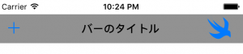

+++
title = "UIBarButtonItem"
url = "2017-05-04"
date = "2017-05-04"
description = "UIBarButtonItem"
tags = ["iOS", "Swift", "UIKit"]
categories = ["iOS"]
archives = "2017/05"
+++

<br>

UINavigationBarの要素追加、カスタマイズに用いられるUIBarButtonItemについてです。

UIBarButtonItemのクラス階層

NSObject  
↑  
UIBarItem  
↑  
UIBarButtonItem  
[AppleDeveloperリファレンスUIBarButtonItem](https://developer.apple.com/documentation/uikit/uibarbuttonitem)

UIBarButtonItem例文

UINavigationBarを生成し、タイトルとボタンを付けます。



<!--more-->

**UINavigationBarBasic.swift**

```swift
import UIKit

class ViewController: UIViewController {

    override func viewDidLoad() {
        super.viewDidLoad()
        
        //画面横サイズを取得
        let viewWidth = self.view.frame.width
        
        //UINavigationBarを作成
        let myNavBar = UINavigationBar()
        
        //UINavigationBarの位置とサイズを指定
        myNavBar.frame = CGRect(x: 0, y: 22, width: viewWidth, height: 40)
        
        //ナビゲーションバーの色を変える
        myNavBar.barTintColor = UIColor.gray
        
        //ナビゲーションボタンの色を変更する
        //UINavigationBar.appearance().tintColor = UIColor.black
        
        //曇りガラスの効果を消す
        myNavBar.isTranslucent = false
        
        //ナビゲーションアイテムを作成
        let myNavItems = UINavigationItem()
        myNavItems.title = "バーのタイトル"
        
        //バーの左側に設置するボタンの作成
        let leftNavBtn =  UIBarButtonItem(barButtonSystemItem:  .add, target: self, action: #selector(leftBarBtnClicked(sender:)))
        myNavItems.leftBarButtonItem = leftNavBtn
        
        //バーの右側に設置するボタンの作成
        let rightNavBtn = UIBarButtonItem()
        
        //ボタンにする画像を選択する
        let rightNavBtnImg:UIImage = UIImage(named:"swiftIcon_40")!
        rightNavBtn.image = rightNavBtnImg
        
        //ボタンが押され時のアクションを設定する
        rightNavBtn.action = #selector(rightBarBtnClicked(sender:))
        myNavItems.rightBarButtonItem = rightNavBtn;
        
        //作成したNavItemをNavBarに追加する
        myNavBar.pushItem(myNavItems, animated: true)
        self.view.addSubview(myNavBar)
    }
    
    
    //左側のボタンが押されたら呼ばれる
    internal func leftBarBtnClicked(sender: UIButton){
        print("leftBarBtnClicked")
    }
    
    //右側のボタンが押されたら呼ばれる
    internal func rightBarBtnClicked(sender: UIButton){
        print("rightBarBtnClicked")
    }

}
```


UIBarButtonItemの色の変更

UIBarButtonItemはデフォルトでは青色ですが、以下の方法で色を指定することができます。  
Change color of Back button in navigation bar

```
//ナビゲーションボタンの色を変更する
UINavigationBar.appearance().tintColor = UIColor.black
UIBarButtonSystemItem
```

UIBarButtonSystemItemを用いることで、デフォルトに入っているボタンを使用することができます。  
https://developer.apple.com/reference/uikit/uibarbuttonsystemitem

```
//barButtonSystemItem:に  [.add]を設定することで[+]ボタンを設定する,上のコード参照
let leftNavBtn =  UIBarButtonItem(barButtonSystemItem:  .add, target: self, action: #selector(leftBarBtnClicked(sender:)))
```

- Add
- Done
- Cancel
- Edit
- Save
- Compose
- Reply
- Action
- Organize
- Bookmarks
- Search
- Refresh
- Stop
- Camera
- Trash
- Play
- Pause
- Rewind
- Undo
- Redo
- PageCurl

<!-- Google Ads -->


<!-- Amazon Ads -->

