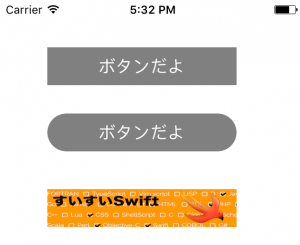

+++
title = "UIButton"
url = "2017-05-05"
date = "2017-05-05"
description = "UIButton"
tags = ["iOS", "Swift", "UIKit"]
categories = ["iOS"]
archives = "2017/05"
+++

<br>

UIButtonクラスはボタンを設置するためのクラスです。  
ボタンタップでアクションを起こすことができます。  

UIButtonのクラス階層  

NSObject  
↑  
UIResponder  
↑  
UIView  
↑  
UIControl  
↑  
UIButton  
[AppleDeveloperリファレンスUIButton](https://developer.apple.com/documentation/uikit/uibutton)

UIButton例文

様々なUIButtonのサンプルです



<!-- Google Ads -->


<!-- Amazon Ads -->


<!--more-->

**UIButtonBasic.swift**

```swift
import UIKit

class ViewController: UIViewController {

    override func viewDidLoad() {
        super.viewDidLoad()
        
        //ボタンの生成
        let basicButton = UIButton()
        
        //ボタンの位置と大きさの指定
        //x:50,y:50の位置に横幅200:縦40のボタンを設置
        basicButton.frame = CGRect(x: 50, y: 50, width: 200, height: 40)
        
        //背景色の指定、灰色
        basicButton.backgroundColor = UIColor.gray
        
        //押された時のアクションを設定
        basicButton.addTarget(self, action: #selector(basicButtonClicked(sender:)), for:.touchUpInside)
        
        //ボタンのテキストを設定
        basicButton.setTitle("ボタンだよ", for: UIControlState.normal)
        basicButton.setTitle("押された時", for: UIControlState.highlighted)
        
        //テキストの色を指定
        basicButton.setTitleColor(UIColor.white, for: UIControlState.normal)
        
        //Viewに配置
        self.view.addSubview(basicButton)
        
        
        //角丸ボタン
        //ボタンの生成
        let cornerCircleButton = UIButton()
        
        //ボタンの位置と大きさの指定
        cornerCircleButton.frame = CGRect(x: 50, y: 120, width: 200, height: 40)
        
        //背景色の指定、灰色
        cornerCircleButton.backgroundColor = UIColor.gray
        
        //押された時のアクションを設定
        cornerCircleButton.addTarget(self, action: #selector(cornerCircleButtonClicked(sender:)), for:.touchUpInside)
        
        //ボタンのテキストを設定
        cornerCircleButton.setTitle("ボタンだよ", for: UIControlState.normal)
        cornerCircleButton.setTitle("押された時", for: UIControlState.highlighted)

        //テキストの色を指定
        cornerCircleButton.setTitleColor(UIColor.white, for: UIControlState.normal)
        
        //ボタンを角丸にします
        cornerCircleButton.layer.masksToBounds = true
        cornerCircleButton.layer.cornerRadius = 20.0
        
        //Viewに配置
        self.view.addSubview(cornerCircleButton)
        
        
        
        //画像ボタンの生成
        let imageButton = UIButton()
        
        //ボタンの位置と大きさの指定
        imageButton.frame = CGRect(x: 50, y: 200, width: 200, height: 40)
        
        //背景色の指定、灰色
        imageButton.backgroundColor = UIColor.gray
        
        //押された時のアクションを設定
        imageButton.addTarget(self, action: #selector(imageButtonClicked(sender:)), for:.touchUpInside)
        
        //ボタン背景を画像にしてみます
        let buttonImage:UIImage = UIImage(named: "buttonImage")!
        imageButton.setBackgroundImage(buttonImage, for: UIControlState.normal)
        
        //Viewに配置
        self.view.addSubview(imageButton);
        
    }
    
    //basicボタンが押されたら呼ばれます
    internal func basicButtonClicked(sender: UIButton){
        print("basicButtonBtnClicked")
    }
    
    //角丸ボタンが押されたら呼ばれます
    internal func cornerCircleButtonClicked(sender: UIButton){
        print("cornerCircleButtonBtnClicked")
    }
    
    //画像ボタンが押されたら呼ばれます
    internal func imageButtonClicked(sender: UIButton){
        print("imageButtonBtnClicked")
    }
}
```

