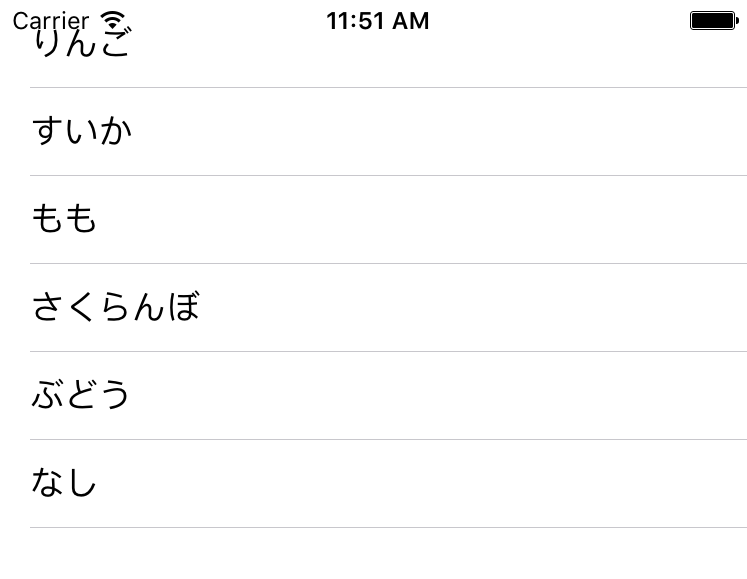

+++
title = "UITableView"
url = "2017-05-07"
date = "2017-05-07"
description = "UITableView"
tags = ["iOS", "Swift", "UIKit"]
categories = ["iOS"]
archives = "2017/09"
+++

<br>

UITableViewはリストのような形でテキストを表示するクラスです。データ一覧などを表示する時などに役立ちます。

UITableViewのクラス階層

NSObject  
↑  
UIResponder  
↑  
UIView  
↑  
UIScrollView  
↑  
UITableView  

[AppleDeveloperリファレンスUITableView](https://developer.apple.com/reference/uikit/uitableview)


UITableView  


<!--more-->

**UITableViewBasic.swift**

```swift
import UIKit

class ViewController: UIViewController,UITableViewDelegate, UITableViewDataSource  {
    
    //テーブルビューインスタンス
    private var myTableView: UITableView!
    
    //テーブルビューに表示する配列
    private var myItems: NSArray = []
    
    override func viewDidLoad() {
        super.viewDidLoad()
        
        //テーブルビューに表示する配列
        myItems = ["りんご", "すいか", "もも", "さくらんぼ", "ぶどう", "なし"]
        
        //Viewの大きさを取得
        let viewWidth = self.view.frame.size.width
        let viewHeight = self.view.frame.size.height
        
        //テーブルビューの初期化
        myTableView = UITableView()
        
        //デリゲートの設定
        myTableView.delegate = self
        myTableView.dataSource = self
        
        //テーブルビューの大きさの指定
        myTableView.frame = CGRect(x: 0, y: 0, width: viewWidth, height: viewHeight)
        
        //テーブルビューの設置
        myTableView.register(UITableViewCell.self, forCellReuseIdentifier: "cell")
        self.view.addSubview(myTableView)
        
    }
    
    //MARK: テーブルビューのセルの数を設定する
    func tableView(_ tableView: UITableView, numberOfRowsInSection section: Int) -> Int {
        //テーブルビューのセルの数はmyItems配列の数とした
        return self.myItems.count
    }
    
    //MARK: テーブルビューのセルの中身を設定する
    func tableView(_ tableView: UITableView, cellForRowAt indexPath: IndexPath) -> UITableViewCell {
        //myItems配列の中身をテキストにして登録した
        let cell:UITableViewCell = tableView.dequeueReusableCell(withIdentifier: "cell")! as UITableViewCell
        cell.textLabel?.text = self.myItems[indexPath.row] as? String
        return cell
    }
    
    //Mark: テーブルビューのセルが押されたら呼ばれる
    func tableView(_ tableView: UITableView, didSelectRowAt indexPath: IndexPath) {
        print("\(indexPath.row)番のセルを選択しました！ ")
    }
}
```


二つのグループの場合です。



<!-- Google Ads -->


<!-- Amazon Ads -->


**UITableViewWith2Group.swift**

```swift
import UIKit

class ViewController: UIViewController, UITableViewDelegate, UITableViewDataSource {
    
    // Tableに表示する文字列
    private var fruitItems: NSArray! = []
    private var vegetableItems: NSArray! = []
    
    // Sectionのタイトル
    private var sectionTitle: NSArray! = []
    
    override func viewDidLoad() {
        super.viewDidLoad()
        
        //TableViewに使用する配列の設定
        fruitItems = ["りんご", "すいか", "もも", "さくらんぼ"]
        vegetableItems = ["キャベツ", "だいこん", "にんじん"]
        sectionTitle = ["くだもの", "野菜"]
        
        // Status Barの高さを取得を.する.
        let statusBarHeight: CGFloat = UIApplication.shared.statusBarFrame.size.height
        
        // Viewの高さと幅を取得する.
        let viewWidth: CGFloat = self.view.frame.width
        let viewHeight: CGFloat = self.view.frame.height
        
        // TableViewの生成( status barの高さ分ずらして表示 ).
        let myTableView: UITableView = UITableView(frame: CGRect(x: 0, y: statusBarHeight, width: viewWidth, height: viewHeight - statusBarHeight))
        
        // Cell名の登録をおこなう.
        myTableView.register(UITableViewCell.self, forCellReuseIdentifier: "MyCell")
        
        // DataSourceの設定をする.
        myTableView.dataSource = self
        
        // Delegateを設定する.
        myTableView.delegate = self
        
        // Viewに追加する.
        self.view.addSubview(myTableView)
    }

    //セクションの数を設定する
    func numberOfSections(in tableView: UITableView) -> Int {
        return sectionTitle.count
    }
    
    //セクションのタイトルを設定する
    func tableView(_ tableView: UITableView, titleForHeaderInSection section: Int) -> String? {
        return sectionTitle[section] as? String
    }
    
    //セル画押された時に呼ばれる
    func tableView(_ tableView: UITableView, didSelectRowAt indexPath: IndexPath) {
        
        print(String(indexPath.section) + "セクション目の" + String(indexPath.row) + "行目が押された")
        if indexPath.section == 0 {
            print("Value: \(fruitItems[indexPath.row])")
        } else if indexPath.section == 1 {
            print("Value: \(vegetableItems[indexPath.row])")
        }
    }
    
    //テーブルのせるの数の設定
    func tableView(_ tableView: UITableView, numberOfRowsInSection section: Int) -> Int {
        if section == 0 {
            return fruitItems.count
        } else if section == 1 {
            return vegetableItems.count
        } else {
            return 0
        }
    }
    
    //セルの中身のテキストを設定する。
    func tableView(_ tableView: UITableView, cellForRowAt indexPath: IndexPath) -> UITableViewCell {
        
        let cell = tableView.dequeueReusableCell(withIdentifier: "MyCell", for: indexPath)
        
        if indexPath.section == 0 {
            cell.textLabel?.text = "\(fruitItems[indexPath.row])"
        } else if indexPath.section == 1 {
            cell.textLabel?.text = "\(vegetableItems[indexPath.row])"
        }
        
        return cell
    }
}
```

