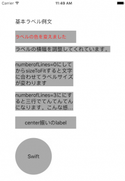

+++
title = "UILabel"
url = "2017-05-09"
date = "2017-05-09"
description = "UILabel"
tags = ["iOS", "Swift", "UIKit"]
categories = ["iOS"]
archives = "2017/05"
+++

<br>

UILabelクラスは文字表示を管理するクラスです。画面に文字を表示させたい時に使用します。

UILabelのクラス階層

NSObject  
↑  
UIResponder  
↑  
UIView  
↑  
UILabel  

[AppleDeveloperリファレンス UILabel](https://developer.apple.com/documentation/uikit/uilabel)


UILabelサンプル

サンプルコード



<!--more-->

**UILabelCustums.swift**

```swift
import UIKit

class ViewController: UIViewController {

    override func viewDidLoad() {
        super.viewDidLoad()

        //基本ラベル例文
        let basicLabel = UILabel()
        basicLabel.frame = CGRect(x: 50, y: 50, width: 200, height: 40)
        basicLabel.text = "基本ラベル例文"
        self.view.addSubview(basicLabel)
        
        //色やサイズを変更します
        let colorLabel = UILabel()
        colorLabel.frame = CGRect(x: 50, y: 100, width: 200, height: 40)
        colorLabel.font = UIFont.systemFont(ofSize: 15)   //文字サイズ15に設定
        colorLabel.textColor = UIColor.red  //文字色を赤色に設定
        colorLabel.backgroundColor = UIColor.lightGray  //背景色を灰色に設定
        colorLabel.text = "ラベルの色を変えました"
        self.view.addSubview(colorLabel)
        
        //文字に合わせてラベル大きさを自動補正します
        let fitLabel = UILabel()
        fitLabel.frame = CGRect(x: 50, y: 150, width: 200, height: 40)
        fitLabel.text = "ラベルの横幅を調整してくれています。"
        fitLabel.backgroundColor = UIColor.lightGray  //背景色を灰色に設定
        fitLabel.sizeToFit()
        self.view.addSubview(fitLabel);
        
        //numberofLines=0にしてからsizeToFitすると文字に合わせてラベルサイズが変わります。
        let manyLineslabel = UILabel()
        manyLineslabel.frame = CGRect(x: 50, y: 200, width: 200, height: 40)
        manyLineslabel.text = "numberofLines=0にしてからsizeToFitすると文字に合わせてラベルサイズが変わります"
        manyLineslabel.backgroundColor = UIColor.lightGray  //背景色を灰色に設定
        manyLineslabel.numberOfLines = 0
        manyLineslabel.sizeToFit()
        self.view.addSubview(manyLineslabel)

        //numberofLines=3ににすると三行で...となります。
        let threeLineslabel = UILabel()
        threeLineslabel.frame = CGRect(x: 50, y: 300, width: 200, height: 40)
        threeLineslabel.text = "numberofLines=3ににすると三行でてんてんてんになります。こんな感じです"
        threeLineslabel.backgroundColor = UIColor.lightGray  //背景色を灰色に設定
        threeLineslabel.numberOfLines = 3
        threeLineslabel.sizeToFit()
        self.view.addSubview(threeLineslabel)
        
        //textAlignment = NSTextAlignment.centerで文字をセンターに揃えます
        let textCenterlabel = UILabel()
        textCenterlabel.frame = CGRect(x: 50, y: 380, width: 200, height: 40)
        textCenterlabel.backgroundColor = UIColor.lightGray  //背景色を灰色に設定
        textCenterlabel.textAlignment = NSTextAlignment.center    //センター揃え
        textCenterlabel.text = "center揃いのlabel"
        self.view.addSubview(textCenterlabel)
    
        //cornerRadiusを設定することで丸いラベルに
        let circleLabel = UILabel()
        circleLabel.frame = CGRect(x: 50, y: 450, width: 120, height: 120)
        circleLabel.backgroundColor = UIColor.lightGray  //背景色を灰色に設定
        circleLabel.textAlignment = NSTextAlignment.center    //センター揃え
        circleLabel.text = "Swift"
        circleLabel.layer.masksToBounds = true
        circleLabel.layer.cornerRadius = 60.0
        self.view.addSubview(circleLabel)
        
    }
}
```


UILabelのカスタマイズ

UILabelにタッチイベントを実装
参考: [[Swift2.0] UILabelとUIImageViewのタップイベント処理を実装する](https://qiita.com/k-yamada-github/items/79bb31cff50dc9fca321)

<!-- Google Ads -->


<!-- Amazon Ads -->


**UILabelWithTapEvent.swift**

```swift
import UIKit

class ViewController: UIViewController {
    
    let tapLabel = UILabel()
    let tapLabelTag = 1
    
    override func viewDidLoad() {
        super.viewDidLoad()
        
        tapLabel.frame = CGRect(x: 50, y: 200, width: 300, height: 80)
        tapLabel.textColor = UIColor.red  //文字色を赤色に設定
        tapLabel.backgroundColor = UIColor.lightGray  //背景色を灰色に設定
        tapLabel.textAlignment = NSTextAlignment.center    //センター揃え
        tapLabel.text = "押されたら反応するLabel"
        tapLabel.isUserInteractionEnabled = true     //タッチイベントを有効化
        tapLabel.tag = tapLabelTag
        self.view.addSubview(tapLabel)
    }
    
    override func touchesEnded(_ touches: Set<UITouch>, with event: UIEvent?) {
        for touch: UITouch in touches {
            let tag = touch.view!.tag
            switch tag {
            case tapLabelTag:
                print("tapLabelがタップされました")
            default:
                print("その他がタップされました")
                break
            }
        }
    }
}

```

