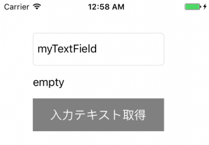

+++
title = "UITextField"
url = "2017-05-12"
date = "2017-05-12"
description = "UITextField"
tags = ["iOS", "Swift", "UIKit"]
categories = ["iOS"]
archives = "2017/05"
+++

<br>

UITextFieldは文字の入力に使われます。

UITextFieldのクラス階層

NSObject  
↑  
UIResponder  
↑  
UIView  
↑  
UIControl  
↑  
UITextField  
AppleDeveloperリファレンスUITextField  

UITextField例文

UITextField、生成し、ボタンが押されるとUITextFieldから文字列を取り出してラベルにコピーします。



<!-- Google Ads -->


<!-- Amazon Ads -->


<!--more-->

**UITextFieldBasic.swift**

```swift
import UIKit

class ViewController: UIViewController, UITextFieldDelegate {
    
    private var myTextField: UITextField!
    private var myLabel: UILabel!
    private var myButton: UIButton!

    override func viewDidLoad() {
        super.viewDidLoad()
        
        // UITextFieldの作成
        myTextField = UITextField()
        
        //大きさと位置の指定
        myTextField.frame = CGRect(x: 50, y: 50, width: 200, height: 50)
        
        // 表示する文字を代入する
        myTextField.text = "myTextField"
        
        // Delegate設定
        myTextField.delegate = self
        
        // 枠を表示する.
        myTextField.borderStyle = UITextBorderStyle.roundedRect
        
        // クリアボタンを追加.
        myTextField.clearButtonMode = .whileEditing
        
        // Viewに追加する
        self.view.addSubview(myTextField)
        
        //入力された文字を表示するラベル
        //UILabelの作成
        myLabel = UILabel()
        myLabel.frame = CGRect(x: 50, y: 100, width: 200, height: 50)
        myLabel.text = "empty"
        self.view.addSubview(myLabel)
        
        //TextFieldの文字列を取得する
        myButton = UIButton()
        myButton.frame = CGRect(x: 50, y: 150, width: 200, height: 50)
        myButton.addTarget(self, action: #selector(buttonClicked(sender:)), for:.touchUpInside)
        myButton.setTitle("入力テキスト取得", for: UIControlState.normal)
        myButton.backgroundColor = UIColor.gray
        self.view.addSubview(myButton)

        
    }
    
     //UITextFieldが編集された前に呼ばれる
    func textFieldDidBeginEditing(_ textField: UITextField) {
        print("textFieldDidBeginEditing: \(textField.text!)")
    }
    
     //UITextFieldが編集された後に呼ばれる
    func textFieldDidEndEditing(_ textField: UITextField) {
        print("textFieldDidEndEditing: \(textField.text!)")
    }
    
     //改行ボタンが押された際に呼ばれる
    func textFieldShouldReturn(_ textField: UITextField) -> Bool {
        print("textFieldShouldReturn \(textField.text!)")
        
        // 改行ボタンが押されたらKeyboardを閉じる処理.
        textField.resignFirstResponder()
        
        return true
    }
    
    //ボタンが押されたら、テキストフィールドから値を取得する
    internal func  buttonClicked(sender: UIButton){
        myLabel.text = myTextField.text
    }
}
```

