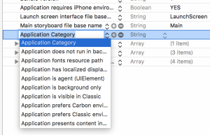

+++
title = "音声認識(SFSpeechRecognizer)"
url = "2017-05-13"
date = "2017-05-13"
description = "音声認識(SFSpeechRecognizer)"
tags = ["iOS", "Swift"]
categories = ["iOS"]
archives = "2017/05"
+++

<br>

iOS10からSpeech Frameworkが登場しました。  
ここではSFSpeechRecognizerを使って音声認識をしてみようと思います。  
そしてシミュレーターでは動かないから気をつけてください。  


参考: [AppleDeveloper:SpeakToMe: Using Speech Recognition with AVAudioEngine](https://developer.apple.com/library/archive/samplecode/SpeakToMe/Introduction/Intro.html)  
参考: [あたも開発ブログ](http://atamo-dev.hatenablog.com/entry/2016/07/20/200650)  
参考: [【iOS 10】Speechフレームワークで音声認識 – 対応言語リスト付き](http://shu223.hatenablog.com/entry/20160615/1466036672)

プライバシー設定をinfo.plistに記入

iOS10になってから、プライバシーに関する機能(通知、カメラ、フォトライブラリへのアクセス)を使う際に、Info.plistにあらかじめ使うことを書いておかないとアプリが落ちてしまうようになりました。  
音声認識機能を使う場合は以下のプライバシー設定を行う必要があります。  

参考: [アプリ開発ブログ（仮）](http://galakutaapp.blogspot.com/2016/09/plist.html)

info.plistを開き、Privacy – Speech Recognition Usage DescriptionをStringで追加し、右側に使用目的を記入します。  
Privacy – Microphone Usage Description to practice programingもまたStringで追加し、右側に使用目的を記入します。  
使用目的が書かれていないと審査で落とされるらしいです。  


サンプルコード

音声認識の結果をAlertで表示するプログラムです。



<!-- Google Ads -->


<!-- Amazon Ads -->


<!--more-->

**VoiceRecognition.swift**

```swift
import UIKit
import Speech

class ViewController: UIViewController, SFSpeechRecognizerDelegate {
    
    // MARK: Properties
    //localeのidentifierに言語を指定、。日本語はja-JP,英語はen-US
    private let speechRecognizer = SFSpeechRecognizer(locale: Locale(identifier: "ja-JP"))!
    private var recognitionRequest: SFSpeechAudioBufferRecognitionRequest?
    private var recognitionTask: SFSpeechRecognitionTask?
    private let audioEngine = AVAudioEngine()
    
    //録音の開始、停止ボタン
    var recordButton : UIButton!
    
    //文字音声認識された
    var voiceStr : String! = ""
    
    override func viewDidLoad() {
        super.viewDidLoad()
        
        //録音を開始するボタンの設定
        recordButton = UIButton()
        recordButton.frame = CGRect(x: 50, y: 50, width: 200, height: 40)
        recordButton.backgroundColor = UIColor.lightGray
        recordButton.addTarget(self, action: #selector(recordButtonTapped(sender:)), for:.touchUpInside)
        recordButton.setTitle("Start Recording", for: [])
        recordButton.isEnabled = false
        self.view.addSubview(recordButton)
        
        //デリゲートの設定
        speechRecognizer.delegate = self
        
        //ユーザーに音声認識の許可を求める
        SFSpeechRecognizer.requestAuthorization { authStatus in

            OperationQueue.main.addOperation {
                switch authStatus {
                case .authorized:
                    //ユーザが音声認識の許可を出した時
                    self.recordButton.isEnabled = true
                    
                case .denied:
                    //ユーザが音声認識を拒否した時
                    self.recordButton.isEnabled = false
                    self.recordButton.setTitle("User denied access to speech recognition", for: .disabled)
                    
                case .restricted:
                    //端末が音声認識に対応していない場合
                    self.recordButton.isEnabled = false
                    self.recordButton.setTitle("Speech recognition restricted on this device", for: .disabled)
                    
                case .notDetermined:
                    //ユーザが音声認識をまだ認証していない時
                    self.recordButton.isEnabled = false
                    self.recordButton.setTitle("Speech recognition not yet authorized", for: .disabled)
                }
            }
        }
    }
    
    
    // MARK: 録音ボタンが押されたら呼ばれる
    func recordButtonTapped(sender: UIButton) {
        
        if audioEngine.isRunning {
            audioEngine.stop()
            recognitionRequest?.endAudio()
            recordButton.isEnabled = false
            recordButton.setTitle("Stopping", for: .disabled)
            
            //録音が停止した！
            print("録音停止")
            
            //入力された文字列の入った文字列を表示
            showStrAlert(str: self.voiceStr)

        } else {
            try! startRecording()
            recordButton.setTitle("Stop recording", for: [])
        }
    }
    
    //渡された文字列が入ったアラートを表示する
    func showStrAlert(str: String){
        
        // UIAlertControllerを作成する.
        let myAlert: UIAlertController = UIAlertController(title: "音声認識結果", message: str, preferredStyle: .alert)
        
        // OKのアクションを作成する.
        let myOkAction = UIAlertAction(title: "OK", style: .default) { action in
            print("Action OK!!")
        }
        
        // OKのActionを追加する.
        myAlert.addAction(myOkAction)
        
        // UIAlertを発動する.
        present(myAlert, animated: true, completion: nil)
    }
    
    
    //録音を開始する
    private func startRecording() throws {
        
        // Cancel the previous task if it's running.
        if let recognitionTask = recognitionTask {
            recognitionTask.cancel()
            self.recognitionTask = nil
        }
        
        let audioSession = AVAudioSession.sharedInstance()
        try audioSession.setCategory(AVAudioSessionCategoryRecord)
        try audioSession.setMode(AVAudioSessionModeMeasurement)
        try audioSession.setActive(true, with: .notifyOthersOnDeactivation)
        
        recognitionRequest = SFSpeechAudioBufferRecognitionRequest()
        
        guard let inputNode = audioEngine.inputNode else { fatalError("Audio engine has no input node") }
        guard let recognitionRequest = recognitionRequest else { fatalError("Unable to created a SFSpeechAudioBufferRecognitionRequest object") }
        
        // Configure request so that results are returned before audio recording is finished
        recognitionRequest.shouldReportPartialResults = true
        
        // A recognition task represents a speech recognition session.
        // We keep a reference to the task so that it can be cancelled.
        recognitionTask = speechRecognizer.recognitionTask(with: recognitionRequest) { result, error in
            var isFinal = false
            
            if let result = result {
                
                //音声認識の区切りの良いところで実行される。
                self.voiceStr = result.bestTranscription.formattedString
                print(result.bestTranscription.formattedString)
                isFinal = result.isFinal
            }
            
            if error != nil || isFinal {
                self.audioEngine.stop()
                inputNode.removeTap(onBus: 0)
                
                self.recognitionRequest = nil
                self.recognitionTask = nil
                
                self.recordButton.isEnabled = true
                self.recordButton.setTitle("Start Recording", for: [])
            }
        }
        
        let recordingFormat = inputNode.outputFormat(forBus: 0)
        inputNode.installTap(onBus: 0, bufferSize: 1024, format: recordingFormat) { (buffer: AVAudioPCMBuffer, when: AVAudioTime) in
            self.recognitionRequest?.append(buffer)
        }
        
        audioEngine.prepare()
        
        try audioEngine.start()
    }
    
    // MARK: SFSpeechRecognizerDelegate
    //speechRecognizerが使用可能かどうかでボタンのisEnabledを変更する
    public func speechRecognizer(_ speechRecognizer: SFSpeechRecognizer, availabilityDidChange available: Bool) {
        if available {
            recordButton.isEnabled = true
            recordButton.setTitle("Start Recording", for: [])
            
        } else {
            recordButton.isEnabled = false
            recordButton.setTitle("Recognition not available", for: .disabled)
        }
    }
}
```

