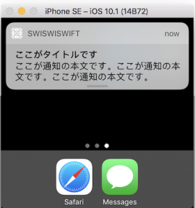

+++
title = "UserNotification(LocalNotification)"
url = "2017-05-14"
date = "2017-05-14"
description = "UserNotification(LocalNotification)"
tags = ["iOS", "Swift"]
categories = ["iOS"]
archives = "2017/05"
+++

<br>

UserNotificationはユーザーに対して通知を発行する時に使用します。  
UserNotificationは大きく分けて二種類あり、外部から通知を発行できるRemoteNotification(LineやTwitterのような通知)とLocalNotification(時計アプリなどの内部的に発行する通知)があります。  
ここではLocalNotificationを取り扱います。  

UserNotificationサンプル  

初めにオリジナル通知音の発行に使用する音データ(.cafファイル)をプロジェクトに登録します。  
`.caf` ファイルをプロジェクトに追加し、BundleResoucesに登録されていることを確認します。  
また使用したcafファイルはこちらです。  
UserNotificationの仕様として、使用するオリジナル通知音に不具合がある場合、デフォルトの通知音が再生されます。  



<!-- Google Ads -->


<!-- Amazon Ads -->


<!--more-->

**UserNotificationsBasic.swift**

```swift
import UIKit
import UserNotifications

class ViewController: UIViewController {
    
    override func viewDidLoad() {
        super.viewDidLoad()
        
        //通知の許可を出す
        let center = UNUserNotificationCenter.current()
        center.requestAuthorization(options: [.alert, .sound]) { (granted, error) in
        }
        
        // MARK: - 10秒後に着火するボタン
        let tenSecondBtn = UIButton()
        tenSecondBtn.frame = CGRect(x: 50, y: 50, width: 250, height: 40)
        tenSecondBtn.backgroundColor = UIColor.gray
        tenSecondBtn.addTarget(self, action: #selector(tenSecondBtnClicked(sender:)), for:.touchUpInside)
        tenSecondBtn.setTitle("10秒後に通知", for: UIControlState.normal)
        tenSecondBtn.setTitleColor(UIColor.white, for: UIControlState.normal)
        self.view.addSubview(tenSecondBtn)
        
        // MARK: - 時間日時をしてして通知する
        let setDayAndTimeBtn = UIButton()
        setDayAndTimeBtn.frame = CGRect(x: 50, y: 120, width: 250, height: 40)
        setDayAndTimeBtn.backgroundColor = UIColor.gray
        setDayAndTimeBtn.addTarget(self, action: #selector(setDayAndTimeBtnClicked(sender:)), for:.touchUpInside)
        setDayAndTimeBtn.setTitle("日時と時間を指定して通知", for: UIControlState.normal)
        setDayAndTimeBtn.setTitleColor(UIColor.white, for: UIControlState.normal)
        self.view.addSubview(setDayAndTimeBtn)

        // MARK: - 通知音を変更する
        let setOriginalSoundBtn = UIButton()
        setOriginalSoundBtn.frame = CGRect(x: 50, y: 190, width: 250, height: 40)
        setOriginalSoundBtn.backgroundColor = UIColor.gray
        setOriginalSoundBtn.addTarget(self, action: #selector(setOriginalSoundBtnClicked(sender:)), for:.touchUpInside)
        setOriginalSoundBtn.setTitle("オリジナルの通知音を設定", for: UIControlState.normal)
        setOriginalSoundBtn.setTitleColor(UIColor.white, for: UIControlState.normal)
        self.view.addSubview(setOriginalSoundBtn)
    }
    
    //10秒後に着火するボタンが終われたら呼ばれる
    internal func tenSecondBtnClicked(sender: UIButton){

        // Notificatiのインスタンス生成
        let content = UNMutableNotificationContent()
        
        // タイトルを設定する
        content.title = "ここがタイトルです"
        
        // 通知の本文です
        content.body = "ここが通知の本文です。ここが通知の本文です。ここが通知の本文です。"
        
        // デフォルトの音に設定します
        content.sound = UNNotificationSound.default()
        
        // Triggerを生成(いつ通知が来るのか)
        let trigger = UNTimeIntervalNotificationTrigger.init(timeInterval: 10, repeats: false)
        
        // Requestを生成する。idには通知IDを設定する
        let request = UNNotificationRequest.init(identifier: "ID_TenSecond", content: content, trigger: trigger)
        
        // Noticationを生成する
        let center = UNUserNotificationCenter.current()
        center.add(request) { (error) in
        }
    }
    
    
    //時間を指定して着火するボタンが終われたら呼ばれる
    internal func setDayAndTimeBtnClicked(sender: UIButton){
        
        // Notificatiのインスタンス生成
        let content = UNMutableNotificationContent()
        
        // タイトルを設定する
        content.title = "ここがタイトルです"
        
        // 通知の本文です
        content.body = "ここが通知の本文です。ここが通知の本文です。ここが通知の本文です。"
        
        // デフォルトの音に設定します
        content.sound = UNNotificationSound.default()
    
        //着火時間の設定
        //以下の例では午前1時25分0秒に設定しています
        var dateComponents = DateComponents()
        dateComponents.hour = 1
        dateComponents.minute = 30
        dateComponents.second = 0
        let calendarTrigger = UNCalendarNotificationTrigger(dateMatching: dateComponents, repeats: false)
        
        // Requestを生成する。idには通知IDを設定する
        let request = UNNotificationRequest.init(identifier: "ID_SetDayAndTime", content: content, trigger: calendarTrigger)
        
        // Noticationを発行する.
        let center = UNUserNotificationCenter.current()
        center.add(request) { (error) in
            print(error ?? "aa")
        }
    }
    
    //オリジナルの通知音に設定ボタンが押されたら動く(10秒後に着火する)
    internal func setOriginalSoundBtnClicked(sender: UIButton){
        
        // Notificatiのインスタンス生成
        let content = UNMutableNotificationContent()
        
        // タイトルを設定する
        content.title = "ここがタイトルです"
        
        // 通知の本文です
        content.body = "ここが通知の本文です。ここが通知の本文です。ここが通知の本文です。"
        
        // オリジナルの音を設定する
        content.sound = UNNotificationSound.init(named: "sampleSound.caf")
        
        // Triggerを生成(いつ通知が来るのか)
        let trigger = UNTimeIntervalNotificationTrigger.init(timeInterval: 10, repeats: false)
        
        // Requestを生成する。idには通知IDを設定する
        let request = UNNotificationRequest.init(identifier: "ID_TenSecond", content: content, trigger: trigger)
        
        // Noticationを生成する
        let center = UNUserNotificationCenter.current()
        center.add(request) { (error) in
        }
    }
}
```

