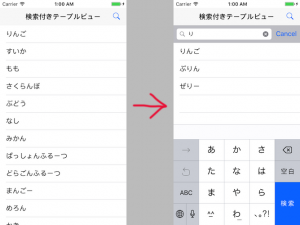

+++
title = "UITableViewとUISearchBar"
url = "2017-05-15"
date = "2017-05-15"
description = "UITableViewとUISearchBar"
tags = ["iOS", "Swift", "UIKit"]
categories = ["iOS"]
archives = "2017/05"
+++

<br>

UITableViewとUISearchBarを組み合わせたサンプルです。  
ナビゲーションバーにある虫眼鏡を押すとSearchBarが現れ、そこに文字を入力することで検索結果が表示されます。  

UITableView  

基本的なテーブルビューの例文を以下に示します。  



<!-- Google Ads -->


<!-- Amazon Ads -->


<!--more-->

**TableViewAndSearchBarSample.swift**

```swift
import UIKit

class ViewController: UIViewController, UISearchBarDelegate, UITableViewDelegate, UITableViewDataSource  {
    
    //SearchBarインスタンス
    private var mySearchBar: UISearchBar!
    
    //テーブルビューインスタンス
    private var myTableView: UITableView!
    
    //テーブルビューに表示する配列
    private var myItems: NSArray = []

    //検索結果が入る配列
    private var searchResult: NSArray = []

    
    override func viewDidLoad() {
        super.viewDidLoad()
        
        //テーブルビューに表示する配列
        myItems = ["りんご", "すいか", "もも", "さくらんぼ", "ぶどう", "なし", "みかん","ぱっしょんふるーつ","どらごんふるーつ","まんごー","めろん","かき","びわ","いちご","らいち","らーめん","すてーき","ゆず","れもん","さくらもち","ぷりん","ぜりー"]
        searchResult = myItems
        
        //Viewの大きさを取得
        let viewWidth = self.view.frame.size.width
        let viewHeight = self.view.frame.size.height
        
        // MARK: - NavigationBar関連
        //UINavigationBarを作成
        let myNavBar = UINavigationBar()
        //大きさの指定
        myNavBar.frame = CGRect(x: 0, y: UIApplication.shared.statusBarFrame.height, width: viewWidth, height: 44)
        //タイトル、虫眼鏡ボタンの作成
        let myNavItems = UINavigationItem()
        myNavItems.title = "検索付きテーブルビュー"
        let rightNavBtn =  UIBarButtonItem(barButtonSystemItem:  .search, target: self, action: #selector(rightBarBtnClicked(sender:)))
        myNavItems.leftBarButtonItem = rightNavBtn
        rightNavBtn.action = #selector(rightBarBtnClicked(sender:))
        myNavItems.rightBarButtonItem = rightNavBtn;
        myNavBar.pushItem(myNavItems, animated: true)
        //ナビゲーションバーをviewに追加
        self.view.addSubview(myNavBar)
        
        
        // MARK: - SearchBar関連
        //SearchBarの作成
        mySearchBar = UISearchBar()
        //デリゲートを設定
        mySearchBar.delegate = self
        //大きさの指定
        mySearchBar.frame = CGRect(x: 0, y: UIApplication.shared.statusBarFrame.height, width: viewWidth, height: 44)
        //キャンセルボタンの追加
        mySearchBar.showsCancelButton = true

        
        // MARK: - TableView関連
        //テーブルビューの初期化
        myTableView = UITableView()
        //デリゲートの設定
        myTableView.delegate = self
        myTableView.dataSource = self
        //テーブルビューの大きさの指定
        myTableView.frame = CGRect(x: 0, y: UIApplication.shared.statusBarFrame.height + myNavBar.frame.height, width: viewWidth, height: viewHeight - UIApplication.shared.statusBarFrame.height-myNavBar.frame.height)
        //先ほど作成したSearchBarを作成
        myTableView.tableHeaderView = mySearchBar
        //サーチバーの高さだけ初期位置を下げる
        myTableView.contentOffset = CGPoint(x: 0,y :44)

        //テーブルビューの設置
        myTableView.register(UITableViewCell.self, forCellReuseIdentifier: "cell")
        self.view.addSubview(myTableView)
    }
    
    
    //MARK: - ナビゲーションバーの右の虫眼鏡が押されたら呼ばれる
    internal func rightBarBtnClicked(sender: UIButton){
        print("rightBarBtnClicked")
        
        myTableView.contentOffset = CGPoint(x: 0,y :0)
    }
    
    //MARK: - 渡された文字列を含む要素を検索し、テーブルビューを再表示する
    func searchItems(searchText: String){
        
        //要素を検索する
        if searchText != "" {
            searchResult = myItems.filter { myItem in
                return (myItem as! String).contains(searchText)
                } as NSArray

        }else{
            //渡された文字列が空の場合は全てを表示
            searchResult = myItems
        }
        
        //tableViewを再読み込みする
        myTableView.reloadData()
    }
    
    // MARK: - SearchBarのデリゲードメソッドたち
    //MARK: テキストが変更される毎に呼ばれる
    func searchBar(_ searchBar: UISearchBar, textDidChange searchText: String) {
        //検索する
        searchItems(searchText: searchText)
    }
    
    //MARK: キャンセルボタンが押されると呼ばれる
    func searchBarCancelButtonClicked(_ searchBar: UISearchBar) {

        mySearchBar.text = ""
        self.view.endEditing(true)
        searchResult = myItems
        
        //tableViewを再読み込みする
        myTableView.reloadData()
    }
    
    //MARK: Searchボタンが押されると呼ばれる
    func searchBarSearchButtonClicked(_ searchBar: UISearchBar) {
        
        self.view.endEditing(true)
        //検索する
        searchItems(searchText: mySearchBar.text! as String)
    }
    
    // MARK: - テーブルビューのデリゲードメソッドたち
    //MARK: テーブルビューのセルの数を設定する
    func tableView(_ tableView: UITableView, numberOfRowsInSection section: Int) -> Int {
        //テーブルビューのセルの数はmyItems配列の数とした
        return self.searchResult.count
    }
    
    //MARK: テーブルビューのセルの中身を設定する
    func tableView(_ tableView: UITableView, cellForRowAt indexPath: IndexPath) -> UITableViewCell {
        //myItems配列の中身をテキストにして登録した
        let cell:UITableViewCell = tableView.dequeueReusableCell(withIdentifier: "cell")! as UITableViewCell
        cell.textLabel?.text = self.searchResult[indexPath.row] as? String
        return cell
    }
    
    //Mark: テーブルビューのセルが押されたら呼ばれる
    func tableView(_ tableView: UITableView, didSelectRowAt indexPath: IndexPath) {
        print(searchResult[indexPath.row])
    }
}
```

