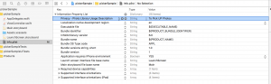
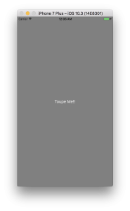
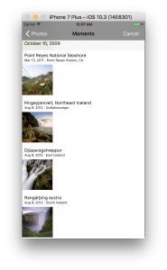
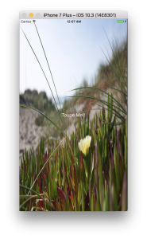

+++
title = "UIImagePickerControllerで画像の選択"
url = "2017-06-14"
date = "2017-06-14"
description = "UIImagePickerControllerで画像の選択"
tags = ["iOS", "Swift", "UIKit"]
categories = ["iOS"]
archives = "2017/06"
+++

<br>

iPhoneのフォトライブラリから画像を取得するサンプルプログラムです。  

フォトライブラリから画像を選択するために、プロジェクトの `info.plist` にフォトライブラリを使用する旨を記述します。  
これを書いておかないとUIImagePickerControllerは使えません。  
キーの値は以下の値を使います。  
`NSPhotoLibraryUsageDescription`  
Typeは `String` でValueの中に使用理由を書きます。  
使用理由を書かないと審査の時に落とされるらしいです。  
下の画像のような感じです。  







コードは以下のようになります。

<!-- Google Ads -->


<!-- Amazon Ads -->


<!--more-->

**UIImagePickerControllerSample.swift**

```swift
import UIKit

class ViewController: UIViewController,UIImagePickerControllerDelegate,UINavigationControllerDelegate {
    
    var imagePickUpButton:UIButton = UIButton()
    var picker: UIImagePickerController! = UIImagePickerController()

    override func viewDidLoad() {
        super.viewDidLoad()

        //押されるとUIImagePickerControllerが開くボタンを作成する
        imagePickUpButton.frame = self.view.bounds
        imagePickUpButton.addTarget(self, action: #selector(imagePickUpButtonClicked(sender:)), for: .touchUpInside)
        imagePickUpButton.backgroundColor = UIColor.gray
        imagePickUpButton.setTitle("Toupe Me!!", for: UIControlState.normal)
        self.view.addSubview(imagePickUpButton)
    }
    
    //basicボタンが押されたら呼ばれます
    func imagePickUpButtonClicked(sender: UIButton){

        //PhotoLibraryから画像を選択
        picker.sourceType = UIImagePickerControllerSourceType.photoLibrary
        
        //デリゲートを設定する
        picker.delegate = self
        
        //現れるピッカーNavigationBarの文字色を設定する
        picker.navigationBar.tintColor = UIColor.white
        
        //現れるピッカーNavigationBarの背景色を設定する
        picker.navigationBar.barTintColor = UIColor.gray
        
        //ピッカーを表示する
        present(picker, animated: true, completion: nil)
    }
    
    //UIImagePickerControllerのデリゲートメソッド
    
    //画像が選択された時に呼ばれる.
    func imagePickerController(_ picker: UIImagePickerController, didFinishPickingMediaWithInfo info: [String : Any]) {
        
        if let image = info[UIImagePickerControllerOriginalImage] as? UIImage {
            
            //ボタンの背景に選択した画像を設定
            imagePickUpButton.setBackgroundImage(image, for: UIControlState.normal)
        } else{
            print("Error")
        }
        
        // モーダルビューを閉じる
        self.dismiss(animated: true, completion: nil)
    }
    
     //画像選択がキャンセルされた時に呼ばれる.
    func imagePickerControllerDidCancel(_ picker: UIImagePickerController) {
        
        // モーダルビューを閉じる
        self.dismiss(animated: true, completion: nil)
    }
}

```

