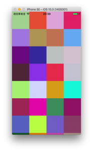

+++
title = "UICollectionView"
url = "2017-10-02"
date = "2017-10-02"
description = "UICollectionView"
tags = ["iOS", "Swift", "UIKit"]
categories = ["iOS"]
archives = "2017/10"
+++

<br>

[新しい記事](/2022-02-02) があります。

UICollectionViewのサンプルです。  

[UICollectionViewを使う](http://docs.fabo.io/swift/uikit/053_uicollectionview.html) を参考にさせていただきました。  
このサイトは見やすくて、swiftをやる人にとてもオススメです。  

`makeColor()` 関数でランダムに生成した色をセルに入れています。  
スクロールするたびに色が変わります。  



<!-- Google Ads -->


<!-- Amazon Ads -->


<!--more-->

**ViewController.swift**

```swift
import UIKit

class ViewController: UIViewController, UICollectionViewDelegate, UICollectionViewDataSource {
    
    var myCollectionView : UICollectionView!
    
    override func viewDidLoad() {
        super.viewDidLoad()
        
        let viewWidth = self.view.frame.width
        let viewHeight = self.view.frame.height
        let collectionFrame = CGRect(x: 0, y: 0, width: viewWidth, height: viewHeight)
        
        // CollectionViewのレイアウトを生成.
        let layout = UICollectionViewFlowLayout()
        
        // Cell一つ一つの大きさ.
        layout.itemSize = CGSize(width:viewWidth/4, height:viewWidth/4)
        
        // セルのマージン.
        layout.sectionInset = UIEdgeInsets.zero
        //layout.sectionInset = UIEdgeInsetsMake(16, 16, 16, 16)

        //セルの横方向のマージン
        layout.minimumInteritemSpacing = 0.0
        
        //セルの縦方向のマージン
        layout.minimumLineSpacing = 0.0
        
        // セクション毎のヘッダーサイズ.
        layout.headerReferenceSize = CGSize(width:0,height:0)
        
        // CollectionViewを生成.
        myCollectionView = UICollectionView(frame: collectionFrame, collectionViewLayout: layout)
        
        // Cellに使われるクラスを登録.
        myCollectionView.register(UICollectionViewCell.self, forCellWithReuseIdentifier: "MyCell")
        
        myCollectionView.delegate = self
        myCollectionView.dataSource = self
        
        self.view.addSubview(myCollectionView)
    }
    
    //Cellが選択された際に呼び出される
    func collectionView(_ collectionView: UICollectionView, didSelectItemAt indexPath: IndexPath) {
        
        print("Num: \(indexPath.row)")
    }
    
    //Cellの総数を返す
    func collectionView(_ collectionView: UICollectionView, numberOfItemsInSection section: Int) -> Int {
        return 100
    }
    
    //Cellに値を設定する
    func collectionView(_ collectionView: UICollectionView, cellForItemAt indexPath: IndexPath) -> UICollectionViewCell {
        
        let cell : UICollectionViewCell = collectionView.dequeueReusableCell(withReuseIdentifier: "MyCell", for: indexPath as IndexPath)
        cell.backgroundColor = makeColor()
        return cell
    }
    
    //ランダムに色を生成する
    func makeColor() -> UIColor {
        let r: CGFloat = CGFloat(arc4random_uniform(255)+1) / 255.0
        let g: CGFloat = CGFloat(arc4random_uniform(255)+1) / 255.0
        let b: CGFloat = CGFloat(arc4random_uniform(255)+1) / 255.0
        let color: UIColor = UIColor(red: r, green: g, blue: b, alpha: 1.0)
        
        return color
    }
}
```

