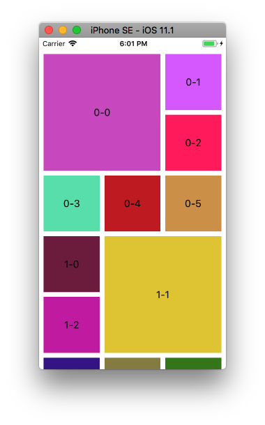

+++
title = "カスタムレイアウトを持つコレクションビューをつくる"
url = "2017-11-27"
date = "2017-11-27"
description = "カスタムレイアウトを持つコレクションビューをつくる"
tags = ["iOS", "Swift"]
categories = ["iOS"]
archives = "2017/11"
+++

<br>

今作成しているアプリに画像が入れ子となったデザインをつくることになったので、実装方法について調べました。  

主なコードは以下のサイトを参考にさせていただきました。  
本当にありがとうございました。  
Swift2->4の変換は大変でした。。。  

[iOS UICollecionViewFlowLayout でカスタムレイアウトを作ろう ～ Swift版](https://www.indetail.co.jp/blog/5257/)



<!-- Google Ads -->


<!-- Amazon Ads -->


<!--more-->

**CustomCollectionViewFlowLayout.swift**

```swift
import UIKit

class CustomCollectionViewFlowLayout: UICollectionViewFlowLayout {
    
    private static let kMaxRow = 3
    var maxColumn = kMaxRow
    
    private var sectionCells = [[CGRect]]()
    private var contentSize = CGSize.zero
    
    required init?(coder aDecoder: NSCoder) {
        super.init(coder: aDecoder)
    }
    
    override init() {
        super.init()
        
        self.sectionInset = UIEdgeInsets(top: 8, left: 8, bottom: 8, right: 8)
        self.minimumLineSpacing = 8
        self.minimumInteritemSpacing = 8
        self.sectionInset = UIEdgeInsetsMake(8, 8, 8, 8)
    }
    
    override func prepare() {
        super.prepare()
        sectionCells = [[CGRect]]()
        
        if let collectionView = self.collectionView {
            contentSize = CGSize(width: collectionView.bounds.width - collectionView.contentInset.left - collectionView.contentInset.right, height: 0)
            let smallCellSideLength: CGFloat = (contentSize.width - super.sectionInset.left - super.sectionInset.right - (super.minimumInteritemSpacing * (CGFloat(maxColumn) - 1.0))) / CGFloat(maxColumn)
            
            for section in (0..<collectionView.numberOfSections) {
                var cells = [CGRect]()
                let numberOfCellsInSection = collectionView.numberOfItems(inSection: section)
                var height = contentSize.height
                
                var x:CGFloat = 0
                var y:CGFloat = 0
                var cellwidth:CGFloat = 0
                var cellheight:CGFloat = 0
                
                for i in (0..<numberOfCellsInSection) {
                    let position = i  % (numberOfCellsInSection)
                    let cellPosition = position % 6
                    
                    switch cellPosition {
                    case 0:
                        if section % 2 == 0 {
                            x = super.sectionInset.left
                            y = contentSize.height + super.sectionInset.top
                            cellwidth = 2 * smallCellSideLength + super.minimumInteritemSpacing
                            cellheight = 2 * smallCellSideLength + super.minimumLineSpacing
                        }else{
                            x = super.sectionInset.left
                            y = contentSize.height + super.sectionInset.top
                            cellwidth = smallCellSideLength
                            cellheight = smallCellSideLength
                        }
                    case 1:
                        if section % 2 == 0 {
                            x = 2 * (smallCellSideLength + super.minimumInteritemSpacing) + super.sectionInset.left
                            y = 0 * (smallCellSideLength + super.minimumLineSpacing) + contentSize.height + super.sectionInset.top
                            cellwidth = smallCellSideLength; cellheight = smallCellSideLength
                        }else {
                            x = smallCellSideLength + super.minimumInteritemSpacing + super.sectionInset.left
                            y = (0 * (smallCellSideLength + super.minimumLineSpacing)) + contentSize.height + super.sectionInset.top
                            cellwidth = 2 * smallCellSideLength  + super.minimumInteritemSpacing
                            cellheight = 2 * smallCellSideLength + super.minimumLineSpacing
                        }
                    case 2:
                        if section % 2 == 0 {
                            x = 2 * (smallCellSideLength + super.minimumInteritemSpacing) + super.sectionInset.left
                            y = 1 * (smallCellSideLength + super.minimumLineSpacing) + contentSize.height + super.sectionInset.top
                            cellwidth = smallCellSideLength; cellheight = smallCellSideLength
                        }else{
                            x = super.sectionInset.left
                            y = (1 * (smallCellSideLength + super.minimumLineSpacing)) + contentSize.height + super.sectionInset.top
                            cellwidth = smallCellSideLength; cellheight = smallCellSideLength
                        }
                    case 3:
                        x = super.sectionInset.left
                        y = 2 * (smallCellSideLength + super.minimumLineSpacing) + contentSize.height + super.sectionInset.top
                        cellwidth = smallCellSideLength; cellheight = smallCellSideLength
                    case 4:
                        x = smallCellSideLength + super.minimumInteritemSpacing + super.sectionInset.left
                        y = 2 * (smallCellSideLength + super.minimumLineSpacing) + contentSize.height + super.sectionInset.top
                        cellwidth = smallCellSideLength; cellheight = smallCellSideLength
                    case 5:
                        x = 2 * (smallCellSideLength + super.minimumInteritemSpacing) + super.sectionInset.left
                        y = 2 * (smallCellSideLength + super.minimumLineSpacing) + contentSize.height + super.sectionInset.top
                        cellwidth = smallCellSideLength; cellheight = smallCellSideLength
                    default:
                        x = 0; y = 0
                        cellwidth = 0; cellheight = 0
                        break
                    }
                
                    let cellRect = CGRect(x: x, y: y, width: cellwidth, height: cellheight)
                    cells.append(cellRect)
                    
                    if (height < cellRect.origin.y + cellRect.height) {
                        height = cellRect.origin.y + cellRect.height
                    }
                }
                contentSize = CGSize(width: contentSize.width, height: height)
                sectionCells.append(cells)
            }
        }
    }
    
    override func layoutAttributesForElements(in rect: CGRect) -> [UICollectionViewLayoutAttributes]? {
        var layoutAttributes = [UICollectionViewLayoutAttributes]()
        
        if let collectionView = self.collectionView {
            for i in 0..<collectionView.numberOfSections {
                let numberOfCellsInSection = collectionView.numberOfItems(inSection: i);
                for j in 0..<numberOfCellsInSection {

                    let indexPath = IndexPath(row: j, section: i)
                    if let attributes = layoutAttributesForItem(at: indexPath) {
                        if (rect.intersects(attributes.frame)) {
                            layoutAttributes.append(attributes)
                        }
                    }
                }
            }
        }
        return layoutAttributes
    }
    
    override func layoutAttributesForItem(at indexPath: IndexPath) -> UICollectionViewLayoutAttributes? {
        let attributes = super.layoutAttributesForItem(at: indexPath)
        attributes?.frame = sectionCells[indexPath.section][indexPath.row]
        return attributes
    }
    
    override var collectionViewContentSize : CGSize {
        return contentSize
    }
}
```


**ViewController.swift**

```swift

import UIKit

class ViewController: UIViewController, UICollectionViewDelegate, UICollectionViewDataSource {
    
    var myCollectionView : UICollectionView!
    
    override func viewDidLoad() {
        super.viewDidLoad()
        
        let viewWidth = self.view.frame.width
        let viewHeight = self.view.frame.height
        let collectionFrame = CGRect(x: 0, y: 0, width: viewWidth, height: viewHeight)
        
        // CollectionViewのレイアウトを生成.
        let layout = CustomCollectionViewFlowLayout()

        // CollectionViewを生成.
        myCollectionView = UICollectionView(frame: collectionFrame, collectionViewLayout: layout)
        myCollectionView.backgroundColor = UIColor.white
        
        // Cellに使われるクラスを登録.
        myCollectionView.register(UICollectionViewCell.self, forCellWithReuseIdentifier: "MyCell")
        
        myCollectionView.delegate = self
        myCollectionView.dataSource = self
        
        self.view.addSubview(myCollectionView)
    }
    
    //Cellが選択された際に呼び出される
    func collectionView(_ collectionView: UICollectionView, didSelectItemAt indexPath: IndexPath) {
        print("Section: \(indexPath.section)")
        print("Num: \(indexPath.row)")
        print("Number: \(indexPath.section * 6 + indexPath.row)")
    }
    
    //セクションあたりのセルの色を返す
    func collectionView(_ collectionView: UICollectionView, numberOfItemsInSection section: Int) -> Int {
        return 6
    }
    //セクションの総数を返す
    func numberOfSections(in collectionView: UICollectionView) -> Int {
        return 8
    }
    //Cellに値を設定する
    func collectionView(_ collectionView: UICollectionView, cellForItemAt indexPath: IndexPath) -> UICollectionViewCell {
        
        let cell : UICollectionViewCell = collectionView.dequeueReusableCell(withReuseIdentifier: "MyCell", for: indexPath as IndexPath)
        cell.backgroundColor = makeColor()
        let mainLabel = UILabel(frame: cell.frame)
        mainLabel.text = "\(indexPath.section)-\(indexPath.item)"
        mainLabel.textAlignment = .center
        mainLabel.backgroundColor = makeColor()
        cell.backgroundView = mainLabel
        cell.clipsToBounds = true
        cell.addSubview(mainLabel)
        return cell
    }
    //ランダムに色を生成する
    func makeColor() -> UIColor {
        let r: CGFloat = CGFloat(arc4random_uniform(255)+1) / 255.0
        let g: CGFloat = CGFloat(arc4random_uniform(255)+1) / 255.0
        let b: CGFloat = CGFloat(arc4random_uniform(255)+1) / 255.0
        let color: UIColor = UIColor(red: r, green: g, blue: b, alpha: 1.0)
        return color
    }
}
```

