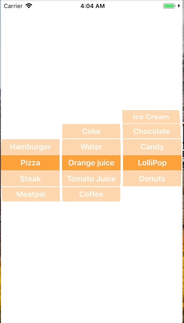

+++
title = "UIPickerViewを使って値を選択する"
url = "2018-01-14"
date = "2018-01-14"
description = "UIPickerViewを使って値を選択する"
tags = ["iOS", "Swift", "UIKit"]
categories = ["iOS"]
archives = "2018/01"
+++

<br>

はいどーも！  
UIPickerViewを使って値を取得するサンプルコードです。  
PIPickerViewは選択肢の中から要素を選ぶときによく使いますね。  
今回は食べ物とドリンクとフードを選ぶアプリを作ってみました。  

新しい記事は [こちら](/2020-07-05/)

AppleDeveloperDocuments  
[UIPickerView](https://developer.apple.com/documentation/uikit/uipickerview)



<!-- Google Ads -->


<!-- Amazon Ads -->


<!--more-->

**UIPickerViewSamle.swift**

```swift
import UIKit

class ViewController: UIViewController, UIPickerViewDelegate, UIPickerViewDataSource{
    
    // UIPickerView.
    private var myUIPicker: UIPickerView!
    
    // Value
    private let foodMenus: Array<String>  = ["Hamburger","Pizza","Steak","Meatpai"]
    private let drinkMenus: Array<String>  = ["Coke","Water","Orange juice","Tomato Juice", "Coffee"]
    private let dessertMenus: Array<String> = ["Ice Cream","Chocolate","Candy","LolliPop", "Donuts", ]

    override func viewDidLoad() {
        super.viewDidLoad()
        
        // UIPickerViewを生成.
        // make UIPickerView instance
        myUIPicker = UIPickerView()
        
        // サイズを指定する.
        // set picker size
        myUIPicker.frame = CGRect(x: 0, y: 0, width: self.view.bounds.width, height: self.view.bounds.height)
        
        // Delegateを設定する.
        // set delegate
        myUIPicker.delegate = self
        
        // DataSourceを設定する.
        // set datasources
        myUIPicker.dataSource = self
        
        //初期値を設定する
        // Set init picker position
        myUIPicker.selectRow(1, inComponent: 0, animated: true)
        myUIPicker.selectRow(2, inComponent: 1, animated: true)
        myUIPicker.selectRow(3, inComponent: 2, animated: true)

        // Viewに追加する.
        // add view
        self.view.addSubview(myUIPicker)
    }
    
    // MARK: - UIPickerViewのデリゲートメソッド
    // MARK: - Delegate Methods for UIPickerView

    // Compenetの数を設定
    // Set number of Compenet
    func numberOfComponents(in pickerView: UIPickerView) -> Int {
        // foodMenus + drinkMenus + dessertMenus
        return 3
    }
    
    // Compenetの要素数を設定
    // Set the number of elements of Compenet
    func pickerView(_ pickerView: UIPickerView, numberOfRowsInComponent component: Int) -> Int {
        
        switch component {
        case 0:
            return foodMenus.count
        case 1:
            return drinkMenus.count
        case 2:
            return dessertMenus.count
        default:
            return 0
        }
    }
    
    // 要素を指定する String
    // Set elements String
    /*
    func pickerView(_ pickerView: UIPickerView, titleForRow row: Int, forComponent component: Int) -> String? {
        switch component {
        case 0:
            return foodMenus[row]
        case 1:
            return drinkMenus[row]
        case 2:
            return dessertMenus[row]
        default:
            return "Error"
        }
    }
    */
    
    // 要素を指定する UIView
    // Set elements UIView
    func pickerView(_ pickerView: UIPickerView, viewForRow row: Int, forComponent component: Int, reusing view: UIView?) -> UIView {
        
        let cellLabel = UILabel()
        cellLabel.frame = CGRect(x: 0, y: 0, width: pickerView.rowSize(forComponent: 0).width, height: pickerView.rowSize(forComponent: 0).height)
        cellLabel.textAlignment = .center
        cellLabel.font = UIFont.boldSystemFont(ofSize: 16)
        cellLabel.backgroundColor = UIColor.orange
        cellLabel.textColor = UIColor.white
        
        switch component {
        case 0:
            cellLabel.text = foodMenus[row]
        case 1:
            cellLabel.text = drinkMenus[row]
        case 2:
            cellLabel.text =  dessertMenus[row]
        default:
            cellLabel.text = "Error"
        }
        
        return cellLabel
    }
    
    // ピッカーが動いたら呼ばれる
    // Called when picker moved
    func pickerView(_ pickerView: UIPickerView, didSelectRow row: Int, inComponent component: Int) {
        print("componet: \(component)")
        print("row: \(row)")
        
        switch component {
        case 0:
            print("value: \(foodMenus[row])")
        case 1:
            print("value: \(drinkMenus[row])")
        case 2:
            print("value: \(dessertMenus[row])")
        default:
            print("Error")
        }
    }
}
```

