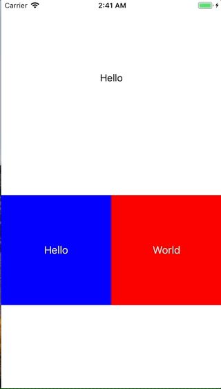

+++
title = "UserDefaultsを使ってパラメーターを保存する"
url = "2018-01-17"
date = "2018-01-17"
description = "UserDefaultsを使ってパラメーターを保存する"
tags = ["iOS", "Swift"]
categories = ["iOS"]
archives = "2018/01"
+++

<br>

UserDefaultsはアプリを落としても保持しておきたいデータを保存するときに使います。  
使い方はいたってシンプルです。  
サンプルコードでは、まず最初に `userDefaults.register(defaults: ["KEY_LabelText": "Hello"])` で初期値を設定しています。  
`.register（）` はとても便利で、指定したキーに対応するデータが存在しない場合に、初期値を入れてくれます。  
次にラベルにUserDefaultで保存した値を読み取り、ラベルのテキストに反映。  
そしてボタンを押されたらuserdefaultsとラベルの値を更新しています。  



<!-- Google Ads -->


<!-- Amazon Ads -->


<!--more-->

**UIViewController.swift**

```swift
import UIKit

class ViewController: UIViewController {
    
    var label:UILabel!
    var leftBtn:UIButton!
    var rightBtn:UIButton!

    override func viewDidLoad() {
        super.viewDidLoad()
        
        let viewWidth = self.view.frame.width
        let viewHeight = self.view.frame.height
        
        //値が無い場合、初期値を設定する
        //初期値に "KEY_LabelText”というKeyで"Hello"と設定する
        //set init value
        let userDefaults:UserDefaults = UserDefaults.standard
        userDefaults.register(defaults: ["KEY_LabelText": "Hello"])
        
        //set label
        label = UILabel()
        label.frame = CGRect(x: 0, y: viewHeight*0.1, width: viewWidth, height: viewHeight*0.2)
        
        //UserDefaultから値を取り出して、labelに貼り付ける。
        label.text = userDefaults.string(forKey: "KEY_LabelText")
        label.textAlignment = NSTextAlignment.center
        self.view.addSubview(label)
        
        //set left button
        leftBtn = UIButton()
        leftBtn.frame = CGRect(x: 0, y: viewHeight*0.5, width: viewWidth*0.5, height: viewWidth*0.5)
        leftBtn.addTarget(self, action: #selector(leftBtnClicked(sender:)), for: .touchUpInside)
        leftBtn.backgroundColor = UIColor.blue
        leftBtn.setTitle("Hello", for: UIControlState.normal)
        self.view.addSubview(leftBtn)
        
        //set right button
        rightBtn = UIButton()
        rightBtn.frame = CGRect(x: viewWidth*0.5, y: viewHeight*0.5, width: viewWidth*0.5, height: viewWidth*0.5)
        rightBtn.addTarget(self, action: #selector(rightBtnClicked(sender:)), for: .touchUpInside)
        rightBtn.backgroundColor = UIColor.red
        rightBtn.setTitle("World", for: UIControlState.normal)
        self.view.addSubview(rightBtn)
    }
    
    @objc func rightBtnClicked(sender: UIButton){
        label.text = "World"
        //UserDefaultの"KEY_LabelText"に"World"を登録する
        let userDefaults:UserDefaults = UserDefaults.standard
        userDefaults.set("World", forKey: "KEY_LabelText")
    }
    
    @objc func leftBtnClicked(sender: UIButton){
        label.text = "Hello"
        //UserDefaultの"KEY_LabelText"に"Hello"を登録する
        let userDefaults:UserDefaults = UserDefaults.standard
        userDefaults.set("Hello", forKey: "KEY_LabelText")
    }
}
```

