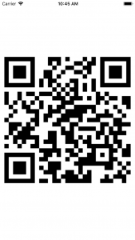

+++
title = "文字列やURLからQRコードを生成する"
url = "2018-03-07"
date = "2018-03-07"
description = "文字列やURLからQRコードを生成する"
tags = ["iOS", "Swift"]
categories = ["iOS"]
archives = "2018/03"
+++

<br>

文字列やURLからQRコードを生成するサンプルコードです。  
This is a sample code that generates a QR code from a character string or URL.  

これらの記事を参考にさせていただきました。  

[CIImageをData型に変換したときにハマった時の対処法(Swift3.0)](https://qiita.com/coffeemk2/items/5f6f5352f9b8b1b02ec9)  
[SwiftでQRコードを生成してみた](https://qiita.com/matsuhisa_h/items/91cdeeaf32553c3b23fb)

生成したQRコードはこちらです。  



<!-- Google Ads -->


<!-- Amazon Ads -->


<!--more-->

**ViewController.swift**

```swift
import UIKit

class ViewController: UIViewController {
    
    override func viewDidLoad() {
        super.viewDidLoad()
        
        //文字列をNSDataに変換し、QRコードを作成します。
        //Converts a string to NSData.
        let str = "カビゴン可愛い、大好き"
        let data = str.data(using: String.Encoding.utf8)!
        
        //URLをNSDataに変換し、QRコードを作成します。
        //Converts a url to NSData.
        //let url = "http://swiswiswift.com"
        //let data = url.data(using: String.Encoding.utf8)!
        
        //QRコードを生成します。
        //Generate QR code.
        let qr = CIFilter(name: "CIQRCodeGenerator", withInputParameters: ["inputMessage": data, "inputCorrectionLevel": "M"])!
        let sizeTransform = CGAffineTransform(scaleX: 10, y: 10)
        let qrImage = qr.outputImage!.transformed(by: sizeTransform)
        let context = CIContext()
        let cgImage = context.createCGImage(qrImage, from: qrImage.extent)
        let uiImage = UIImage(cgImage: cgImage!)
        
        //作成したQRコードを表示します
        //Display QR code
        let qrImageView = UIImageView()
        qrImageView.contentMode = .scaleAspectFit
        qrImageView.frame = self.view.frame
        qrImageView.image = uiImage
        self.view.addSubview(qrImageView)

    }
}
```

