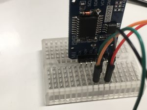
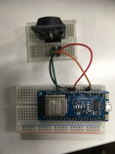

+++
title = "ESP32でRTCモジュールを使う"
url = "2018-03-14"
date = "2018-03-14"
description = "ESP32でRTCモジュールを使う"
tags = ["ESP32"]
categories = ["ESP32"]
archives = "2018/03"
+++

<br>

ESP32でRTCモジュールを使おうとしたら少し詰まったので記事にしました。
結論を先に書くと、#include　DS1307RTC.h　を一番上に持ってくることで解決しました。
サンプルコードのReadTestのESP32バージョンになります。

使用ライブラリと機材は以下の通りです。

DS1307RTCライブラリ
[github.com/PaulStoffregen/DS1307RTC](https://github.com/PaulStoffregen/DS1307RTC)

[ESPr® Developer 32 ](https://amzn.to/2u4PvEn)


[HiLetgo 3個セット DS3231 AT24C32 時計モジュール リアル時間時計モジュール IICモジュール RTCモジュール Arduinoに対応 並行輸入品](https://amzn.to/39qbi9R)


配線図  




<!-- Google Ads -->


<!-- Amazon Ads -->


<!--more-->

**ReadTestForESP32.ino**

```cpp
//Set <DS1307RTC.h> to the top.
//<DS1307RTC.h>を一番上に持ってくる
#include <DS1307RTC.h>
#include <Wire.h>

void setup() {
  Serial.begin(115200);

  //set SDA and SCL port
  //SDA:21 SCL:22 is default
  //Some ports can not be used?
  //SDAとSCLを設定する。
  //SDA:21 SCL:22がデフォルトらしい
  //Wire.begin(SDA,SCL) でSDAとSCLの番号を変える
  //動くポート番号と動かないポート番号がある？
  Wire.begin(21,22);
}

void loop() {
  tmElements_t tm;

  if (RTC.read(tm)) {
    Serial.print("Ok, Time = ");
    print2digits(tm.Hour);
    Serial.write(':');
    print2digits(tm.Minute);
    Serial.write(':');
    print2digits(tm.Second);
    Serial.print(", Date (D/M/Y) = ");
    Serial.print(tm.Day);
    Serial.write('/');
    Serial.print(tm.Month);
    Serial.write('/');
    Serial.print(tmYearToCalendar(tm.Year));
    Serial.println();
  } else {
    if (RTC.chipPresent()) {
      Serial.println("The DS1307 is stopped.  Please run the SetTime");
      Serial.println("example to initialize the time and begin running.");
      Serial.println();
    } else {
      Serial.println("DS1307 read error!  Please check the circuitry.");
      Serial.println();
    }
    delay(9000);
  }
  delay(1000);
}

void print2digits(int number) {
  if (number >= 0 && number < 10) {
    Serial.write('0');
  }
  Serial.print(number);
}
```

