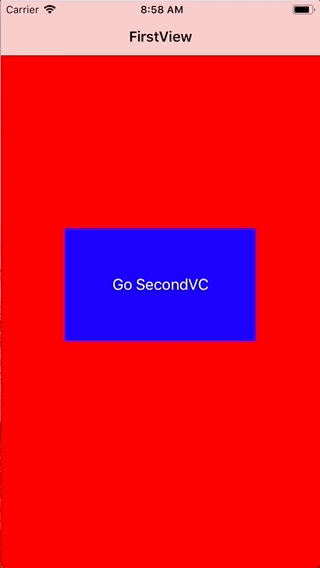

+++
title = "NavigationControllerを実装する"
url = "2018-03-15"
date = "2018-03-15"
description = "NavigationControllerを実装する"
tags = ["iOS", "Swift", "UIKit"]
categories = ["iOS"]
archives = "2018/03"
+++

<br>

NavigationContorollerのサンプルコードです。  
NavigationContorollerは横にニュッと動いて画面遷移をします。  



<!-- Google Ads -->


<!-- Amazon Ads -->


<!--more-->

**AppDelegate.swift**

```swift
import UIKit

@UIApplicationMain
class AppDelegate: UIResponder, UIApplicationDelegate {

    var window: UIWindow?
    var navigationController: UINavigationController?

    func application(_ application: UIApplication, didFinishLaunchingWithOptions launchOptions: [UIApplicationLaunchOptionsKey: Any]?) -> Bool {
        // Override point for customization after application launch.
        
        self.window = UIWindow(frame: UIScreen.main.bounds)
        self.window!.makeKeyAndVisible()
        let firstViewController: FirstViewController? = FirstViewController()
        navigationController = UINavigationController(rootViewController: firstViewController!)
        window!.rootViewController = navigationController
        
        return true
    }

    func applicationWillResignActive(_ application: UIApplication) {
        // Sent when the application is about to move from active to inactive state. This can occur for certain types of temporary interruptions (such as an incoming phone call or SMS message) or when the user quits the application and it begins the transition to the background state.
        // Use this method to pause ongoing tasks, disable timers, and invalidate graphics rendering callbacks. Games should use this method to pause the game.
    }

    func applicationDidEnterBackground(_ application: UIApplication) {
        // Use this method to release shared resources, save user data, invalidate timers, and store enough application state information to restore your application to its current state in case it is terminated later.
        // If your application supports background execution, this method is called instead of applicationWillTerminate: when the user quits.
    }

    func applicationWillEnterForeground(_ application: UIApplication) {
        // Called as part of the transition from the background to the active state; here you can undo many of the changes made on entering the background.
    }

    func applicationDidBecomeActive(_ application: UIApplication) {
        // Restart any tasks that were paused (or not yet started) while the application was inactive. If the application was previously in the background, optionally refresh the user interface.
    }

    func applicationWillTerminate(_ application: UIApplication) {
        // Called when the application is about to terminate. Save data if appropriate. See also applicationDidEnterBackground:.
    }


}
```


**FirstViewController.swift**

```swift
import UIKit

class FirstViewController: UIViewController {

    override func viewDidLoad() {
        super.viewDidLoad()
        
        self.title = "FirstView"
        self.view.backgroundColor = UIColor.red

        let viewWidth = self.view.frame.width
        let viewHeight = self.view.frame.height
        
        let transitionBtn = UIButton()
        transitionBtn.frame = CGRect(x: viewWidth*0.2, y: viewHeight*0.4, width: viewWidth*0.6, height: viewHeight*0.2)
        transitionBtn.backgroundColor = UIColor.blue
        transitionBtn.setTitle("Go SecondVC", for: UIControlState.normal)
        transitionBtn.addTarget(self, action: #selector(goSevondVC(sender:)), for:.touchUpInside)
        self.view.addSubview(transitionBtn)
    }

    @objc internal func goSevondVC(sender: UIButton){
        
        let secondVC:SecondViewController = SecondViewController()
        self.navigationController?.pushViewController(secondVC, animated: true)
    }
}
```


**SecondViewController.swift**

```swift
import UIKit

class SecondViewController: UIViewController {

    override func viewDidLoad() {
        super.viewDidLoad()

        self.title = "SecondView"
        self.view.backgroundColor = UIColor.blue
        
        let viewWidth = self.view.frame.width
        let viewHeight = self.view.frame.height
        
        let transitionBtn = UIButton()
        transitionBtn.frame = CGRect(x: viewWidth*0.2, y: viewHeight*0.4, width: viewWidth*0.6, height: viewHeight*0.2)
        transitionBtn.backgroundColor = UIColor.green
        transitionBtn.setTitle("Back To FirstVC", for: UIControlState.normal)
        transitionBtn.addTarget(self, action: #selector(backToFirstVC(sender:)), for:.touchUpInside)
        self.view.addSubview(transitionBtn)
    }

    @objc internal func backToFirstVC(sender: UIButton){
        
        //前のViewCotrollerに戻る
        //back to previous VC
        self.navigationController?.popViewController(animated: true)

        //RootViewに戻る
        //Back to Root VC
        //self.navigationController?.popToRootViewController(animated: true)
    }
 
}
```

