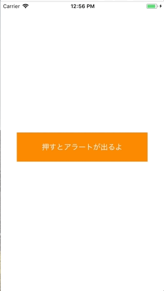

+++
title = "UIAlertControllerにTextFieldを追加する"
url = "2018-03-17"
date = "2018-03-17"
description = "UIAlertControllerにTextFieldを追加する"
tags = ["iOS", "Swift", "UIKit"]
categories = ["iOS"]
archives = "2018/03"
+++

<br>

UIAlertControllerにTextFieldを追加したサンプルです。  



<!-- Google Ads -->


<!-- Amazon Ads -->


<!--more-->

**UIViewController.swift**

```swift
import UIKit

class ViewController: UIViewController {
    
    override func viewDidLoad() {
        super.viewDidLoad()
        
        let viewWidth = self.view.frame.width
        let viewHeight = self.view.frame.height
        
        //アラート表示用のボタンを用意する
        let basicButton = UIButton()
        basicButton.frame = CGRect(x: viewWidth*0.1, y: viewHeight*0.45, width: viewWidth*0.8, height: viewHeight*0.1)
        basicButton.backgroundColor = UIColor.orange
        basicButton.setTitle("押すとアラートが出るよ", for: UIControlState.normal)
        basicButton.setTitleColor(UIColor.white, for: UIControlState.normal)
        basicButton.addTarget(self, action: #selector(showAlert(sender:)), for:.touchUpInside)
        self.view.addSubview(basicButton)
    }
    
    //ボタンが押されるとこの関数が呼ばれる
    @objc func showAlert(sender: UIButton){
        
        //UIAlertControllerを用意する
        let actionAlert = UIAlertController(title: "入力", message: "好きなポケモンを入力してください", preferredStyle: UIAlertControllerStyle.alert)
        
        //UIAlertControllerにアクションを追加する
        let kabigonAction = UIAlertAction(title: "OK", style: UIAlertActionStyle.default, handler: {
            (action: UIAlertAction!) in

            //UIAlertControllerの中のキーボードを取得する
            let textFields:Array<UITextField>? =  actionAlert.textFields as Array<UITextField>?
            if textFields != nil {
                for textField:UITextField in textFields! {
                    //TextFieldの.textにアクセス
                    print(textField.text ?? "error")
                }
            }
        })
        actionAlert.addAction(kabigonAction)
        
        //UIAlertControllerにキャンセルのアクションを追加する
        let cancelAction = UIAlertAction(title: "Cancel", style: UIAlertActionStyle.cancel, handler: {
            (action: UIAlertAction!) in
            print("キャンセルのシートが押されました。")
        })
        actionAlert.addAction(cancelAction)
        
        //UIAlertControllerにTextFieldを追加する
        actionAlert.addTextField(configurationHandler: {(text:UITextField!) -> Void in
            
            text.placeholder = "What is your favorite pokemon?"
        })
        
        //アクションを表示する
        self.present(actionAlert, animated: true, completion: nil)
        
    }
}
```

