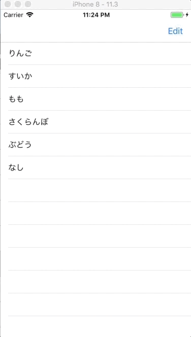

+++
title = "TableViewを編集してCellを削除する"
url = "2018-04-24"
date = "2018-04-24"
description = "TableViewを編集してCellを削除する"
tags = ["iOS", "Swift", "UIKit"]
categories = ["iOS"]
archives = "2018/04"
+++

<br>

TableViewを編集してCellを削除するサンプルコードです。  
NavigationBarに編集ボタンを追加し、そのボタンを押すことでセルを削除することができます。  
NavigationControllerについてはこの記事を参考にしてください。  

NavigationControllerを実装する



<!-- Google Ads -->


<!-- Amazon Ads -->


<!--more-->

**AppDelegate.swift**

```swift
import UIKit

@UIApplicationMain
class AppDelegate: UIResponder, UIApplicationDelegate {

    var window: UIWindow?
    var navigationController: UINavigationController?

    func application(_ application: UIApplication, didFinishLaunchingWithOptions launchOptions: [UIApplicationLaunchOptionsKey: Any]?) -> Bool {
        self.window = UIWindow(frame: UIScreen.main.bounds)
        self.window!.makeKeyAndVisible()
        let firstViewController: ViewController? = ViewController()
        navigationController = UINavigationController(rootViewController: firstViewController!)
        window!.rootViewController = navigationController
        return true
    }

    func applicationWillResignActive(_ application: UIApplication) {
        // Sent when the application is about to move from active to inactive state. This can occur for certain types of temporary interruptions (such as an incoming phone call or SMS message) or when the user quits the application and it begins the transition to the background state.
        // Use this method to pause ongoing tasks, disable timers, and invalidate graphics rendering callbacks. Games should use this method to pause the game.
    }

    func applicationDidEnterBackground(_ application: UIApplication) {
        // Use this method to release shared resources, save user data, invalidate timers, and store enough application state information to restore your application to its current state in case it is terminated later.
        // If your application supports background execution, this method is called instead of applicationWillTerminate: when the user quits.
    }

    func applicationWillEnterForeground(_ application: UIApplication) {
        // Called as part of the transition from the background to the active state; here you can undo many of the changes made on entering the background.
    }

    func applicationDidBecomeActive(_ application: UIApplication) {
        // Restart any tasks that were paused (or not yet started) while the application was inactive. If the application was previously in the background, optionally refresh the user interface.
    }

    func applicationWillTerminate(_ application: UIApplication) {
        // Called when the application is about to terminate. Save data if appropriate. See also applicationDidEnterBackground:.
    }
}
```


**ViewController.swift**

```swift
import UIKit

class ViewController: UIViewController, UITableViewDelegate, UITableViewDataSource {

    //テーブルビューインスタンス
    private var myTableView: UITableView!
    
    //テーブルビューに表示する配列
    private var myItems: Array<String>!
    
    override func viewDidLoad() {
        super.viewDidLoad()

        //テーブルビューに表示する配列
        myItems = ["りんご", "すいか", "もも", "さくらんぼ", "ぶどう", "なし"]
        
        //テーブルビューの初期化
        myTableView = UITableView()
        
        //デリゲートの設定
        myTableView.delegate = self
        myTableView.dataSource = self
        
        //テーブルビューの大きさの指定
        myTableView.frame = self.view.frame
        
        //テーブルビューの設置
        myTableView.register(UITableViewCell.self, forCellReuseIdentifier: "cell")
        self.view.addSubview(myTableView)
        
        //ナビゲーションバーに編集ボタンをつける
        navigationItem.rightBarButtonItem = editButtonItem
    }

    //MARK: テーブルビューのセルの数を設定する
    func tableView(_ tableView: UITableView, numberOfRowsInSection section: Int) -> Int {
        return self.myItems.count
    }
    
    //MARK: テーブルビューのセルの中身を設定する
    func tableView(_ tableView: UITableView, cellForRowAt indexPath: IndexPath) -> UITableViewCell {
        let cell:UITableViewCell = tableView.dequeueReusableCell(withIdentifier: "cell")! as UITableViewCell
        cell.textLabel?.text = self.myItems[indexPath.row]
        return cell
    }
    
    //Mark: テーブルビューのセルが押されたら呼ばれる
    func tableView(_ tableView: UITableView, didSelectRowAt indexPath: IndexPath) {
        print("\(indexPath.row)番のセルを選択しました！ ")
    }
    
    //Mark: ナビゲーションバーの編集ボタンが押されたら呼ばれる
    override func setEditing(_ editing: Bool, animated: Bool) {
        super.setEditing(editing, animated: animated)
        myTableView.setEditing(editing, animated: animated)
    }
    
    //Mark: セル画編集されたら呼ばれる
    func tableView(_ tableView: UITableView, commit editingStyle: UITableViewCellEditingStyle, forRowAt indexPath: IndexPath) {
        myItems.remove(at: indexPath.row)
        myTableView.deleteRows(at: [indexPath], with: .fade)
    }
}

```

