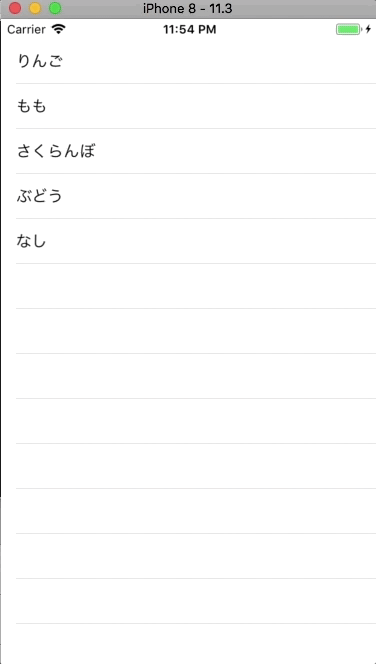

+++
title = "TableViewを編集してCellを削除する(横スライド)"
url = "2018-04-25"
date = "2018-04-25"
description = "TableViewを編集してCellを削除する(横スライド)"
tags = ["iOS", "Swift", "UIKit"]
categories = ["iOS"]
archives = "2018/04"
+++

<br>

TableViewを編集してCellを削除するサンプルコードです。  
以下の関数を追加することで、セルを横スライドで削除できる機能を付けることができます。  


```
func tableView(_ tableView: UITableView, commit editingStyle: UITableViewCellEditingStyle, forRowAt indexPath: IndexPath)
```



<!-- Google Ads -->


<!-- Amazon Ads -->


<!--more-->

**ViewController.swift**

```swift
import UIKit

class ViewController: UIViewController,UITableViewDelegate, UITableViewDataSource  {
    
    //テーブルビューインスタンス
    private var myTableView: UITableView!
    
    //テーブルビューに表示する配列
    private var myItems: Array<String>!
    
    override func viewDidLoad() {
        super.viewDidLoad()
        
        //テーブルビューに表示する配列
        myItems = ["りんご", "すいか", "もも", "さくらんぼ", "ぶどう", "なし"]
        
        //テーブルビューの初期化
        myTableView = UITableView()
        
        //デリゲートの設定
        myTableView.delegate = self
        myTableView.dataSource = self
        
        //テーブルビューの大きさの指定
        myTableView.frame = self.view.frame
        
        //テーブルビューの設置
        myTableView.register(UITableViewCell.self, forCellReuseIdentifier: "cell")
        self.view.addSubview(myTableView)
    }
    
    //MARK: テーブルビューのセルの数を設定する
    func tableView(_ tableView: UITableView, numberOfRowsInSection section: Int) -> Int {
        return self.myItems.count
    }
    
    //MARK: テーブルビューのセルの中身を設定する
    func tableView(_ tableView: UITableView, cellForRowAt indexPath: IndexPath) -> UITableViewCell {
        let cell:UITableViewCell = tableView.dequeueReusableCell(withIdentifier: "cell")! as UITableViewCell
        cell.textLabel?.text = self.myItems[indexPath.row]
        return cell
    }
    
    //Mark: テーブルビューのセルが押されたら呼ばれる
    func tableView(_ tableView: UITableView, didSelectRowAt indexPath: IndexPath) {
        print("\(indexPath.row)番のセルを選択しました！ ")
    }
    
    //Mark: セルの編集ができるようにする。
    func tableView(_ tableView: UITableView, commit editingStyle: UITableViewCellEditingStyle, forRowAt indexPath: IndexPath) {
        myItems.remove(at: indexPath.row)
        myTableView.deleteRows(at: [indexPath], with: .fade)
    }
}
```

