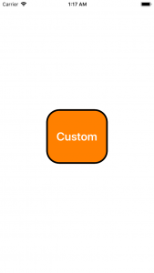

+++
title = "カスタムボタンクラスを実装する"
url = "2018-05-02"
date = "2018-05-02"
description = "カスタムボタンクラスを実装する"
tags = ["iOS", "Swift"]
categories = ["iOS"]
archives = "2018/05"
+++

<br>

UIButtonを拡張したカスタムボタンクラスを作成して貼り付けるサンプルコードです。  
見た目を別ファイルに切り分けることでViewControllerがすっきりします。  



<!-- Google Ads -->


<!-- Amazon Ads -->


<!--more-->

**CustomButton.swift**

```swift
import UIKit

class CustomButton: UIButton {
    
    required init(coder aDecoder: NSCoder) {
        super.init(coder: aDecoder)!
    }
    
    override init(frame: CGRect) {
        super.init(frame: frame)
        self.setTitle("Custom", for: UIControlState.normal)
        self.setTitleColor(UIColor.white, for: UIControlState.normal)
        self.backgroundColor = UIColor.orange
        self.layer.masksToBounds = true
        self.layer.cornerRadius = 32
        self.layer.borderColor = UIColor.black.cgColor
        self.layer.borderWidth = 4
        self.titleLabel?.font = UIFont.boldSystemFont(ofSize: 28)
    }
}
```


**ViewController.swift**

```swift
import UIKit

class ViewController: UIViewController {
    
    override func viewDidLoad() {
        super.viewDidLoad()
        
        let viewWidth = self.view.frame.width
        let viewHeight = self.view.frame.height
        
        let custumBtn = CustomButton()
        custumBtn.frame = CGRect(x: viewWidth * 0.3, y: viewHeight * 0.4, width: viewWidth * 0.4, height: viewHeight * 0.2)
        custumBtn.addTarget(self, action: #selector(customBtnClicked(sender:)), for:.touchUpInside)
        self.view.addSubview(custumBtn)
    }
    
    @objc func customBtnClicked(sender:UIButton) {
        print("ボタンが押されたよ")
    }
}
```

