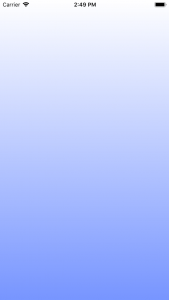
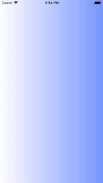
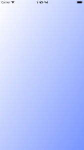

+++
title = "UIViewの背景をグラデーションさせる"
url = "2018-05-06"
date = "2018-05-06"
description = "UIViewの背景をグラデーションさせる"
tags = ["iOS", "Swift", "UIKit"]
categories = ["iOS"]
archives = "2018/05"
+++

<br>

UIViewの背景をグラデーションさせるサンプルコードです。  

参考にさせていただいたページ  
[【Swift x iOSアプリ開発】Viewの背景色にグラデーションを設定する方法](http://amazarashi.me/ios-swift-background-gradiation/)
[Swift UIViewの背景をグラデーションさせる方法　-iPhoneアプリ開発- ](https://techno-monkey.com/swift-uiview-gradation-iphoneapp/)





<!-- Google Ads -->


<!-- Amazon Ads -->


 <!--more-->

**UIViewController.swift**

```swift
import UIKit

class ViewController: UIViewController {
    
    override func viewDidLoad() {
        super.viewDidLoad()
        
        //グラデーションをつける
        let gradientLayer = CAGradientLayer()
        gradientLayer.frame = self.view.bounds
        
        //グラデーションさせるカラーの設定
        //今回は、徐々に色を濃くしていく
        let color1 = UIColor(red: 1.0, green: 1.0, blue: 1.0, alpha: 1).cgColor     //白
        let color2 = UIColor(red: 120/256.0, green: 150/256.0, blue: 256/256.0, alpha: 1).cgColor   //水色
        
        //CAGradientLayerにグラデーションさせるカラーをセット
        gradientLayer.colors = [color1, color2]
        
        //グラデーションの開始地点・終了地点の設定
        //上が白で下が水色
        gradientLayer.startPoint = CGPoint.init(x: 0.5, y: 0)
        gradientLayer.endPoint = CGPoint.init(x: 0.5 , y:1 )
        
        //左が白で右が水色
        //gradientLayer.startPoint = CGPoint.init(x: 0, y: 0.5)
        //gradientLayer.endPoint = CGPoint.init(x: 1 , y:0.5)
        
        //左上が白で右下が水色
        //gradientLayer.startPoint = CGPoint.init(x: 0, y: 0)
        //gradientLayer.endPoint = CGPoint.init(x: 1 , y:1)
        
        //ViewControllerのViewレイヤーにグラデーションレイヤーを挿入する
        self.view.layer.insertSublayer(gradientLayer,at:0)
    }
}
```

