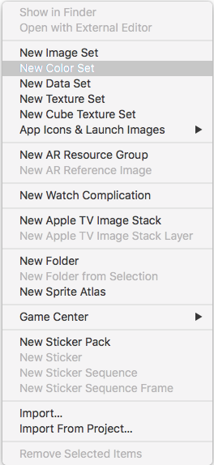
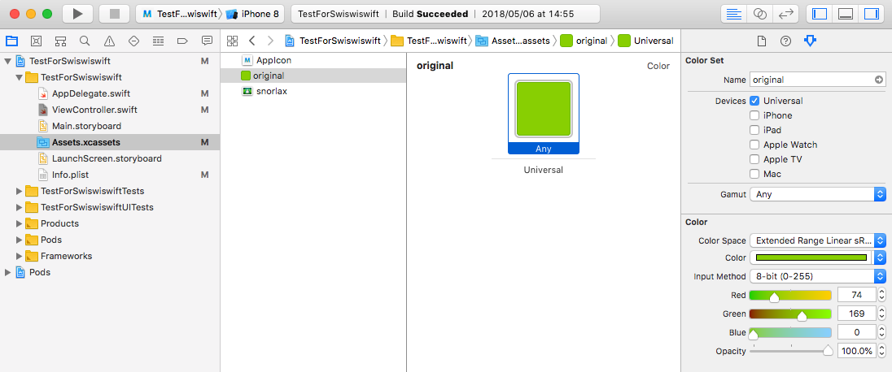
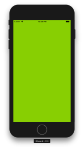

+++
title = "Asset CatalogでColor Setを使って色を管理する"
url = "2018-05-24"
date = "2018-05-24"
description = "Asset CatalogでColor Setを使って色を管理する"
tags = ["iOS", "Swift"]
categories = ["iOS"]
archives = "2018/05"
+++

<br>

Xcode9(iOS 11)から、色をAssetで管理することができるようになりました。  
UIColorのExtensionを作って色を登録して関数作ったりしてごにょごにょしなくて良くなりました。  
色の管理がしやすくなりましたし、デザイナーさんとの連携もちょっとしやすくなったのかな？って思いました。  
とても良い機能なんですが、iOS１１以上でしか動かないので注意が必要です。  
Deployment Targetを11.0以上にしないと警告が出ます。  

Assetを開いて右クリック -> 「New Color Set」を選択  




ここでは「original」という名前で濃い緑色を登録  




<!-- Google Ads -->


<!-- Amazon Ads -->


<!--more-->

**ViewController.swift**

```swift
import UIKit

class ViewController: UIViewController {
    
    override func viewDidLoad() {
        super.viewDidLoad()
        
        if #available(iOS 11.0, *) {
            self.view.backgroundColor = UIColor.init(named: "original")
        } else {
            self.view.backgroundColor = .red
        }
    }
}
```

