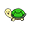
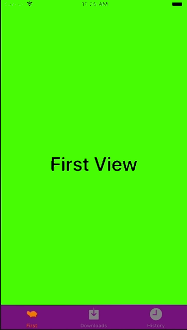

+++
title = "UITabBarControllerを実装する"
url = "2018-06-02"
date = "2018-06-02"
description = "UITabBarControllerを実装する"
tags = ["iOS", "Swift", "UIKit"]
categories = ["iOS"]
archives = "2018/06"
+++

<br>

Viewの切り替えに使われるUITabBarControllerを実装サンプルです。  
UITabBarControllerのアイコンは30×30の透過pngです。  


<br>


<!-- Google Ads -->


<!-- Amazon Ads -->


<!--more-->

**AppDelegate.swift**

```swift
import UIKit

@UIApplicationMain
class AppDelegate: UIResponder, UIApplicationDelegate {

    var window: UIWindow?
    var tabBarController: UITabBarController?
    
    func application(_ application: UIApplication, didFinishLaunchingWithOptions launchOptions: [UIApplicationLaunchOptionsKey: Any]?) -> Bool {
        
        //tabb
        UITabBar.appearance().tintColor = UIColor.orange
        UITabBar.appearance().unselectedItemTintColor = UIColor.gray
        UITabBar.appearance().barTintColor = .purple
        UITabBar.appearance().isTranslucent = false
        
        // ページを格納する配列
        var viewControllers: [UIViewController] = []
        
        let firstViewController: FirstViewController? = FirstViewController()
        firstViewController?.tabBarItem = UITabBarItem(title: "First", image: UIImage(named: "tab-icon-sample"), tag: 1)
        viewControllers.append(firstViewController!)
        
        let secondViewController: SecondViewController? = SecondViewController()
        secondViewController?.tabBarItem = UITabBarItem(tabBarSystemItem: UITabBarSystemItem.downloads, tag: 2)
        viewControllers.append(secondViewController!)
        
        let thirdViewController: ThirdViewController? = ThirdViewController()
        thirdViewController?.tabBarItem = UITabBarItem(tabBarSystemItem: UITabBarSystemItem.history, tag: 3)
        viewControllers.append(thirdViewController!)
        
        tabBarController = UITabBarController()
        tabBarController?.setViewControllers(viewControllers, animated: false)
        
        self.window = UIWindow(frame: UIScreen.main.bounds)
        self.window!.makeKeyAndVisible()
        window?.rootViewController = tabBarController
        
        return true
    }

    func applicationWillResignActive(_ application: UIApplication) {
        // Sent when the application is about to move from active to inactive state. This can occur for certain types of temporary interruptions (such as an incoming phone call or SMS message) or when the user quits the application and it begins the transition to the background state.
        // Use this method to pause ongoing tasks, disable timers, and invalidate graphics rendering callbacks. Games should use this method to pause the game.
    }

    func applicationDidEnterBackground(_ application: UIApplication) {
        // Use this method to release shared resources, save user data, invalidate timers, and store enough application state information to restore your application to its current state in case it is terminated later.
        // If your application supports background execution, this method is called instead of applicationWillTerminate: when the user quits.
    }

    func applicationWillEnterForeground(_ application: UIApplication) {
        // Called as part of the transition from the background to the active state; here you can undo many of the changes made on entering the background.
    }

    func applicationDidBecomeActive(_ application: UIApplication) {
        // Restart any tasks that were paused (or not yet started) while the application was inactive. If the application was previously in the background, optionally refresh the user interface.
    }

    func applicationWillTerminate(_ application: UIApplication) {
        // Called when the application is about to terminate. Save data if appropriate. See also applicationDidEnterBackground:.
    }


}

```


**FirstViewController.swift**

```swift
import UIKit

class FirstViewController: UIViewController {
    
    override func viewDidLoad() {
        super.viewDidLoad()

        self.view.backgroundColor = .green
        
        let firstViewLabel = UILabel()
        firstViewLabel.frame = self.view.frame
        firstViewLabel.textAlignment = .center
        firstViewLabel.font = UIFont.boldSystemFont(ofSize: 40)
        firstViewLabel.textColor = .black
        firstViewLabel.text = "First View"
        self.view.addSubview(firstViewLabel)
    }
}
```


**SecondViewController.swift**

```swift
import UIKit

class SecondViewController: UIViewController {

    override func viewDidLoad() {
        super.viewDidLoad()

        self.view.backgroundColor = .orange
        
        let firstViewLabel = UILabel()
        firstViewLabel.frame = self.view.frame
        firstViewLabel.textAlignment = .center
        firstViewLabel.font = UIFont.boldSystemFont(ofSize: 40)
        firstViewLabel.textColor = .black
        firstViewLabel.text = "Second View"
        self.view.addSubview(firstViewLabel)
    }
}
```


**ThirdViewController.swift**

```swift
import UIKit

class ThirdViewController: UIViewController {

    override func viewDidLoad() {
        super.viewDidLoad()

        self.view.backgroundColor = .red
        
        let firstViewLabel = UILabel()
        firstViewLabel.frame = self.view.frame
        firstViewLabel.textAlignment = .center
        firstViewLabel.font = UIFont.boldSystemFont(ofSize: 40)
        firstViewLabel.textColor = .black
        firstViewLabel.text = "Third View"
        self.view.addSubview(firstViewLabel)
        
    }
}
```

