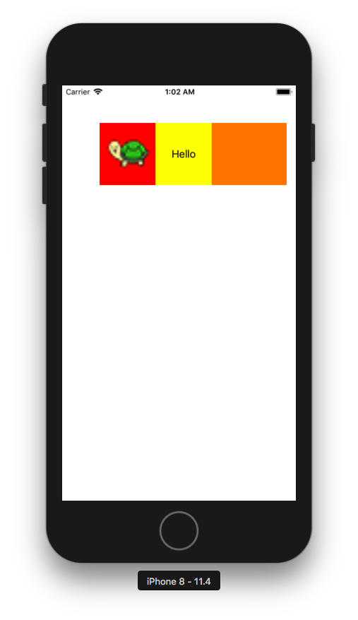

+++
title = "CustomViewをコードで実装する"
url = "2018-06-19"
date = "2018-06-19"
description = "CustomViewをコードで実装する"
tags = ["iOS", "Swift"]
categories = ["iOS"]
archives = "2018/06"
+++

<br>

コードでカスタムビューを作り表示するサンプルです。  
私はxibやstoryboradを使わずに実装するのが好きですが、何がベストなのでしょうか。  



<!-- Google Ads -->


<!-- Amazon Ads -->


<!--more-->

**CustumView.swift**

```swift
import UIKit

class CustumView: UIView {

    var imageView:UIImageView!
    var label:UILabel!
    
    required init?(coder aDecoder: NSCoder) {
        super.init(coder: aDecoder)
    }
    
    override init(frame: CGRect) {
        super.init(frame: frame)
        
        self.backgroundColor = .orange
        
        imageView = UIImageView()
        imageView.image = UIImage(named: "tab-icon-sample")
        imageView.backgroundColor = .red
        self.addSubview(imageView)
        
        label = UILabel()
        label.text = "Hello"
        label.backgroundColor = .yellow
        label.textAlignment = .center
        self.addSubview(label)
    }
    
    override func layoutSubviews() {
        let viewWidth = frame.width
        let viewHeight = frame.height
        imageView.frame = CGRect(x: 0, y: 0, width: viewWidth * 0.3, height: viewHeight)
        label.frame = CGRect(x: viewWidth * 0.3, y: 0, width: viewWidth * 0.3, height: viewHeight)
    }
}
```


**ViewController.swift**

```swift
import UIKit

class ViewController: UIViewController {
    
    override func viewDidLoad() {
        super.viewDidLoad()

        self.view.backgroundColor = .white
        let custumView = CustumView()
        custumView.frame = CGRect(x: 60, y: 60, width: 300, height: 100)
        self.view.addSubview(custumView)
    }
}
```

