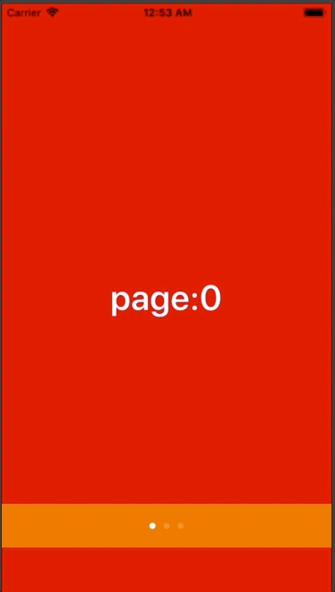

+++
title = "PageViewControllerとPageControl"
url = "2018-06-21"
date = "2018-06-21"
description = "PageViewControllerとPageControl"
tags = ["iOS", "Swift", "UIKit"]
categories = ["iOS"]
archives = "2018/06"
+++

<br>

チュートリアル画面や電子書籍リーダーによく使われるPageViewControllerの実装サンプルです。



<!-- Google Ads -->


<!-- Amazon Ads -->


<!--more-->

**ViewController.swift**

```swift
import UIKit

class ViewController: UIViewController, UIPageViewControllerDataSource, UIPageViewControllerDelegate {
    var pageViewController:UIPageViewController!
    var viewControllersArray:Array<UIViewController> = []
    let colors:Array<UIColor> = [UIColor.red, UIColor.gray, UIColor.blue]
    var pageControl: UIPageControl!
    
    override func viewDidLoad() {
        super.viewDidLoad()
        
        self.view.backgroundColor = .white
        
        //PageViewControllerに表示するViewControllerを生成
        //電子書籍アプリなど、大量のViewControllerを使う場合は一気にインスタンスを作らず、逐次生成する方が良いらしいです
        for index in 0 ..< colors.count {
            let viewController = UIViewController()
            viewController.view.backgroundColor = colors[index]
            viewController.view.tag = index
            let label = UILabel()
            label.text = "page:" + index.description
            label.textColor = .white
            label.font = UIFont.boldSystemFont(ofSize: 40)
            label.frame = self.view.frame
            label.textAlignment = .center
            viewController.view.addSubview(label)
            viewControllersArray.append(viewController)
        }
        
        //PageViewControllerの生成
        pageViewController = UIPageViewController(transitionStyle: UIPageViewControllerTransitionStyle.scroll,
                                                  navigationOrientation: UIPageViewControllerNavigationOrientation.horizontal,
                                                  options: nil)
        //DelegateとDataSouceの設定
        pageViewController.dataSource = self
        pageViewController.delegate = self
        
        //はじめに生成するページを設定
        pageViewController.setViewControllers([viewControllersArray.first!], direction: .forward, animated: true, completion: nil)
        pageViewController.view.frame = self.view.frame
        self.view.addSubview(pageViewController.view!)
        
        
        //PageControlの生成
        pageControl = UIPageControl(frame: CGRect(x:0, y:self.view.frame.height - 100, width:self.view.frame.width, height:50))
        pageControl.backgroundColor = .orange
        
        // PageControlするページ数を設定する.
        pageControl.numberOfPages = colors.count
        
        // 現在ページを設定する.
        pageControl.currentPage = 0
        pageControl.isUserInteractionEnabled = false
        self.view.addSubview(pageControl)
    }
    
    //DataSourceのメソッド
    //指定されたViewControllerの前にViewControllerを返す
    func pageViewController(_ pageViewController: UIPageViewController, viewControllerAfter viewController: UIViewController) -> UIViewController? {
        var index = viewController.view.tag
        pageControl.currentPage = index
        if index == colors.count - 1{
            return nil
        }
        index = index + 1
        return viewControllersArray[index]
    }
    
    //DataSourceのメソッド
    //指定されたViewControllerの前にViewControllerを返す
    func pageViewController(_ pageViewController: UIPageViewController, viewControllerBefore viewController: UIViewController) -> UIViewController? {
        var index = viewController.view.tag
        pageControl.currentPage = index
        index = index - 1
        if index < 0{
            return nil
        }
        return viewControllersArray[index]
    }
    
    //Viewが変更されると呼ばれる
    func pageViewController(_ pageViewController: UIPageViewController, didFinishAnimating: Bool, previousViewControllers: [UIViewController], transitionCompleted: Bool) {
        print("moved")
    }
}
```

