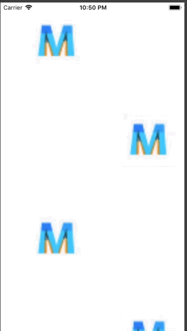

+++
title = "流れるように動く背景を実装する"
url = "2018-06-28"
date = "2018-06-28"
description = "流れるように動く背景を実装する"
tags = ["iOS", "Swift"]
categories = ["iOS"]
archives = "2018/06"
+++

<br>

私が作っている４択化学というアプリの背景の実装方法をたまに聞かれるので、それのサンプルコードを書きました。  
アプリのアイコン画像がViewの背景を流れます。  
またviewDidLoadにアニメーション関係のメソッドを書くと、NavigationBarの遷移によりアニメーションが止まってしまうことがあります。  
その場合はアニメーション関係のメソッドをviewWillAppearに書き出すことで解決します。  




<!-- Google Ads -->


<!-- Amazon Ads -->


<!--more-->

**ViewController.swift**

```swift
import UIKit

class ViewController: UIViewController {
    var imageArray:Array<UIImageView> = Array()

    override func viewDidLoad() {
        super.viewDidLoad()
        
        self.view.backgroundColor = .white
        
        let viewWidth:CGFloat = self.view.frame.width
        let viewHeight:CGFloat = self.view.frame.height
        
        //インスタンスの生成
        for i in 0..<9 {
            let imgView:UIImageView = UIImageView()
            imgView.image = UIImage(named: "AppIcon")
            imgView.contentMode = .scaleAspectFit
            imgView.frame.size = CGSize(width: 200, height: 200)
            imageArray.append(imgView)
            self.view.addSubview(imageArray[i])
        }
        
        //アニメーション
        //１列目
        imageArray[0].center = CGPoint(x: -viewWidth / 2, y: viewHeight * 0.6)
        imageArray[1].center = CGPoint(x: 0, y: viewHeight * 0.3)
        imageArray[2].center =  CGPoint(x: viewWidth / 2, y: 0)
        
        //2列目
        imageArray[3].center = CGPoint(x: -viewWidth / 2, y: viewHeight * 1.2)
        imageArray[4].center = CGPoint(x: 0, y: viewHeight * 0.9)
        imageArray[5].center = CGPoint(x: viewWidth / 2, y: viewHeight * 0.6)
        imageArray[6].center = CGPoint(x: viewWidth, y: viewHeight * 0.3)
        
        //３列目
        imageArray[7].center = CGPoint(x: viewWidth / 2, y: viewHeight * 1.2)
        imageArray[8].center = CGPoint(x: viewWidth, y: viewHeight * 0.9)
        
        //アニメーションの設定
        //4秒間かけて、一定の速さで繰り返しのアニメーションを行う
        UIView.animate(withDuration: 4, delay: 0.0, options: [.repeat, .curveLinear], animations: {
            //１列目
            self.imageArray[0].center = CGPoint(x: 0, y: viewHeight * 0.3)
            self.imageArray[1].center = CGPoint(x: viewWidth / 2, y: 0)
            self.imageArray[2].center = CGPoint(x: viewWidth, y: -viewHeight * 0.3)
            
            //2列目
            self.imageArray[3].center = CGPoint(x: 0, y: viewHeight * 0.9)
            self.imageArray[4].center = CGPoint(x: viewWidth / 2, y: viewHeight * 0.6)
            self.imageArray[5].center = CGPoint(x: viewWidth, y: viewHeight * 0.3)
            self.imageArray[6].center = CGPoint(x: viewWidth * 1.5, y: 0)
            
            //３列目
            self.imageArray[7].center = CGPoint(x: viewWidth, y: viewHeight * 0.9)
            self.imageArray[8].center = CGPoint(x: viewWidth * 1.5, y: viewHeight * 0.6)
        },completion:nil)

    }
}
```

