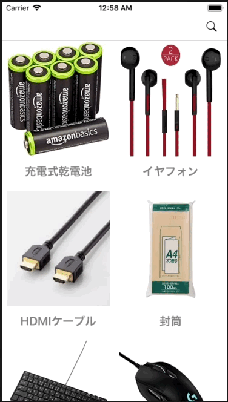

+++
title = "CollectionViewにSearchBarをつけて検索する"
url = "2018-07-18"
date = "2018-07-18"
description = "CollectionViewにSearchBarをつけて検索する"
tags = ["iOS", "Swift", "UIKit"]
categories = ["iOS"]
archives = "2018/07"
+++

<br>

コレクションビューにサーチバーとコレクションビューをつけて検索するサンプルです。



<!-- Google Ads -->


<!-- Amazon Ads -->


<!--more-->

**AppDelegate.swift**

```swift
import UIKit

@UIApplicationMain
class AppDelegate: UIResponder, UIApplicationDelegate {

    var window: UIWindow?
    var navigationController: UINavigationController?

    func application(_ application: UIApplication, didFinishLaunchingWithOptions launchOptions: [UIApplicationLaunchOptionsKey: Any]?) -> Bool {

        //ナビゲーションバーの見た目の設定
        UINavigationBar.appearance().tintColor = UIColor.black
        UINavigationBar.appearance().barTintColor = UIColor.white
        UINavigationBar.appearance().titleTextAttributes = [NSAttributedStringKey.foregroundColor: UIColor.black]

        self.window = UIWindow(frame: UIScreen.main.bounds)
        self.window!.makeKeyAndVisible()
        let firstViewController: ViewController? = ViewController()
        navigationController = UINavigationController(rootViewController: firstViewController!)
        window!.rootViewController = navigationController
        return true
    }

    func applicationWillResignActive(_ application: UIApplication) {
    }

    func applicationDidEnterBackground(_ application: UIApplication) {
    }

    func applicationWillEnterForeground(_ application: UIApplication) {
    }

    func applicationDidBecomeActive(_ application: UIApplication) {
    }

    func applicationWillTerminate(_ application: UIApplication) {
    }
}
```


**CustumCollectionViewCell.swift**

```swift
import UIKit

class CustumCollectionViewCell: UICollectionViewCell {

    var thumbnailImageView: UIImageView?
    var textLabel: UILabel?

    required init(coder aDecoder: NSCoder) {
        super.init(coder: aDecoder)!
    }

    override init(frame: CGRect) {
        super.init(frame: frame)

        let width: CGFloat = self.frame.width
        let height: CGFloat = self.frame.height
        let margin: CGFloat = 8
        
        self.backgroundColor = .white

        thumbnailImageView = UIImageView()
        thumbnailImageView?.image = UIImage(named: "snorlax")
        thumbnailImageView?.frame = CGRect(x: margin, y: margin, width: width - margin * 2, height: height * 0.8 - margin)
        self.contentView.addSubview(thumbnailImageView!)

        // UILabelを生成.
        textLabel = UILabel(frame: CGRect(x: 0, y: height * 0.8, width: frame.width, height: frame.height * 0.2))
        textLabel?.textColor = UIColor.gray
        textLabel?.textAlignment = NSTextAlignment.center
        textLabel?.font = UIFont.boldSystemFont(ofSize: 20)
        self.contentView.addSubview(textLabel!)
    }
}
```


**ViewController.swift**

```swift
import UIKit

class ViewController: UIViewController, UISearchBarDelegate, UICollectionViewDelegate, UICollectionViewDataSource {

    var statusBarHeight: CGFloat!
    var navigationBarHeight: CGFloat!

    //SearchBarインスタンス
    private var mySearchBar: UISearchBar!

    //コレクションビュー
    var myCollectionView: UICollectionView!

    //コレクションビューに表示するベースとなる配列
    //ファイル名と製品名
    var array: Array<Array<String>> = [["battery", "充電式乾電池"], ["earphone", "イヤフォン"], ["hdmi", "HDMIケーブル"], ["huto", "封筒"], ["keyborad", "キーボード"], ["moouse", "マウス"], ["tissue", "テッシュ"], ["toiletpaper", "トイレペーパー"]]

    //検索された配列
    var searchedArray: Array<Array<String>>!

    override func viewDidLoad() {
        super.viewDidLoad()

        self.view.backgroundColor = .white

        searchedArray = array

        //サイズを取得
        statusBarHeight = UIApplication.shared.statusBarFrame.size.height
        navigationBarHeight = (self.navigationController?.navigationBar.frame.size.height)!
        let viewWidth = self.view.frame.width
        let viewHeight = self.view.frame.height
        let collectionFrame = CGRect(x: 0, y: 0, width: viewWidth, height: viewHeight)
        let searchBarHeight: CGFloat = 44

        // MARK: - CollectionView関連
        // CollectionViewのレイアウトを生成.
        let layout = UICollectionViewFlowLayout()

        // Cell一つ一つの大きさ.
        layout.itemSize = CGSize(width: viewWidth / 2, height: viewWidth / 1.5)

        // セルのマージン.
        layout.sectionInset = UIEdgeInsets.zero
        //layout.sectionInset = UIEdgeInsetsMake(16, 16, 16, 16)

        //セルの横方向のマージン
        layout.minimumInteritemSpacing = 0.0

        //セルの縦方向のマージン
        layout.minimumLineSpacing = 0.0

        // セクション毎のヘッダーサイズ.
        //サーチバー大きさ
        layout.headerReferenceSize = CGSize(width: viewWidth, height: searchBarHeight)

        // CollectionViewを生成.
        myCollectionView = UICollectionView(frame: collectionFrame, collectionViewLayout: layout)

        // Cellに使われるクラスを登録.
        myCollectionView.register(CustumCollectionViewCell.self, forCellWithReuseIdentifier: NSStringFromClass(CustumCollectionViewCell.self))

        //デリゲートとデータソースを設定
        myCollectionView.delegate = self
        myCollectionView.dataSource = self
        myCollectionView.backgroundColor = .white

        //サーチバーの高さだけ初期位置を下げる
        myCollectionView.contentOffset = CGPoint(x: 0, y: searchBarHeight)
        self.view.addSubview(myCollectionView)

        // MARK: - SearchBar関連
        //SearchBarの作成
        mySearchBar = UISearchBar()
        //デリゲートを設定
        mySearchBar.delegate = self
        //大きさの指定
        mySearchBar.frame = CGRect(x: 0, y: 0, width: viewWidth, height: 44)
        //キャンセルボタンの追加
        mySearchBar.showsCancelButton = true
        self.myCollectionView.addSubview(mySearchBar)

        //虫眼鏡の設定を実装
        let rightNavBtn = UIBarButtonItem(barButtonSystemItem: .search, target: self, action: #selector(rightBarBtnClicked(sender:)))
        self.navigationItem.rightBarButtonItem = rightNavBtn
    }

    //MARK: - 渡された文字列を含む要素を検索し、テーブルビューを再表示する
    func searchItems(searchText: String) {

        //要素を検索する
        if searchText != "" {
            searchedArray = array.filter { myItem in
                return (myItem[1]).contains(searchText)
            } as Array<Array<String>>

        } else {
            //渡された文字列が空の場合は全てを表示
            searchedArray = array
        }
        //再読み込みする
        myCollectionView.reloadData()
    }

    //MARK: - ナビゲーションバーの右の虫眼鏡が押されたら呼ばれる
    @objc internal func rightBarBtnClicked(sender: UIButton) {
        print("rightBarBtnClicked")
        myCollectionView.contentOffset = CGPoint(x: 0, y: -(statusBarHeight + navigationBarHeight))
    }

    //MARK: - CollectionView Delegate Methods

    //Cellが選択された際に呼び出される
    func collectionView(_ collectionView: UICollectionView, didSelectItemAt indexPath: IndexPath) {
        print("Num: \(indexPath.row)")
    }

    //Cellの総数を返す
    func collectionView(_ collectionView: UICollectionView, numberOfItemsInSection section: Int) -> Int {
        return searchedArray.count
    }

    //Cellに値を設定する
    func collectionView(_ collectionView: UICollectionView, cellForItemAt indexPath: IndexPath) -> UICollectionViewCell {

        let cell: CustumCollectionViewCell = collectionView.dequeueReusableCell(withReuseIdentifier: NSStringFromClass(CustumCollectionViewCell.self), for: indexPath) as! CustumCollectionViewCell
        cell.thumbnailImageView?.image = UIImage(named: searchedArray[indexPath.row][0])
        cell.textLabel?.text = searchedArray[indexPath.row][1]
        return cell
    }

    // MARK: - SearchBarのデリゲードメソッドたち
    //MARK: テキストが変更される毎に呼ばれる
    func searchBar(_ searchBar: UISearchBar, textDidChange searchText: String) {
        //検索する
        searchItems(searchText: searchText)
    }

    //MARK: キャンセルボタンが押されると呼ばれる
    func searchBarCancelButtonClicked(_ searchBar: UISearchBar) {

        mySearchBar.text = ""
        self.view.endEditing(true)
        searchedArray = array

        //コレクションビューを再読み込みする
        myCollectionView.reloadData()
    }

    //MARK: Searchボタンが押されると呼ばれる
    func searchBarSearchButtonClicked(_ searchBar: UISearchBar) {

        self.view.endEditing(true)
        //検索する
        searchItems(searchText: mySearchBar.text! as String)
    }
}

```

