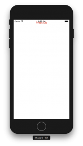
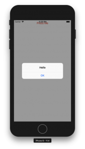

+++
title = "ReactNativeでボタンを表示する"
url = "2018-08-12"
date = "2018-08-12"
description = "ReactNativeでボタンを表示する"
tags = ["React Native"]
categories = ["React Native"]
archives = "2018/08"
+++

<br>

ReactNativeでボタンを表示するサンプルです。  
ボタンを押すとアラームが表示されます。  

react-native: 0.56.0  




<!-- Google Ads -->


<!-- Amazon Ads -->


<!--more-->

**index.js**

```javascript
import React, {Component} from 'react';
import {AppRegistry} from 'react-native';
import {
    StyleSheet,
    Button,
    View,
    Alert
} from 'react-native';
import {name as appName} from './app.json';

export class App extends Component {

    render() {
        return (
            <View style={styles.container}>
                <Button
                    color="red"
                    title={'Press Me'}
                    onPress={()=>Alert.alert('Hello')}
                />
            </View>
        );
    }
}

const styles = StyleSheet.create({
    container: {
        flex: 1,
    },
});

AppRegistry.registerComponent(appName, () => App);
```

