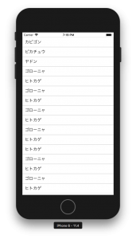

+++
title = "ReactNativeでFlatListを表示する"
url = "2018-08-13"
date = "2018-08-13"
description = "ReactNativeでFlatListを表示する"
tags = ["React Native"]
categories = ["React Native"]
archives = "2018/08"
+++

<br>

ReactNativeでFlatListを表示するサンプルです。  
react-native: 0.56.0  で動作を確認しました。



<!-- Google Ads -->


<!-- Amazon Ads -->


<!--more-->

**index.js**

```javascript
import React, {Component} from 'react';
import {AppRegistry} from 'react-native';
import {
    StyleSheet,
    Text,
    View,
    FlatList,
    Alert
} from 'react-native';
import {name as appName} from './app.json';

export class App extends Component {

    constructor(props) {
        super(props);
        this.state = {
            data: [
                {key: 1, title: 'カビゴン'},
                {key: 2, title: 'ピカチュウ'},
                {key: 3, title: 'ヤドン'},
                {key: 4, title: 'ゴローニャ'},
                {key: 5, title: 'ヒトカゲ'},
                {key: 6, title: 'ゴローニャ'},
                {key: 7, title: 'ヒトカゲ'},
                {key: 8, title: 'ゴローニャ'},
                {key: 9, title: 'ヒトカゲ'},
                {key: 10, title: 'ゴローニャ'},
                {key: 11, title: 'ヒトカゲ'},
                {key: 12, title: 'ヒトカゲ'},
                {key: 13, title: 'ゴローニャ'},
                {key: 14, title: 'ヒトカゲ'},
                {key: 15, title: 'ゴローニャ'},
                {key: 16, title: 'ヒトカゲ'},
            ]
        };
    }

    render() {
        return (
            <FlatList
                style={styles.container}
                data={this.state.data}
                extraData={this.state}
                removeClippedSubviews={false}
                keyExtractor={item => item.key.toString()}
                renderItem={({item}) =>
                    <View
                        style={styles.cell}
                    >
                        <Text
                            style={styles.text}
                            onPress={() =>
                                Alert.alert('hello')
                            }
                        >{item.title}</Text>
                    </View>}
            />
        );
    }
}

const styles = StyleSheet.create({
    container: {
        flex: 1,
        marginTop: 20
    },
    cell: {
        flexDirection: 'row',
        borderStyle: 'solid',
        borderWidth: 0.5,
        borderColor: '#bbb',
    },
    text: {
        padding: 10,
        fontSize: 18,
    },
});

AppRegistry.registerComponent(appName, () => App);
```

