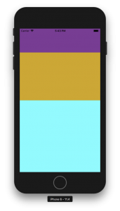
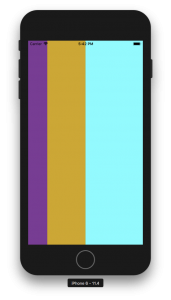

+++
title = "FlexBoxでViewの大きさを指定する"
url = "2018-08-14"
date = "2018-08-14"
description = "FlexBoxでViewの大きさを指定する"
tags = ["React Native"]
categories = ["React Native"]
archives = "2018/08"
+++

<br>

FlexBoxでViewの大きさを指定するサンプルコードです。

react-native: 0.56.0

紫、黄土色、水色のViewが　1 : 2 : 3 の高さになっています。



<!--more-->

**index.js**

```javascript
import React, {Component} from 'react';
import {AppRegistry} from 'react-native';
import {StyleSheet, View} from 'react-native';
import {name as appName} from './app.json';

export class App extends Component {
    render() {
        return (
            <View style={styles.container}>
                <View style={styles.top}>

                </View>
                <View style={styles.center}>

                </View>
                <View style={styles.bottom}>

                </View>
            </View>
        );
    }
}

const styles = StyleSheet.create({
    container: {
        flex: 1,
    },
    top: {
        flex: 1,
        backgroundColor: "#883496"
    },
    center: {
        flex: 2,
        backgroundColor: "goldenrod"
    },
    bottom: {
        flex: 3,
        backgroundColor: "cyan"
    },
});

AppRegistry.registerComponent(appName, () => App);
```


横にするには
flexDirection: 'row'と設定します。



<!-- Google Ads -->


<!-- Amazon Ads -->


**index.js**

```javascript
import React, {Component} from 'react';
import {AppRegistry} from 'react-native';
import {StyleSheet, View} from 'react-native';
import {name as appName} from './app.json';

export class App extends Component {
    render() {
        return (
            <View style={styles.container}>
                <View style={styles.top}>

                </View>
                <View style={styles.center}>

                </View>
                <View style={styles.bottom}>

                </View>
            </View>
        );
    }
}

const styles = StyleSheet.create({
    container: {
        flex: 1,
        flexDirection: 'row',
    },
    top: {
        flex: 1,
        backgroundColor: "#883496"
    },
    center: {
        flex: 2,
        backgroundColor: "goldenrod"
    },
    bottom: {
        flex: 3,
        backgroundColor: "cyan"
    },
});

AppRegistry.registerComponent(appName, () => App);
```

