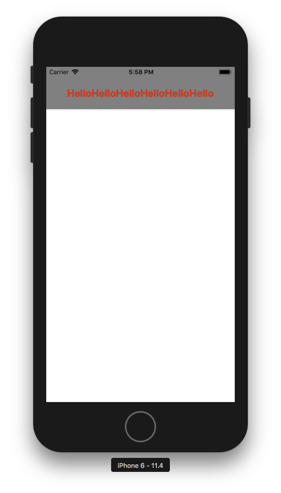

+++
title = "ReactNativeでテキストを表示"
url = "2018-08-18"
date = "2018-08-18"
description = "ReactNativeでテキストを表示"
tags = ["React Native"]
categories = ["React Native"]
archives = "2018/08"
+++

<br>

ReactNativeでTextを表示するサンプルです。  

react-native: 0.56.0  



<!-- Google Ads -->


<!-- Amazon Ads -->


<!--more-->

**index.js**

```javascript
import React, {Component} from 'react';
import {AppRegistry} from 'react-native';
import {
    StyleSheet,
    View,
    Text,
    Alert
} from 'react-native';
import {name as appName} from './app.json';


export class App extends Component {

    showAlert(text) {
        Alert.alert('Hello')
    }

    render() {
        return (
            <View style={styles.container}>
                <Text
                    style={styles.text}
                    onPress={() => this.showAlert()}>
                    HelloHelloHelloHelloHelloHello
                </Text>
            </View>
        );
    }
}

const styles = StyleSheet.create({
    container: {
        flex: 1,
    },
    text: {
        color: 'red',
        fontWeight: 'bold',
        backgroundColor: 'gray',
        textAlign: 'center',
        fontSize: 20,
        paddingTop: 40,
        paddingBottom: 20,
    },
});

AppRegistry.registerComponent(appName, () => App);

```

