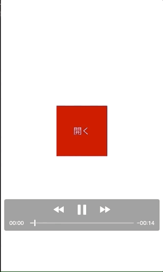

+++
title = "iOSでバーコードを読み取る"
url = "2018-09-17"
date = "2018-09-17"
description = "iOSでバーコードを読み取る"
tags = ["iOS", "Swift"]
categories = ["iOS"]
archives = "2018/08"
+++

<br>

Swiftでバーコードを読み取るサンプルコードです。
Swift 4.1

// 参考にさせて頂いたサイトです  

[Swift 4でQRコードを読み取る](https://shinjism.com/blog/2017/10/qrcode.html)  
[AVFoundation(AVCaptureMetadataOutput)でバーコードリーダーを作ってみた](https://dev.classmethod.jp/smartphone/ios-avfoundation-avcapturemetadataoutput-ean13-ean8/)  

まず、`info.plist`に
`Privacy - Camera Usage Description` のキーを追加し、使用理由を記述します。
「バーコードリーダー読み込みます」などなど。
この文言は使用許可を求める時に表示されます。



<!-- Google Ads -->


<!-- Amazon Ads -->


<!--more-->

**BarCodeReaderVC.swift**

```swift
import UIKit
import AVFoundation

class BarCodeReaderVC: UIViewController, AVCaptureMetadataOutputObjectsDelegate {
    // カメラやマイクの入出力を管理するオブジェクトを生成
    private let session = AVCaptureSession()

    override func viewDidLoad() {
        super.viewDidLoad()
        self.view.backgroundColor = .white

        // カメラやマイクのデバイスそのものを管理するオブジェクトを生成（ここではワイドアングルカメラ・ビデオ・背面カメラを指定）
        let discoverySession = AVCaptureDevice.DiscoverySession(deviceTypes: [.builtInWideAngleCamera],
            mediaType: .video,
            position: .back)

        // ワイドアングルカメラ・ビデオ・背面カメラに該当するデバイスを取得
        let devices = discoverySession.devices

        //　該当するデバイスのうち最初に取得したものを利用する
        if let backCamera = devices.first {
            do {
                // QRコードの読み取りに背面カメラの映像を利用するための設定
                let deviceInput = try AVCaptureDeviceInput(device: backCamera)
                if self.session.canAddInput(deviceInput) {
                    self.session.addInput(deviceInput)

                    // 背面カメラの映像からQRコードを検出するための設定
                    let metadataOutput = AVCaptureMetadataOutput()
                    if self.session.canAddOutput(metadataOutput) {
                        self.session.addOutput(metadataOutput)

                        metadataOutput.setMetadataObjectsDelegate(self, queue: DispatchQueue.main)
                        // 読み取りたいバーコードの種類を指定
                        // .ean13 は本の書籍などに使用されるバーコード
                        // .qr はQRコード、などなど
                        metadataOutput.metadataObjectTypes = [.ean13]

                        // 読み取り可能エリアの設定を行う
                        // 画面の横、縦に対して、左が10%、上が40%のところに、横幅80%、縦幅20%を読み取りエリアに設定
                        let x: CGFloat = 0.1
                        let y: CGFloat = 0.4
                        let width: CGFloat = 0.8
                        let height: CGFloat = 0.2
                        metadataOutput.rectOfInterest = CGRect(x: y, y: 1 - x - width, width: height, height: width)

                        // 背面カメラの映像を画面に表示するためのレイヤーを生成
                        let previewLayer = AVCaptureVideoPreviewLayer(session: self.session)
                        previewLayer.frame = self.view.bounds
                        previewLayer.videoGravity = .resizeAspectFill
                        self.view.layer.addSublayer(previewLayer)

                        // 読み取り可能エリアに赤い枠を追加する
                        let detectionArea = UIView()
                        detectionArea.frame = CGRect(x: view.frame.size.width * x, y: view.frame.size.height * y, width: view.frame.size.width * width, height: view.frame.size.height * height)
                        detectionArea.layer.borderColor = UIColor.red.cgColor
                        detectionArea.layer.borderWidth = 3
                        view.addSubview(detectionArea)

                        // 閉じるボタン
                        let closeBtn:UIButton = UIButton()
                        closeBtn.frame = CGRect(x: 20, y: 20, width: 100, height: 40)
                        closeBtn.setTitle("閉じる", for: UIControlState.normal)
                        closeBtn.backgroundColor = UIColor.lightGray
                        closeBtn.addTarget(self, action: #selector(closeTaped(sender:)), for: .touchUpInside)
                        self.view.addSubview(closeBtn)

                        // 読み取り開始
                        self.session.startRunning()
                    }
                }
            } catch {
                print("Error occured while creating video device input: \(error)")
            }
        }
    }

    func metadataOutput(_ output: AVCaptureMetadataOutput, didOutput metadataObjects: [AVMetadataObject], from connection: AVCaptureConnection) {
        for metadata in metadataObjects as! [AVMetadataMachineReadableCodeObject] {
            // バーコードの内容が空かどうかの確認
            if metadata.stringValue == nil { continue }

            // 読み取ったデータの値
            print(metadata.type)
            print(metadata.stringValue!)
            
            // 取得したデータの処理を行う
            let alert: UIAlertController = UIAlertController(title: "バーコードの中身", message: metadata.stringValue, preferredStyle: UIAlertControllerStyle.alert)
            let cancel: UIAlertAction = UIAlertAction(title: "キャンセル", style: UIAlertActionStyle.cancel, handler:nil)
            alert.addAction(cancel)
            present(alert, animated: true, completion: nil)
        }
    }
    
    // 閉じるが押されたら呼ばれます
    @objc func closeTaped(sender: UIButton) {
        self.dismiss(animated: true, completion: nil)
    }
}
```


**ViewController.swift**

```swift
import UIKit

class ViewController: UIViewController {
    override func viewDidLoad() {
        super.viewDidLoad()
        self.view.backgroundColor = .white

        // バーコードリーダーのモーダルが開くボタン
        let buttonSize: CGFloat = 100
        let button: UIButton = UIButton()
        button.frame = CGRect(x: (self.view.frame.width - buttonSize) / 2, y: (self.view.frame.height - buttonSize) / 2, width: buttonSize, height: buttonSize)
        button.backgroundColor = .red
        button.setTitle("開く", for: UIControlState.normal)
        button.addTarget(self, action: #selector(taped(sender:)), for: .touchUpInside)
        self.view.addSubview(button)
    }

    // ボタンが押されたら呼ばれます
    @objc func taped(sender: UIButton) {
        self.present(BarCodeReaderVC(), animated: true, completion: nil)
    }
}
```

