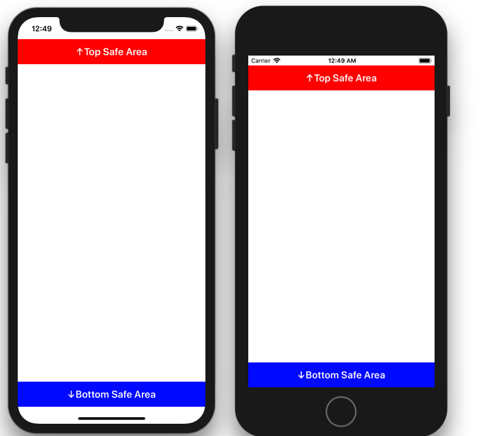

+++
title = "SafeAreaを取得する"
url = "2018-09-19"
date = "2018-09-19"
description = "SafeAreaを取得する"
tags = ["iOS", "Swift", "UIKit"]
categories = ["iOS"]
archives = "2018/09"
+++

<br>

iPhoneXが登場したことで、iPhoneXのレイアウト(SafeAreaの取得)には気を使うようになりました。  
SafeAreaはviewDidLayoutSubviews メソッド内で、safeAreaInsets プロパティを参照することで取得することができます。  



<!-- Google Ads -->


<!-- Amazon Ads -->


<!--more-->

**ViewController.swift**

```swift
import UIKit
class ViewController: UIViewController {
    var topSafeAreaHeight: CGFloat = 0
    var bottomSafeAreaHeight: CGFloat = 0
    var topSafeAreaLabel:UILabel!
    var bottomSafeAreaLabel:UILabel!
    override func viewDidLoad() {
        super.viewDidLoad()
        self.view.backgroundColor = UIColor.white
        // viewDidLoadの段階では高さは取得できない
        print("in viewDidLoad")
        print(topSafeAreaHeight)    // 0
        print(bottomSafeAreaHeight) // 0
        
        // Top Safe Area 下のラベル
        topSafeAreaLabel = UILabel()
        topSafeAreaLabel.backgroundColor = UIColor.red
        topSafeAreaLabel.text = "↑Top Safe Area"
        topSafeAreaLabel.textAlignment = NSTextAlignment.center
        topSafeAreaLabel.textColor = UIColor.white
        topSafeAreaLabel.font = UIFont.boldSystemFont(ofSize: 20)
        self.view.addSubview(topSafeAreaLabel)
        
        // Bottom Safe Area 上のラベル
        bottomSafeAreaLabel = UILabel()
        bottomSafeAreaLabel.backgroundColor = UIColor.blue
        bottomSafeAreaLabel.text = "↓Bottom Safe Area"
        bottomSafeAreaLabel.textAlignment = NSTextAlignment.center
        bottomSafeAreaLabel.textColor = UIColor.white
        bottomSafeAreaLabel.font = UIFont.boldSystemFont(ofSize: 20)
        self.view.addSubview(bottomSafeAreaLabel)
    }
    
    override func viewDidLayoutSubviews() {
        super.viewDidLayoutSubviews()
        if #available(iOS 11.0, *) {
            // viewDidLayoutSubviewsではSafeAreaの取得ができている
            topSafeAreaHeight = self.view.safeAreaInsets.top
            bottomSafeAreaHeight = self.view.safeAreaInsets.bottom
            print("in viewDidLayoutSubviews")
            print(topSafeAreaHeight)    // iPhoneXなら44, その他は20.0
            print(bottomSafeAreaHeight) // iPhoneXなら34,  その他は0
            
            let width:CGFloat = self.view.frame.width
            let height:CGFloat = self.view.frame.height
            let labelHeight:CGFloat = 50
            topSafeAreaLabel.frame = CGRect(
                x: 0, y: topSafeAreaHeight,
                width: width, height: labelHeight)
            bottomSafeAreaLabel.frame = CGRect(
                x: 0, y: height - (labelHeight + bottomSafeAreaHeight),
                width: width, height: labelHeight)
        }
    }
}
```

