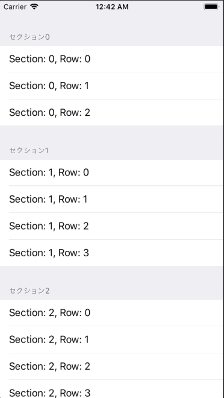

+++
title = "グループスタイルのTableViewを作成する"
url = "2018-09-20"
date = "2018-09-20"
description = "グループスタイルのTableViewを作成する"
tags = ["iOS", "Swift", "UIKit"]
categories = ["iOS"]
archives = "2018/09"
+++

<br>

グループスタイルのテーブルビューを表示するサンプルコードです
設定画面などはこんな感じですね。



<!-- Google Ads -->


<!-- Amazon Ads -->


<!--more-->

**ViewController.swift**

```swift
import UIKit

class ViewController: UIViewController, UITableViewDelegate, UITableViewDataSource {
    // Sectionで使用する配列を定義する.
    private let sections: Array = ["セクション0", "セクション1", "セクション2"]

    override func viewDidLoad() {
        super.viewDidLoad()

        // グループスタイルでTableViewを生成
        let myTableView: UITableView = UITableView.init(frame: CGRect.zero, style: .grouped)
        myTableView.frame = self.view.bounds

        // Delegateの設定
        myTableView.dataSource = self
        myTableView.delegate = self

        // Cell名の登録をおこなう.
        myTableView.register(UITableViewCell.self, forCellReuseIdentifier: NSStringFromClass(UITableViewCell.self))

        // Viewに追加する.
        self.view.addSubview(myTableView)
    }

    //MARK: - TableViewのデリゲートメソッド
    // セクション数を返す
    func numberOfSections(in tableView: UITableView) -> Int {
        return sections.count
    }

    // セクションのタイトルを返す
    func tableView(_ tableView: UITableView, titleForHeaderInSection section: Int) -> String? {
        return sections[section]
    }

    // Cellが選択された際に呼び出される
    func tableView(_ tableView: UITableView, didSelectRowAt indexPath: IndexPath) {
        print("Section: \(indexPath.section), Row: \(indexPath.row)")
    }

    // テーブルに表示する配列の総数を返す
    func tableView(_ tableView: UITableView, numberOfRowsInSection section: Int) -> Int {
        if section == 0 {
            return 3
        } else if section == 1 {
            return 4
        } else {
            return 5
        }
    }

    // Cellに値を設定する
    func tableView(_ tableView: UITableView, cellForRowAt indexPath: IndexPath) -> UITableViewCell {
        let cell = tableView.dequeueReusableCell(withIdentifier: NSStringFromClass(UITableViewCell.self), for: indexPath)
        cell.textLabel?.text = "Section: \(indexPath.section), Row: \(indexPath.row)"
        return cell
    }
}
```

