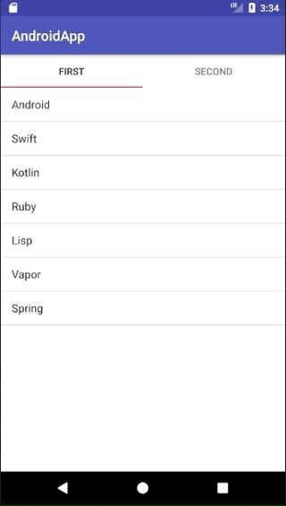

+++
title = "KotlinでListViewを内包したTabを作成する"
url = "2018-09-25"
date = "2018-09-25"
description = "KotlinでListViewを内包したTabを作成する"
tags = ["Android"]

categories = ["Android"]
archives = "2018/09"
+++

<br>


KotlinでListViewを内包したTabを作成しました。

参考にさせて頂いたWebページです。
すごく良い記事なので、この記事より彼の記事をみてください。
[Getting Started with Tabs in Android — Kotlin](https://medium.com/@eijaz/getting-started-with-tablayout-in-android-kotlin-bb7e21783761)

build.gradle に以下のdependencyを追加します。

`implementation 'com.android.support:design:26.1.0'`



<!-- Google Ads -->


<!-- Amazon Ads -->



<!--more-->

**FirstFragment.kt**

```kotlin
package swiswiswift.com.androidapp

import android.support.v4.app.Fragment
import android.support.v4.app.FragmentManager
import android.support.v4.app.FragmentPagerAdapter

class MyPagerAdapter(fm: FragmentManager) : FragmentPagerAdapter(fm) {

    override fun getItem(position: Int): Fragment {
        return when (position) {
            0 -> {
                FirstFragment()
            }
            else -> {
                return SecondFragment()
            }
        }
    }

    override fun getCount(): Int {
        return 2
    }

    override fun getPageTitle(position: Int): CharSequence {
        return when (position) {
            0 -> "First"
            else -> {
                return "Second"
            }
        }
    }
}
```


**MainActivity.kt**

```kotlin
package swiswiswift.com.androidapp

import android.support.v7.app.AppCompatActivity
import android.os.Bundle
import kotlinx.android.synthetic.main.activity_main.*

class MainActivity : AppCompatActivity() {
    override fun onCreate(savedInstanceState: Bundle?) {
        super.onCreate(savedInstanceState)
        setContentView(R.layout.activity_main)

        val fragmentAdapter = MyPagerAdapter(supportFragmentManager)
        viewpager_main.adapter = fragmentAdapter
        tabs_main.setupWithViewPager(viewpager_main)
    }
}
```


**MyPagerAdapter.kt**

```kotlin
package swiswiswift.com.androidapp

import android.support.v4.app.Fragment
import android.support.v4.app.FragmentManager
import android.support.v4.app.FragmentPagerAdapter

class MyPagerAdapter(fm: FragmentManager) : FragmentPagerAdapter(fm) {
    override fun getItem(position: Int): Fragment {
        return when (position) {
            0 -> {
                FirstFragment()
            }
            else -> {
                return SecondFragment()
            }
        }
    }

    override fun getCount(): Int {
        return 2
    }

    override fun getPageTitle(position: Int): CharSequence {
        return when (position) {
            0 -> "First"
            else -> {
                return "Second"
            }
        }
    }
}
```


**SecondFragment.kt**

```kotlin
package swiswiswift.com.androidapp

import android.os.Bundle
import android.support.v4.app.Fragment
import android.view.LayoutInflater
import android.view.View
import android.view.ViewGroup
import android.widget.ArrayAdapter
import android.widget.ListView

class SecondFragment : Fragment() {
    private var listView: ListView? = null

    override fun onCreateView(inflater: LayoutInflater, container: ViewGroup?, savedInstanceState: Bundle?): View? {
        super.onCreateView(inflater, container, savedInstanceState)
        val titles = arrayListOf("Mac", "Apple", "Mini", "iMac", "Pro")

        val view = inflater.inflate(R.layout.fragment_first, container, false)
        this.listView = view.findViewById(R.id.listView) as ListView
        val adapter = ArrayAdapter<String>(this.context, android.R.layout.simple_list_item_1, titles)
        listView!!.adapter = adapter
        return view
    }
}
```


**activity_main.xml**

```xml
<?xml version="1.0" encoding="utf-8"?>
<android.support.constraint.ConstraintLayout
    xmlns:android="http://schemas.android.com/apk/res/android"
    xmlns:tools="http://schemas.android.com/tools"
    xmlns:app="http://schemas.android.com/apk/res-auto"
    android:layout_width="match_parent"
    android:layout_height="match_parent"
    tools:context=".MainActivity">

    <android.support.design.widget.TabLayout
        android:id="@+id/tabs_main"
        android:layout_width="match_parent"
        android:layout_height="wrap_content"
        app:tabMode="fixed" />

    <android.support.v4.view.ViewPager
        android:id="@+id/viewpager_main"
        android:layout_width="match_parent"
        android:layout_height="wrap_content"
        app:layout_constraintTop_toBottomOf="@+id/tabs_main"/>

</android.support.constraint.ConstraintLayout>
```


**build.gradle**

```gradle
apply plugin: 'com.android.application'

apply plugin: 'kotlin-android'

apply plugin: 'kotlin-android-extensions'

android {
    compileSdkVersion 28
    defaultConfig {
        applicationId "swiswiswift.com.androidapp"
        minSdkVersion 15
        targetSdkVersion 28
        versionCode 1
        versionName "1.0"
        testInstrumentationRunner "android.support.test.runner.AndroidJUnitRunner"
    }
    buildTypes {
        release {
            minifyEnabled false
            proguardFiles getDefaultProguardFile('proguard-android.txt'), 'proguard-rules.pro'
        }
    }
}

dependencies {
    implementation fileTree(dir: 'libs', include: ['*.jar'])
    implementation"org.jetbrains.kotlin:kotlin-stdlib-jdk7:$kotlin_version"
    implementation 'com.android.support:appcompat-v7:28.0.0'
    implementation 'com.android.support.constraint:constraint-layout:1.1.3'
    testImplementation 'junit:junit:4.12'
    androidTestImplementation 'com.android.support.test:runner:1.0.2'
    androidTestImplementation 'com.android.support.test.espresso:espresso-core:3.0.2'

    implementation 'com.android.support:design:28.0.0'
}
```


**fragment_first.xml**

```xml
<?xml version="1.0" encoding="utf-8"?>
<android.support.constraint.ConstraintLayout
    xmlns:android="http://schemas.android.com/apk/res/android" android:layout_width="match_parent"
    android:layout_height="match_parent">

    <ListView
        android:id="@+id/listView"
        android:layout_width="match_parent"
        android:layout_height="match_parent" />
</android.support.constraint.ConstraintLayout>
```


**fragment_second.xml**

```xml
<?xml version="1.0" encoding="utf-8"?>
<android.support.constraint.ConstraintLayout
    xmlns:android="http://schemas.android.com/apk/res/android" android:layout_width="match_parent"
    android:layout_height="match_parent">
    <ListView
        android:id="@+id/listView"
        android:layout_width="match_parent"
        android:layout_height="match_parent" />
</android.support.constraint.ConstraintLayout>
```

