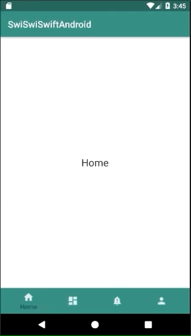

+++
title = "Fragmentsを入れ子にしたBottomNavigationを実装する"
url = "2018-11-13"
date = "2018-11-13"
description = "Fragmentsを入れ子にしたBottomNavigationを実装する"
tags = ["Android"]
categories = ["Android"]
archives = "2018/11"
+++

<br>

BottomNavigationはiOSのTabBarControllerによく似たAPIです。  
BottomNavigationのタブを選択するとFragmentが切り替わるサンプルコードです。  

参考にさせていただいたページ。  
[BottomNavigationView入門](https://qiita.com/neonankiti/items/8f5a4b9039914192a948)  
[Bottom Navigation Android Example using Fragments](https://www.simplifiedcoding.net/bottom-navigation-android-example/)  



<!-- Google Ads -->


<!-- Amazon Ads -->


<!--more-->

**DashboardFragment.kt**

```kotlin
package swiswiswift.com.swiswiswiftandroid

import android.os.Bundle
import android.support.v4.app.Fragment
import android.view.LayoutInflater
import android.view.View
import android.view.ViewGroup

class DashboardFragment : Fragment() {
    override fun onCreateView(inflater: LayoutInflater, container: ViewGroup?, savedInstanceState: Bundle?): View? {
        return inflater.inflate(R.layout.fragment_dashboard, null)
    }
}
```


**HomeFragment.kt**

```kotlin
package swiswiswift.com.swiswiswiftandroid

import android.os.Bundle
import android.support.v4.app.Fragment
import android.view.LayoutInflater
import android.view.View
import android.view.ViewGroup

class HomeFragment : Fragment() {
    override fun onCreateView(inflater: LayoutInflater, container: ViewGroup?, savedInstanceState: Bundle?): View? {
        return inflater.inflate(R.layout.fragment_home, null)
    }
}
```


**MainActivity.kt**

```kotlin
package swiswiswift.com.swiswiswiftandroid

import android.support.v7.app.AppCompatActivity
import android.os.Bundle
import android.support.design.widget.BottomNavigationView
import android.support.v4.app.Fragment
import android.view.MenuItem

class MainActivity : AppCompatActivity(), BottomNavigationView.OnNavigationItemSelectedListener {

    override fun onCreate(savedInstanceState: Bundle?) {
        super.onCreate(savedInstanceState)
        setContentView(R.layout.activity_main)

        //loading the default fragment
        loadFragment(HomeFragment())

        //getting bottom navigation view and attaching the listener
        val navigation = findViewById<BottomNavigationView>(R.id.navigation)
        navigation.setOnNavigationItemSelectedListener(this)
    }

    override fun onNavigationItemSelected(item: MenuItem): Boolean {
        var fragment: Fragment? = null

        when (item.getItemId()) {
            R.id.navigation_home -> fragment = HomeFragment()

            R.id.navigation_dashboard -> fragment = DashboardFragment()

            R.id.navigation_notifications -> fragment = NotificationsFragment()

            R.id.navigation_profile -> fragment = ProfileFragment()
        }

        return loadFragment(fragment)
    }

    private fun loadFragment(fragment: Fragment?): Boolean {
        //switching fragment
        if (fragment != null) {
            supportFragmentManager
                    .beginTransaction()
                    .replace(R.id.fragment_container, fragment!!)
                    .commit()
            return true
        }
        return false
    }
}
```


**NotificationsFragment.kt**

```kotlin
package swiswiswift.com.swiswiswiftandroid

import android.os.Bundle
import android.support.v4.app.Fragment
import android.view.LayoutInflater
import android.view.View
import android.view.ViewGroup

class NotificationsFragment : Fragment() {
    override fun onCreateView(inflater: LayoutInflater, container: ViewGroup?, savedInstanceState: Bundle?): View? {
        return inflater.inflate(R.layout.fragment_notifications, null)
    }
}
```


**ProfileFragment.kt**

```kotlin
package swiswiswift.com.swiswiswiftandroid

import android.os.Bundle
import android.support.v4.app.Fragment
import android.view.LayoutInflater
import android.view.View
import android.view.ViewGroup

class ProfileFragment : Fragment() {
    override fun onCreateView(inflater: LayoutInflater, container: ViewGroup?, savedInstanceState: Bundle?): View? {
        return inflater.inflate(R.layout.fragment_profile, null)
    }
}
```


**activity_main.xml**

```xml
<?xml version="1.0" encoding="utf-8"?>
<android.support.constraint.ConstraintLayout
    xmlns:android="http://schemas.android.com/apk/res/android"
    xmlns:tools="http://schemas.android.com/tools"
    xmlns:app="http://schemas.android.com/apk/res-auto"
    android:layout_width="match_parent"
    android:layout_height="match_parent"
    tools:context=".MainActivity">

    <FrameLayout
        android:id="@+id/fragment_container"
        android:layout_width="match_parent"
        android:layout_height="match_parent"
        android:layout_marginBottom="56dp"
        android:text="@string/navigation_home"
        app:layout_constraintLeft_toLeftOf="parent"
        app:layout_constraintTop_toTopOf="parent" />

    <android.support.design.widget.BottomNavigationView
        android:id="@+id/navigation"
        android:layout_width="0dp"
        android:layout_height="wrap_content"
        android:background="@color/colorPrimary"
        app:itemIconTint="@color/colorNavIcon"
        app:itemTextColor="@color/colorNavText"
        app:layout_constraintBottom_toBottomOf="parent"
        app:layout_constraintLeft_toLeftOf="parent"
        app:layout_constraintRight_toRightOf="parent"
        app:menu="@menu/navigation" />

</android.support.constraint.ConstraintLayout>
```


**build.gradle**

```gradle
apply plugin: 'com.android.application'

apply plugin: 'kotlin-android'

apply plugin: 'kotlin-android-extensions'

android {
    compileSdkVersion 28
    defaultConfig {
        applicationId "swiswiswift.com.swiswiswiftandroid"
        minSdkVersion 15
        targetSdkVersion 28
        versionCode 1
        versionName "1.0"
        testInstrumentationRunner "android.support.test.runner.AndroidJUnitRunner"
    }
    buildTypes {
        release {
            minifyEnabled false
            proguardFiles getDefaultProguardFile('proguard-android.txt'), 'proguard-rules.pro'
        }
    }
}

dependencies {
    implementation fileTree(dir: 'libs', include: ['*.jar'])
    implementation"org.jetbrains.kotlin:kotlin-stdlib-jdk7:$kotlin_version"
    implementation 'com.android.support:appcompat-v7:28.0.0'
    implementation 'com.android.support.constraint:constraint-layout:1.1.3'
    testImplementation 'junit:junit:4.12'
    androidTestImplementation 'com.android.support.test:runner:1.0.2'
    androidTestImplementation 'com.android.support.test.espresso:espresso-core:3.0.2'

    // BottomNavigationView
    implementation 'com.android.support:appcompat-v7:28.0.0'

    // MaterialIcon
    implementation 'com.android.support:design:28.0.0'
}
```


**colors.xml**

```xml
<?xml version="1.0" encoding="utf-8"?>
<resources>
    <color name="colorPrimary">#008577</color>
    <color name="colorPrimaryDark">#00574B</color>
    <color name="colorAccent">#D81B60</color>
    <color name="white">#FFF</color>
    <color name="colorNavIcon">#dae9f6</color>
    <color name="colorNavText">#01294b</color>
</resources>
```


**fragment_dashboard.xml**

```xml
<?xml version="1.0" encoding="utf-8"?>
<RelativeLayout xmlns:android="http://schemas.android.com/apk/res/android"
    android:layout_width="match_parent"
    android:layout_height="match_parent">

    <TextView
        android:layout_width="wrap_content"
        android:layout_height="wrap_content"
        android:layout_centerHorizontal="true"
        android:layout_centerVertical="true"
        android:text="@string/navigation_dashboard"
        android:textAppearance="@style/Base.TextAppearance.AppCompat.Large" />

</RelativeLayout>
```


**fragment_home.xml**

```xml
<?xml version="1.0" encoding="utf-8"?>
<RelativeLayout xmlns:android="http://schemas.android.com/apk/res/android"
    android:layout_width="match_parent"
    android:layout_height="match_parent">

    <TextView
        android:layout_width="wrap_content"
        android:layout_height="wrap_content"
        android:layout_centerHorizontal="true"
        android:layout_centerVertical="true"
        android:text="@string/navigation_home"
        android:textAppearance="@style/Base.TextAppearance.AppCompat.Large" />

</RelativeLayout>
```


**fragment_notifications.xml**

```xml
<?xml version="1.0" encoding="utf-8"?>
<RelativeLayout xmlns:android="http://schemas.android.com/apk/res/android"
    android:layout_width="match_parent"
    android:layout_height="match_parent">

    <TextView
        android:layout_width="wrap_content"
        android:layout_height="wrap_content"
        android:layout_centerHorizontal="true"
        android:layout_centerVertical="true"
        android:text="@string/navigation_notifications"
        android:textAppearance="@style/Base.TextAppearance.AppCompat.Large" />

</RelativeLayout>
```


**fragment_profile.xml**

```xml
<?xml version="1.0" encoding="utf-8"?>
<RelativeLayout xmlns:android="http://schemas.android.com/apk/res/android"
    android:layout_width="match_parent"
    android:layout_height="match_parent">

    <TextView
        android:layout_width="wrap_content"
        android:layout_height="wrap_content"
        android:layout_centerHorizontal="true"
        android:layout_centerVertical="true"
        android:text="@string/navigation_profile"
        android:textAppearance="@style/Base.TextAppearance.AppCompat.Large" />

</RelativeLayout>
```


**navigation.xml**

```xml
<?xml version="1.0" encoding="utf-8"?>
<menu xmlns:android="http://schemas.android.com/apk/res/android">
    <item
        android:id="@+id/navigation_home"
        android:icon="@drawable/ic_home_black_24dp"
        android:title="@string/navigation_home" />
    <item
        android:id="@+id/navigation_dashboard"
        android:icon="@drawable/ic_dashboard_black_24dp"
        android:title="@string/navigation_dashboard" />
    <item
        android:id="@+id/navigation_notifications"
        android:icon="@drawable/ic_notifications_black_24dp"
        android:title="@string/navigation_notifications" />
    <item
        android:id="@+id/navigation_profile"
        android:icon="@drawable/ic_profile_black_24dp"
        android:title="@string/navigation_profile" />
</menu>
```


**string.xm**

```logos
<resources>
    <string name="app_name">SwiSwiSwiftAndroid</string>
    <string name="navigation_home">Home</string>
    <string name="navigation_dashboard">Dashboard</string>
    <string name="navigation_notifications">Notification</string>
    <string name="navigation_profile">Profile</string>
</resources>
```

