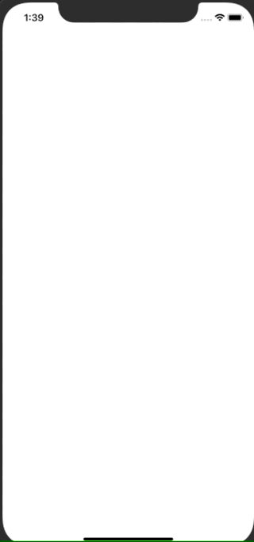

+++
title = "Alamofireを使ってAPIからJSONを取得する(Swift4.2)"
url = "2018-12-01"
date = "2018-12-01"
description = "Alamofireを使ってAPIからJSONを取得する(Swift4.2)"
tags = ["iOS", "Swift"]
categories = ["iOS"]
archives = "2018/12"
+++

<br>

古い記事(Swift3)は こちら Alamofireを使ってAPIからJSONを取得する

#Xcode 10.1  
#Swift 4.2  

swiftの有名な通信ライブラリであるAlamofireとこれまたSwiftで有名なJSONを扱うライブラリであるSwiftyJSONを使って、　お天気APIから情報を取得するサンプルです。  
今回のサンプルでは非同期でJSONを取得し、アラートを表示します。  
ATS の設定も必要なのでお忘れなく。  



<!-- Google Ads -->


<!-- Amazon Ads -->


<!--more-->

**ViewController.swift**

```swift
import UIKit
import Alamofire
import SwiftyJSON

class ViewController: UIViewController {
    override func viewDidLoad() {
        super.viewDidLoad()
        view.backgroundColor = UIColor.white

        //お天気APIから東京の天気を取得する
        let url: String = "http://weather.livedoor.com/forecast/webservice/json/v1?city=130010"
        Alamofire.request(url, method: .get, encoding: JSONEncoding.default).responseJSON { response in
            switch response.result {
            case .success:
                let json: JSON = JSON(response.result.value ?? kill)
                print(json)
                self.showWeatherAlert(title: json["title"].stringValue, message: json["description"]["text"].stringValue)
            case .failure(let error):
                print(error)
            }
        }
    }

    func showWeatherAlert(title: String, message: String) -> Void {

        // アラートを作成
        let alert = UIAlertController(
            title: title,
            message: message,
            preferredStyle: .alert)
        alert.addAction(UIAlertAction(title: "OK", style: .default))

        // アラート表示
        self.present(alert, animated: true, completion: nil)
    }
}
```

