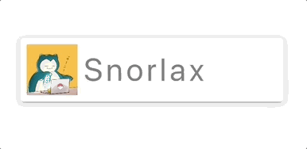

+++
title = "押すとクニュっとするボタンを実装する"
url = "2018-12-27"
date = "2018-12-27"
description = "押すとクニュっとするボタンを実装する"
tags = ["iOS", "Swift"]
categories = ["iOS"]
archives = "2018/12"
+++

<br>

#Swift 4.2  
押すとクニュっとするボタンのサンプルコードです。  
iOSでよくあるマイクロインタラクションです。  
僕はマイクロインタラクション大好きなんですが、エンジニアやデザイナーの自己満なんでしょうかね？  
わからんとです。   



<!-- Google Ads -->


<!-- Amazon Ads -->


<!--more-->

**CustomButton.swift**

```swift
import UIKit

class CustomButton: UIButton {
    private var width: CGFloat = 0
    private var height: CGFloat = 0
    private var margin: CGFloat = 8
    private var offset: CGFloat = 2

    private var thumbnail: UIImageView!
    private var label: UILabel!

    private var tapping: Bool = false

    required init?(coder aDecoder: NSCoder) {
        super.init(coder: aDecoder)
    }

    override init(frame: CGRect) {
        super.init(frame: frame)

        layer.masksToBounds = false
        layer.cornerRadius = 4
        layer.shadowOffset = CGSize(width: 0, height: 2)
        layer.shadowRadius = 4;
        layer.shadowOpacity = 0.4;
        backgroundColor = UIColor.init(named: "unTap")

        thumbnail = UIImageView()
        thumbnail.image = UIImage(named: "icon")
        thumbnail.layer.masksToBounds = false
        thumbnail.layer.cornerRadius = 4
        addSubview(thumbnail)

        label = UILabel()
        label.text = "Snorlax"
        label.textAlignment = .right
        label.textColor = .gray
        // label.font = UIFont.systemFont(ofSize: 40, weight: .light)
        label.font = UIFont.systemFont(ofSize: 40)
        addSubview(label)
    }

    override func layoutSubviews() {
        width = frame.width
        height = frame.height
        if tapping {
            onTapPosition()
        } else {
            unTapPosition()
        }
    }

    func unTapPosition() {
        let thmbnailSize = height - margin * 2
        thumbnail.frame = CGRect(x: margin, y: (height - thmbnailSize) / 2, width: thmbnailSize, height: thmbnailSize)

        let KernAttr = [NSAttributedString.Key.kern: 4]
        label.attributedText = NSMutableAttributedString(string: label.text!, attributes: KernAttr)
        let labelWidth = label.sizeThatFits(CGSize()).width
        label.frame = CGRect(x: height, y: 0, width: labelWidth, height: height)
    }

    func onTapPosition() {
        let thmbnailSize = height - (margin * 2)
        thumbnail.frame = CGRect(x: margin + offset, y: (height - thmbnailSize) / 2, width: thmbnailSize, height: thmbnailSize)

        let KernAttr = [NSAttributedString.Key.kern: 3.8]
        label.attributedText = NSMutableAttributedString(string: label.text!, attributes: KernAttr)
        let labelWidth = label.sizeThatFits(CGSize()).width
        label.frame = CGRect(x: height + offset, y: 0, width: labelWidth, height: height)
    }

    func unTap() {
        backgroundColor = UIColor.init(named: "unTap")
        tapping = false
        UIView.animate(withDuration: 0.2, delay: 0.0, options: [.curveLinear], animations: {
                self.unTapPosition()
            }, completion: nil)
    }

    func onTap() {
        backgroundColor = UIColor.init(named: "onTap")
        tapping = true
        UIView.animate(withDuration: 0.2, delay: 0.0, options: [.curveLinear], animations: {
                self.onTapPosition()
            }, completion: nil)
    }
}
```


**ViewController.swift**

```swift
import UIKit

class ViewController: UIViewController {
    var button: CustomButton!

    override func viewDidLoad() {
        super.viewDidLoad()

        view.backgroundColor = .white

        let width = view.frame.width
        let height = view.frame.height
        let buttonWidth = width * 0.8
        let buttonHeight: CGFloat = 80

        button = CustomButton()
        button.addTarget(self, action: #selector(touchUpInside(_:)), for: UIControl.Event.touchUpInside)
        button.addTarget(self, action: #selector(touchDown(_:)), for: UIControl.Event.touchDown)
        button.addTarget(self, action: #selector(touchDragExit(_:)), for: UIControl.Event.touchDragExit)
        button.setTitle("ボタンのテキスト", for: UIControl.State.normal)
        button.setTitleColor(.red, for: UIControl.State.normal)
        button.frame = CGRect(x: (width - buttonWidth) / 2, y: (height - buttonHeight) / 2, width: buttonWidth, height: buttonHeight)
        view.addSubview(button)
    }

    @objc func touchDown(_ sender: UIButton) {
        print("touchDown")
        (sender as! CustomButton).onTap()
    }

    @objc func touchUpInside(_ sender: UIButton) {
        print("touchUpInside")
        (sender as! CustomButton).unTap()
    }

    @objc func touchDragExit(_ sender: UIButton) {
        print("touchDragExit")
        (sender as! CustomButton).unTap()
    }
}
```

