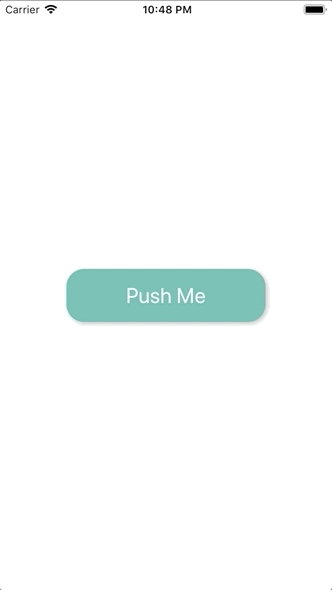

+++
title = "Lifesumアプリのインタラクションが素敵だったので再現してみた"
url = "2018-12-28"
date = "2018-12-28"
description = "Lifesumアプリのインタラクションが素敵だったので再現してみた"
tags = ["iOS", "Swift"]
categories = ["iOS"]
archives = "2018/12"
+++

<br>

#Swift4.2  
Lifesumというアプリの登録導線のインタラクションがとても素敵だったので再現してみました。  
インタラクションの凄さと登録導線離脱率の相関が気になりますね。  



<!-- Google Ads -->


<!-- Amazon Ads -->



<!--more-->

**AppDelegate.swift**

```swift
import UIKit

@UIApplicationMain
class AppDelegate: UIResponder, UIApplicationDelegate {

    var window: UIWindow?
    var navigationController: UINavigationController?

    func application(_ application: UIApplication, didFinishLaunchingWithOptions launchOptions: [UIApplication.LaunchOptionsKey: Any]?) -> Bool {

        self.window = UIWindow(frame: UIScreen.main.bounds)
        self.window!.makeKeyAndVisible()
        let firstViewController: FirstViewController? = FirstViewController()
        navigationController = UINavigationController(rootViewController: firstViewController!)
        navigationController?.setNavigationBarHidden(true, animated: false)
        window!.rootViewController = navigationController

        return true
    }

    func applicationWillResignActive(_ application: UIApplication) {
    }

    func applicationDidEnterBackground(_ application: UIApplication) {
    }

    func applicationWillEnterForeground(_ application: UIApplication) {
    }

    func applicationDidBecomeActive(_ application: UIApplication) {
    }

    func applicationWillTerminate(_ application: UIApplication) {
    }
}

```


**CustomButton.swift**

```swift
import UIKit

class CustomButton: UIButton {
    required init(coder aDecoder: NSCoder) {
        super.init(coder: aDecoder)!
    }

    override init(frame: CGRect) {
        super.init(frame: frame)
        backgroundColor = UIColor(named: "emerald")
        setTitleColor(UIColor.white, for: UIControl.State.normal)
        titleLabel?.font = UIFont.systemFont(ofSize: 24)
        layer.masksToBounds = false
        layer.cornerRadius = 20.0
        layer.shadowColor = UIColor.lightGray.cgColor
        layer.shadowOffset = CGSize(width: 2.0, height: 2.0)
        layer.shadowOpacity = 0.8
    }
}
```


**FirstViewController.swift**

```swift
import UIKit

class FirstViewController: UIViewController {

    override func viewDidLoad() {
        super.viewDidLoad()

        view.backgroundColor = .white
        let buttonHeight: CGFloat = 60

        let button = CustomButton()
        button.frame.size = CGSize(width: view.frame.width * 0.6, height: buttonHeight)
        button.addTarget(self, action: #selector(buttonTaped(sender:)), for: .touchUpInside)
        button.setTitle("Push Me", for: UIControl.State.normal)
        button.center = view.center
        view.addSubview(button)
    }

    @objc func buttonTaped(sender: UIButton) {
        navigationController?.pushViewController(SecondViewController(), animated: true)
    }
}
```


**SecondViewController.swift**

```swift
import UIKit

class SecondViewController: UIViewController {

    var width: CGFloat!
    var height: CGFloat!
    let buttonHeight: CGFloat = 60
    let radius: CGFloat = 100

    var button: CustomButton!

    override func viewDidLoad() {
        super.viewDidLoad()

        view.backgroundColor = .white
        width = view.frame.width
        height = view.frame.height

        //ボタンの生成
        button = CustomButton()
        button.frame.size = CGSize(width: width * 0.6, height: buttonHeight)
        button.center.x = view.frame.width / 2
        button.center.y = view.frame.height / 2 + 40
        button.addTarget(self, action: #selector(cornerCircleButtonClicked(sender:)), for: .touchUpInside)
        button.setTitle("Show Snorlax", for: UIControl.State.normal)
        button.alpha = 0.3
        button.isEnabled = false
        view.addSubview(button)

        // 起動直後のアニメーション
        UIView.animate(withDuration: 0.3, delay: 0.1, options: [.curveLinear], animations: {
                self.button.isEnabled = true
                self.button.alpha = 1.0
                self.button.center = self.view.center
                self.button.frame.size = CGSize(width: self.width * 0.6, height: self.buttonHeight)
            }, completion: nil)
    }

    //角丸ボタンが押されたら呼ばれます
    @objc func cornerCircleButtonClicked(sender: UIButton) {
        button.setTitle("", for: .normal)
        // 丸くするアニメーション
        UIView.animate(withDuration: 0.2, delay: 0.0, options: [.curveLinear], animations: {
                self.button.layer.cornerRadius = self.radius / 2
                self.button.frame.size = CGSize(width: self.radius, height: self.radius)
                self.button.center = self.view.center
            }, completion: { _ in
                //  広がっていくアニメーション
                UIView.animate(withDuration: 0.2, delay: 0.1, options: [.curveLinear], animations: {
                        self.button.layer.cornerRadius = self.width
                        self.button.frame.size = CGSize(width: self.height * 1.5, height: self.height * 1.5)
                        self.button.center = self.view.center
                    }, completion: { _ in
                        self.pushViewController()
                    })
            })
    }

    func pushViewController() {
        // 画面遷移のアニメーション
        let transition = CATransition()
        transition.duration = 0.5
        transition.timingFunction = CAMediaTimingFunction(name: CAMediaTimingFunctionName.easeIn)
        transition.type = CATransitionType.fade
        self.navigationController?.view.layer.add(transition, forKey: nil)
        let viewController = ThirdViewController()
        self.navigationController?.pushViewController(viewController, animated: false)
    }
}
```


**ThirdViewController.swift**

```swift
import UIKit

class ThirdViewController: UIViewController {

    override func viewDidLoad() {
        super.viewDidLoad()
        
        view.backgroundColor = .white
        let imageView = UIImageView()
        imageView.frame = view.frame
        imageView.image = UIImage(named: "icon")
        view.addSubview(imageView)
    }
}
```

