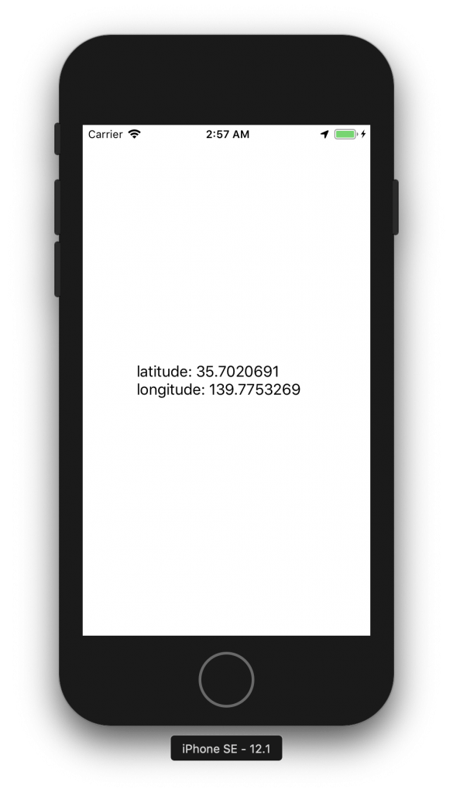

+++
title = "アプリ使用中に位置情報を取得する"
url = "2018-12-29"
date = "2018-12-29"
description = "アプリ使用中に位置情報を取得する"
tags = ["iOS", "Swift"]
categories = ["iOS"]
archives = "2019/01"
+++

<br>

#Swift 4.2

アプリ使用中に緯度と経度を取得するサンプルコードです。  
端末の緯度と経度が変わるとラベル文字列が更新されます。

参考  
[[iOS] 位置情報の取得 (Swift3編)](https://dev.classmethod.jp/smartphone/ios-corelocation-swift3/)  
[【CoreLocation】位置情報を取得する](https://qiita.com/chino_tweet/items/db3a536234a43a3c31d9)  

LocationManagerを使用する場合は、「位置情報を利用する目的」をInfo.plistに記載する必要があります。  

起動中のみ位置情報を取得する場合

`NSLocationWhenInUseUsageDescription`  
`このアプリは、マップで道案内するため、位置情報を取得します`

常に位置情報を取得する場合

`NSLocationAlwaysUsageDescription`  
`åこのアプリは、移動距離取得のため、常に位置情報を取得します`

位置情報が変更されるとラベルに文字が表示されます。



<!-- Google Ads -->


<!-- Amazon Ads -->


<!--more-->

**LocationViewController.swift**

```swift
import UIKit
import CoreLocation

class LocationViewController: UIViewController, CLLocationManagerDelegate {

    var locationManager: CLLocationManager!
    var label: UILabel!

    override func viewDidLoad() {
        super.viewDidLoad()
        view.backgroundColor = .white

        // 緯度、経度表示用のラベル
        label = UILabel()
        label.frame.size = CGSize(width: 200, height: 120)
        label.center = view.center
        label.numberOfLines = 0
        view.addSubview(label)

        locationManager = CLLocationManager()
        locationManager.requestWhenInUseAuthorization()
        let status = CLLocationManager.authorizationStatus()
        switch status {
        case .restricted, .denied:
            print("拒否されている")
            break
        case .notDetermined:
            locationManager.delegate = self
            locationManager.distanceFilter = 10
            locationManager.startUpdatingLocation()
        case .authorizedWhenInUse, .authorizedAlways:
            locationManager.delegate = self
            locationManager.distanceFilter = 10
            locationManager?.startUpdatingLocation()
        default:
            break
        }
    }

    // 緯度経度に変更があったら呼ばれる
    func locationManager(_ manager: CLLocationManager, didUpdateLocations locations: [CLLocation]) {
        let location = locations.first
        let latitude = location?.coordinate.latitude
        let longitude = location?.coordinate.longitude

        print("latitude: \(latitude!)\nlongitude: \(longitude!)")
        label.text = "latitude: \(latitude!)\nlongitude: \(longitude!)"
    }
}

```

