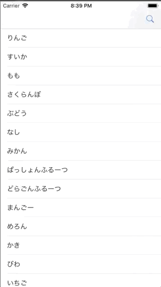

+++
title = "UITableViewの中身をUISearchBarで検索する(Swift4)"
url = "2018-12-30"
date = "2018-12-30"
description = "UITableViewの中身をUISearchBarで検索する(Swift4)"
tags = ["iOS", "Swift", "UIKit"]
categories = ["iOS"]
archives = "2019/01"
+++

<br>


#Swift4.2

UITableViewとUISearchBarを組み合わせたサンプルです。
ナビゲーションバーにある虫眼鏡を押すとSearchBarが現れ、そこに文字を入力することで検索結果が表示されます。

Swift3　での記事はこちら



<!-- Google Ads -->


<!-- Amazon Ads -->



<!--more-->

**SearchTableViewController.swift**

```swift
import UIKit

class SearchTableViewController: UIViewController, UISearchBarDelegate, UITableViewDelegate, UITableViewDataSource {

    //SearchBarインスタンス
    private var mySearchBar: UISearchBar!

    //テーブルビューインスタンス
    private var myTableView: UITableView!

    //テーブルビューに表示する配列
    private var items: Array<String> = []

    //検索結果が入る配列
    private var searchResult: Array<String> = []

    // SearchBarの高さ
    private var searchBarHeight: CGFloat = 44

    // SafeAreaの高さ
    var topSafeAreaHeight: CGFloat = 0

    override func viewDidLoad() {
        super.viewDidLoad()

        view.backgroundColor = .white

        //テーブルビューに表示する配列
        items = ["りんご", "すいか", "もも", "さくらんぼ", "ぶどう", "なし", "みかん", "ぱっしょんふるーつ", "どらごんふるーつ", "まんごー", "めろん", "かき", "びわ", "いちご", "らいち", "らーめん", "すてーき", "ゆず", "れもん", "さくらもち", "ぷりん", "ぜりー"]
        searchResult = items

        // MARK: NavigationBar関連
        //タイトル、虫眼鏡ボタンの作成
        let myNavItems = UINavigationItem()
        myNavItems.title = "検索付きテーブルビュー"
        let rightNavBtn = UIBarButtonItem(barButtonSystemItem: .search, target: self, action: #selector(rightBarBtnClicked(sender:)))
        rightNavBtn.action = #selector(rightBarBtnClicked(sender:))
        self.navigationItem.rightBarButtonItem = rightNavBtn

        // MARK: SearchBar関連
        //SearchBarの作成
        mySearchBar = UISearchBar()
        //デリゲートを設定
        mySearchBar.delegate = self
        //大きさの指定
        mySearchBar.frame = CGRect(x: 0, y: 0, width: view.frame.width, height: searchBarHeight)
        //キャンセルボタンの追加
        mySearchBar.showsCancelButton = true

        // MARK: TableView関連
        //テーブルビューの初期化
        myTableView = UITableView()
        //デリゲートの設定
        myTableView.delegate = self
        myTableView.dataSource = self
        //テーブルビューの大きさの指定
        myTableView.frame = view.frame
        //先ほど作成したSearchBarを作成
        myTableView.tableHeaderView = mySearchBar
        //サーチバーの高さだけ初期位置を下げる
        myTableView.contentOffset = CGPoint(x: 0, y: searchBarHeight)

        //テーブルビューの設置
        myTableView.register(UITableViewCell.self, forCellReuseIdentifier: NSStringFromClass(UITableViewCell.self))
        view.addSubview(myTableView)
    }

    override func viewDidLayoutSubviews() {
        super.viewDidLayoutSubviews()
        // viewDidLayoutSubviewsではSafeAreaの取得ができている
        topSafeAreaHeight = view.safeAreaInsets.top
        print(topSafeAreaHeight)
    }

    //MARK: - ナビゲーションバーの右の虫眼鏡が押されたら呼ばれる
    @objc func rightBarBtnClicked(sender: UIButton) {
        // 一瞬で切り替わると不自然なのでアニメーションを付与する
        UIView.animate(withDuration: 0.1, delay: 0.0, options: [.curveLinear], animations: {
                self.myTableView.contentOffset = CGPoint(x: 0, y: -self.topSafeAreaHeight)
            }, completion: nil)
    }

    //MARK: - 渡された文字列を含む要素を検索し、テーブルビューを再表示する
    func searchItems(searchText: String) {
        //要素を検索する
        if searchText != "" {
            searchResult = items.filter { item in
                return item.contains(searchText)
            } as Array
        } else {
            //渡された文字列が空の場合は全てを表示
            searchResult = items
        }
        //tableViewを再読み込みする
        myTableView.reloadData()
    }

    // MARK: - Search Bar Delegate Methods
    // テキストが変更される毎に呼ばれる
    func searchBar(_ searchBar: UISearchBar, textDidChange searchText: String) {
        //検索する
        searchItems(searchText: searchText)
    }

    // キャンセルボタンが押されると呼ばれる
    func searchBarCancelButtonClicked(_ searchBar: UISearchBar) {
        searchBar.text = ""
        view.endEditing(true)
        searchResult = items
        //tableViewを再読み込みする
        myTableView.reloadData()
    }

    // Searchボタンが押されると呼ばれる
    func searchBarSearchButtonClicked(_ searchBar: UISearchBar) {
        view.endEditing(true)
        //検索する
        searchItems(searchText: searchBar.text! as String)
    }

    // MARK: - TableView Delegate Methods
    // テーブルビューのセルの数を設定する
    func tableView(_ tableView: UITableView, numberOfRowsInSection section: Int) -> Int {
        //テーブルビューのセルの数はmyItems配列の数とした
        return searchResult.count
    }

    // テーブルビューのセルの中身を設定する
    func tableView(_ tableView: UITableView, cellForRowAt indexPath: IndexPath) -> UITableViewCell {
        //myItems配列の中身をテキストにして登録した
        let cell: UITableViewCell = tableView.dequeueReusableCell(withIdentifier: NSStringFromClass(UITableViewCell.self))! as UITableViewCell
        cell.textLabel?.text = self.searchResult[indexPath.row]
        return cell
    }

    // テーブルビューのセルが押されたら呼ばれる
    func tableView(_ tableView: UITableView, didSelectRowAt indexPath: IndexPath) {
        print(searchResult[indexPath.row])
    }
}
```

