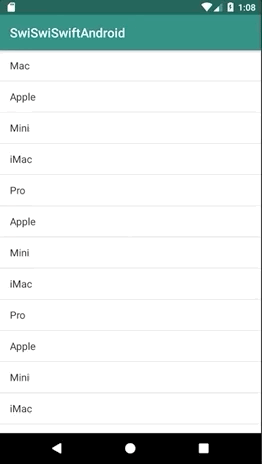

+++
title = "ListViewを使ってリスト表示する(Kotlin)"
url = "2019-01-08"
date = "2019-01-08"
description = "ListViewを使ってリスト表示する(Kotlin)"
tags = ["Android"]
categories = ["Android"]
archives = "2019/01"
+++

<br>

ListViewを使ってリストの表示を行います。
Kotlin 、Android は設定ファイルが多くて難しいです。




<!-- Google Ads -->


<!-- Amazon Ads -->


<!--more-->

**MainActivity.kt**

```kotlin
package swiswiswift.com.swiswiswiftandroid

import android.support.v7.app.AppCompatActivity
import android.os.Bundle
import android.widget.ArrayAdapter
import android.widget.ListView

class MainActivity : AppCompatActivity() {
    private var listView: ListView? = null

    override fun onCreate(savedInstanceState: Bundle?) {
        super.onCreate(savedInstanceState)
        setContentView(R.layout.activity_main)
        val titles = arrayListOf(
            "Mac",
            "Apple",
            "Mini",
            "iMac",
            "Pro",
            "Apple",
            "Mini",
            "iMac",
            "iPhone",
            "Watch",
            "Google Home",
            "Alexa",
            "Pro"
        )

        this.listView = findViewById(R.id.listView)
        val adapter = ArrayAdapter<String>(this, android.R.layout.simple_list_item_1, titles)
        listView!!.adapter = adapter
    }
}
```


**activity_main.xml**

```xml
<?xml version="1.0" encoding="utf-8"?>
<android.support.constraint.ConstraintLayout
        xmlns:android="http://schemas.android.com/apk/res/android"
        xmlns:tools="http://schemas.android.com/tools"
        android:layout_width="match_parent"
        android:layout_height="match_parent"
        tools:context=".MainActivity">
    <ListView
            android:id="@+id/listView"
            android:layout_width="match_parent"
            android:layout_height="match_parent"/>

</android.support.constraint.ConstraintLayout>
```

