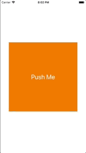

+++
title = "ImagePickerControllerで画像を選択する(Swift4.2)"
url = "2019-01-11"
date = "2019-01-11"
description = "ImagePickerControllerで画像を選択する(Swift4.2)"
tags = ["iOS", "Swift", "UIKit"]
categories = ["iOS"]
archives = "2019/01"
+++

<br>

`# Swift 4.2`

Swift3の記事はこちら  
UIImagePickerControllerで画像の選択

iPhoneのフォトライブラリから画像を取得するサンプルプログラムです。  
フォトライブラリから画像を選択するために、プロジェクトの info.plistにフォトライブラリを使用する旨を記述します。  
これを書いておかないとUIImagePickerControllerは使えません。  
キーの値は以下の値を使います。  
`NSPhotoLibraryUsageDescription`
TypeはStringでValueの中に使用理由を書きます。  
使用理由を書かないと審査の時に落とされるらしいです。  



<!-- Google Ads -->


<!-- Amazon Ads -->


<!--more-->

**ImagePickerViewController.swift**

```swift
import UIKit

class ImagePickerViewController: UIViewController, UIImagePickerControllerDelegate, UINavigationControllerDelegate {

    var picker: UIImagePickerController!
    var button: UIButton!

    override func viewDidLoad() {
        super.viewDidLoad()

        view.backgroundColor = .white

        picker = UIImagePickerController()
        picker.delegate = self
        picker.sourceType = UIImagePickerController.SourceType.photoLibrary
        picker.allowsEditing = true // Whether to make it possible to edit the size etc after selecting the image
        // set picker's navigationBar appearance
        picker.view.backgroundColor = .white
        picker.navigationBar.isTranslucent = false
        picker.navigationBar.barTintColor = .blue
        picker.navigationBar.tintColor = .white
        picker.navigationBar.titleTextAttributes = [
            NSAttributedString.Key.foregroundColor: UIColor.white
        ] // Title color

        button = UIButton()
        button.addTarget(self, action: #selector(touchUpInside(_:)), for: UIControl.Event.touchUpInside)
        let size = view.frame.width * 0.8
        button.setTitle("Push Me", for: UIControl.State.normal)
        button.frame.size = CGSize(width: size, height: size)
        button.titleLabel?.font = UIFont.systemFont(ofSize: 28)
        button.center = view.center
        button.backgroundColor = .orange
        view.addSubview(button)
    }

    @objc func touchUpInside(_ sender: UIButton) {
        // show picker modal
        present(picker, animated: true, completion: nil)
    }

    // MARK: ImageVicker Delegate Methods
    // called when image picked
    func imagePickerController(_ picker: UIImagePickerController, didFinishPickingMediaWithInfo info: [UIImagePickerController.InfoKey: Any]) {
        if let editedImage = info[UIImagePickerController.InfoKey.editedImage] as? UIImage {
            button.setBackgroundImage(editedImage, for: .normal)
        } else if let originalImage = info[UIImagePickerController.InfoKey.originalImage] as? UIImage {
            button.setBackgroundImage(originalImage, for: .normal)
        }
        dismiss(animated: true, completion: nil)
    }

    // called when cancel select image
    func imagePickerControllerDidCancel(_ picker: UIImagePickerController) {
        // close picker modal
        dismiss(animated: true, completion: nil)
    }
}
```

