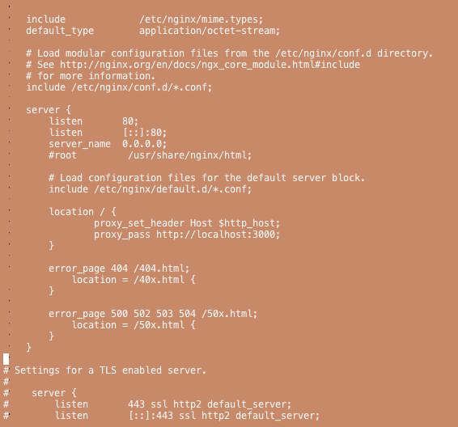

+++
title = "CentOS7にRailsをインストールする"
url = "2019-01-14"
date = "2019-01-14"
description = "CentOS7にRailsをインストールする"
tags = ["CentOS", "Linux", "Rails", "Ruby"]
categories = ["Linux", "Rails", "Ruby"]
archives = "2019/01"
+++

<br>

CentOS7にRailsをインストールした時のメモになります。  
最終的なNginxの　nginx.conf ファイルはこちらになります。



<!-- Google Ads -->


<!-- Amazon Ads -->


<!--more-->

**install.md**

````markdown
#### Login
```
$ ssh root@IP_ADRESS 
```

#### Update OS
```
$ yum update
```

#### Add user kabigon
```
$ adduser kabigon
$ passwd kabigon
# enter password
```

#### Logout
```
$ exit
```

#### Login
```
$ ssh kabigon@IP_ADRESS
```

#### Switch to root
```
$ su -
```

#### Prohibit root login
```
$ cd /etc/ssh
$ cp sshd_config sshd_config.old
$ vim sshd_config
```

#### Prohibit root login
#### It is described around the 45th line
``` 
PermitRootLogin yes -> PermitRootLogin no
```

#### Restart sshd service
``` 
$ systemctl restart sshd.service
``` 

#### Confirm that you can not log in as root
``` 
$ exit
$ ssh root@IP_ADRESS 
# can not login
``` 

#### Install rbenv dependency package
#### Some are unnecessary depending on the environment
``` 
$ yum -y install openssl-devel readline-devel zlib-devel libcurl-devel make openssl-devel
$ yum -y install gcc-c++ glibc-headers openssl-devel readline libyaml-devel readline-devel zlib
$ yum -y install git gcc make openssl-devel libffi-devel sqlite sqlite-devel nodejs
``` 

#### Install rbenv
``` 
$ cd /opt
$ git clone https://github.com/rbenv/rbenv.git
``` 

#### Install ruby-build
``` 
$ mkdir /opt/rbenv/plugins
$ cd /opt/rbenv/plugins
$ git clone https://github.com/rbenv/ruby-build.git
``` 

##### Setting path
``` 
$ cat << 'EOS' > /etc/profile.d/rbenv.sh
export RBENV_ROOT="/opt/rbenv"
export PATH="${RBENV_ROOT}/bin:${PATH}"
eval "$(rbenv init -)"
EOS
``` 

#### Reload shell
``` 
exec $SHELL -l
``` 

#### Install ruby
``` 
$ rbenv install 2.5.1
$ rbenv global 2.5.1
$ ruby -v
``` 

#### Install rails
``` 
$ gem install rails
$ cd
$ rails new myApp
$ cd myApp
``` 

#### Run background
``` 
$ rails s
$ control + z
$ jobs
$ bg 1
$ curl localhost:3000
``` 

#### Install nginx
``` 
yum -y install nginx
systemctl enable nginx.service
systemctl start nginx.service
systemctl status nginx.service
``` 

#### Configure firewall
``` 
$ firewall-cmd --add-service=http --permanent
$ firewall-cmd --reload
``` 

#### Configure nginx
``` 
$ cd /etc/nginx
$ vi nginx.conf
``` 

``` 
listen          80;
listen          [::]:80;
servername      0.0.0.0;

...

location / {
        proxy_pass http://localhost:3000;
}
``` 

#### Restart nginx
``` 
$ systemctl restart nginx.service
``` 

````

