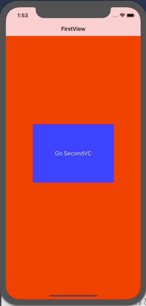

+++
title = "NavigationControllerで画面遷移を行う（Swift4.2）"
url = "2019-01-21"
date = "2019-01-21"
description = "NavigationControllerで画面遷移を行う（Swift4.2）"
tags = ["iOS", "Swift", "UIKit"]
categories = ["iOS", "Swift"]
archives = "2019/01"
+++

<br>
#Swift4.2

NavigationContorollerのサンプルコードです。  
NavigationContorollerは横にニュッと動いて画面遷移をします。  



<!-- Google Ads -->


<!-- Amazon Ads -->


<!--more-->

**AppDelegate.swift**

```swift
import UIKit

@UIApplicationMain
class AppDelegate: UIResponder, UIApplicationDelegate {

    var window: UIWindow?
    var navigationController: UINavigationController?

    func application(_ application: UIApplication, didFinishLaunchingWithOptions launchOptions: [UIApplication.LaunchOptionsKey: Any]?) -> Bool {
        self.window = UIWindow(frame: UIScreen.main.bounds)
        self.window!.makeKeyAndVisible()
        let firstViewController: FirstSwitchNavigationViewController? = FirstSwitchNavigationViewController()
        navigationController = UINavigationController(rootViewController: firstViewController!)
        window!.rootViewController = navigationController
        return true
    }

    func applicationWillResignActive(_ application: UIApplication) {
    }

    func applicationDidEnterBackground(_ application: UIApplication) {
    }

    func applicationWillEnterForeground(_ application: UIApplication) {
    }

    func applicationDidBecomeActive(_ application: UIApplication) {
    }

    func applicationWillTerminate(_ application: UIApplication) {
    }
}

```


**FirstSwitchNavigationViewController.swift**

```swift
import UIKit

class FirstSwitchNavigationViewController: UIViewController {
    
    override func viewDidLoad() {
        super.viewDidLoad()
        
        title = "FirstView"
        view.backgroundColor = UIColor.red
        
        let width = view.frame.width
        let height = view.frame.height
        
        let transitionBtn = UIButton()
        transitionBtn.frame.size = CGSize(width: width * 0.6, height: height * 0.2)
        transitionBtn.center = view.center
        transitionBtn.backgroundColor = UIColor.blue
        transitionBtn.setTitle("Switch to SecondVC", for: UIControl.State.normal)
        transitionBtn.addTarget(self, action: #selector(goSevondVC(sender:)), for:.touchUpInside)
        view.addSubview(transitionBtn)
    }
    
    @objc internal func goSevondVC(sender: UIButton){
        let secondVC = SecondSwitchNavigationViewController()
        navigationController?.setViewControllers([secondVC], animated: true)
    }
}
```


**SecondSwitchNavigationViewController.swift**

```swift
import UIKit

class SecondSwitchNavigationViewController: UIViewController {
    
    override func viewDidLoad() {
        super.viewDidLoad()
        
        title = "SecondView"
        view.backgroundColor = UIColor.blue
        
        let width = view.frame.width
        let height = view.frame.height
        
        let transitionBtn = UIButton()
        transitionBtn.frame.size = CGSize(width: width * 0.6, height: height * 0.2)
        transitionBtn.center = view.center
        transitionBtn.backgroundColor = UIColor.green
        transitionBtn.setTitle("Switch to FirstVC", for: UIControl.State.normal)
        transitionBtn.setTitleColor(UIColor.black, for: UIControl.State.normal)
        transitionBtn.addTarget(self, action: #selector(backToFirstVC(sender:)), for:.touchUpInside)
        view.addSubview(transitionBtn)
    }
    
    @objc internal func backToFirstVC(sender: UIButton){
        let firstVC = FirstSwitchNavigationViewController()
        navigationController?.setViewControllers([firstVC], animated: true)
    }
}
```

