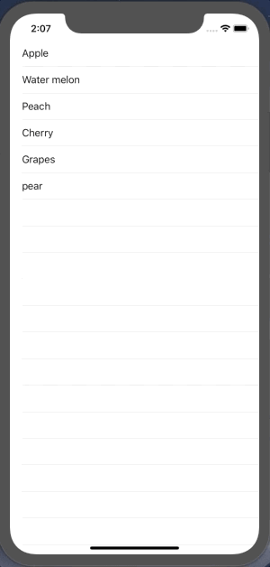

+++
title = "UITableViewでテーブルにアイテムを表示（Swift4.2）"
url = "2019-01-22"
date = "2019-01-22"
description = "UITableViewでテーブルにアイテムを表示（Swift4.2）"
tags = ["iOS", "Swift", "UIKit"]
categories = ["iOS", "Swift"]
archives = "2019/02"
+++

<br>
UITableViewはリストのような形でテキストを表示するクラスです。データ一覧などを表示する時などに役立ちます。

UITableViewのクラス階層

NSObject
↑
UIResponder
↑
UIView
↑
UIScrollView
↑
UITableView

[AppleDeveloperリファレンスUITableView](https://developer.apple.com/documentation/uikit/uitableview)



<!-- Google Ads -->


<!-- Amazon Ads -->


<!--more-->

**TableViewController.swift**

```swift
import UIKit

class TableViewController: UIViewController, UITableViewDelegate, UITableViewDataSource {

    // tableview instance
    private var tableView: UITableView!

    // Array to display tableview
    private var items: [String] = []

    override func viewDidLoad() {
        super.viewDidLoad()

        items = ["Apple", "Water melon", "Peach", "Cherry", "Grapes", "pear"]

        // initialize tableview
        tableView = UITableView()

        // set delegate
        tableView.delegate = self
        tableView.dataSource = self

        // set tableview size
        tableView.frame = view.frame

        // set tableview
        tableView.register(UITableViewCell.self, forCellReuseIdentifier: NSStringFromClass(UITableViewCell.self))
        view.addSubview(tableView)
    }

    // MARK: tableview delegate methods
    // set the number of rows
    func tableView(_ tableView: UITableView, numberOfRowsInSection section: Int) -> Int {
        return items.count
    }

    // set tableview rows
    func tableView(_ tableView: UITableView, cellForRowAt indexPath: IndexPath) -> UITableViewCell {
        let cell = tableView.dequeueReusableCell(withIdentifier: NSStringFromClass(UITableViewCell.self))! as UITableViewCell
        cell.textLabel?.text = self.items[indexPath.row]
        return cell
    }

    // called when tableview cell was tapped
    func tableView(_ tableView: UITableView, didSelectRowAt indexPath: IndexPath) {
        print("\(indexPath.row) cell was selected")
    }
}
```

