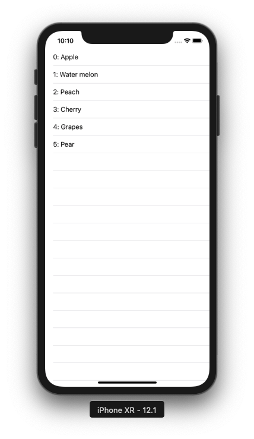

+++
title = "ローカルのJsonファイルをParseしてテーブルビューに表示する(Swift4.2)"
url = "2019-01-27"
date = "2019-01-27"
description = "ローカルのJsonファイルをParseしてテーブルビューに表示する(Swift4.2)"
tags = ["iOS", "Swift"]
categories = ["iOS"]
archives = "2019/01"
+++

<br>

ローカルに追加したJsonファイルをパースし、TableViewに表示するサンプルコードです。  
SwiftyJsonなどを使うともっと良い感じにかけますが、今回は使わないで書いてみました。



<!-- Google Ads -->


<!-- Amazon Ads -->


<!--more-->

**ViewController_20190128.swift**

```swift
import UIKit

class ViewController_20190128: UIViewController, UITableViewDelegate, UITableViewDataSource {

    // tableview instance
    private var tableView: UITableView!

    // Item Struct
    struct Item {
        var id: Int
        var name: String
    }
    
    // Array to display tableview
    private var items: [Item] = []

    override func viewDidLoad() {
        super.viewDidLoad()

        // parse json files
        if let path = Bundle.main.path(forResource: "json_20190128", ofType: "json") {
            do {
                let data = try Data(contentsOf: URL(fileURLWithPath: path), options: .mappedIfSafe)
                let jsonResult = try JSONSerialization.jsonObject(with: data, options: .mutableLeaves)
                guard let json = jsonResult as? Dictionary<String, AnyObject>, let dics = json["data"] else {
                    return
                }
                let array = dics as! [Dictionary<String, AnyObject>]
                for content in array {
                    let id = content["id"] as! Int
                    let name = content["name"] as! String
                    items.append(Item(id: id, name: name))
                }
            } catch {
                print("error")
            }
        }

        // initialize tableview
        tableView = UITableView()

        // set delegate
        tableView.delegate = self
        tableView.dataSource = self

        // set tableview size
        tableView.frame = view.frame

        // set tableview
        tableView.register(UITableViewCell.self, forCellReuseIdentifier: NSStringFromClass(UITableViewCell.self))
        view.addSubview(tableView)
    }

    // MARK: tableview delegate methods
    // set the number of rows
    func tableView(_ tableView: UITableView, numberOfRowsInSection section: Int) -> Int {
        return items.count
    }

    // set tableview rows
    func tableView(_ tableView: UITableView, cellForRowAt indexPath: IndexPath) -> UITableViewCell {
        let cell = tableView.dequeueReusableCell(withIdentifier: NSStringFromClass(UITableViewCell.self))! as UITableViewCell
        cell.textLabel?.text = "\(items[indexPath.row].id): " + items[indexPath.row].name
        return cell
    }

    // called when tableview cell was tapped
    func tableView(_ tableView: UITableView, didSelectRowAt indexPath: IndexPath) {
        print("\(indexPath.row) cell was selected")
    }
}
```


**json_20190128.json**

```json
{
    "data": [{
        "id": 0,
        "name": "Apple"
    },
    {
        "id": 1,
        "name": "Water melon"
    },
    {
        "id": 2,
        "name": "Peach"
    },
    {
        "id": 3,
        "name": "Cherry"
    },
    {
        "id": 4,
        "name": "Grapes"
    },
    {
        "id": 5,
        "name": "Pear"
    }
    ]
}
```

