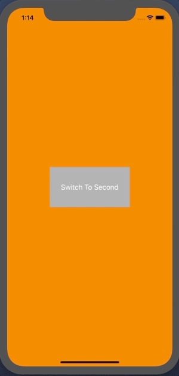

+++
title = "RootViewController をアニメーション付きで切り替える(Swift4.2)"
url = "2019-02-01"
date = "2019-02-01"
description = "RootViewController をアニメーション付きで切り替える(Swift4.2)"
tags = ["iOS", "Swift", "UIKit"]
categories = ["iOS"]
archives = "2019/02"
+++

<br>

RootViewController をアニメーション付きで切り替えるサンプルコードです。  
チュートリアルの後とかでの使用を想定しています。



<!-- Google Ads -->


<!-- Amazon Ads -->


<!--more-->

**AppDelegate.swift**

```swift
import UIKit

@UIApplicationMain
class AppDelegate: UIResponder, UIApplicationDelegate {
    
    var window: UIWindow?
    
    func application(_ application: UIApplication, didFinishLaunchingWithOptions launchOptions: [UIApplication.LaunchOptionsKey: Any]?) -> Bool {
        self.window = UIWindow(frame: UIScreen.main.bounds)
        self.window!.makeKeyAndVisible()
        window!.rootViewController = FirstViewController_20190130()
        return true
    }
    
    func switchViewController(viewController: UIViewController) {
        UIView.transition(with: self.window!, duration: 0.5, options: .transitionCrossDissolve, animations: {
            let oldState: Bool = UIView.areAnimationsEnabled
            UIView.setAnimationsEnabled(false)
            self.window?.rootViewController = viewController
            UIView.setAnimationsEnabled(oldState)
        }, completion: nil)
    }
    
    func applicationWillResignActive(_ application: UIApplication) {
    }
    
    func applicationDidEnterBackground(_ application: UIApplication) {
    }
    
    func applicationWillEnterForeground(_ application: UIApplication) {
    }
    
    func applicationDidBecomeActive(_ application: UIApplication) {
    }
    
    func applicationWillTerminate(_ application: UIApplication) {
    }
}

```


**FirstViewController_20190130.swift**

```swift
import UIKit

class FirstViewController_20190130: UIViewController {
    
    override func viewDidLoad() {
        super.viewDidLoad()
        
        view.backgroundColor = .orange
        let button = UIButton()
        button.frame.size = CGSize(width: 200, height: 100)
        button.center = view.center
        print(button.frame)
        button.backgroundColor = .lightGray
        button.setTitle("Switch To Second", for: .normal)
        button.addTarget(self, action: #selector(switchToSecond(sender:)), for:.touchUpInside)
        view.addSubview(button)
    }
    
    @objc func switchToSecond(sender: UIButton) {
        let appDelegate = UIApplication.shared.delegate as! AppDelegate
        appDelegate.switchViewController(viewController: SecondViewController_20190130())
    }
}
```


**SecondViewController_20190130.swift**

```swift
import UIKit

class SecondViewController_20190130: UIViewController {
    
    override func viewDidLoad() {
        super.viewDidLoad()

        view.backgroundColor = .lightGray
        let button = UIButton()
        button.frame.size = CGSize(width: 200, height: 100)
        button.center = view.center
        button.backgroundColor = .orange
        button.setTitle("Switch To First", for: .normal)
        button.addTarget(self, action: #selector(switchToFirst(sender:)), for:.touchUpInside)
        view.addSubview(button)
    }
    
    @objc func switchToFirst(sender: UIButton) {
        let appDelegate = UIApplication.shared.delegate as! AppDelegate
        appDelegate.switchViewController(viewController: FirstViewController_20190130())
    }
}
```

