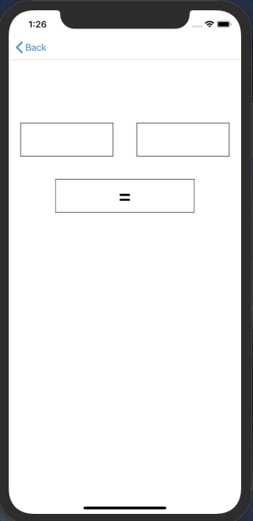
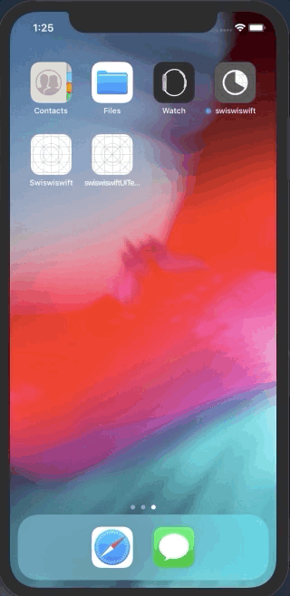

+++
title = "iOSでUITest（E2Eテスト）を行う(Swift5.0)"
url = "2019-04-11"
date = "2019-04-11"
description = "iOSでUITest（E2Eテスト）を行う(Swift5.0)"
tags = ["iOS", "Swift"]
categories = ["iOS"]
archives = "2019/04"
+++

<br>
Swift でUITest を行うサンプルコードです。  
左右のテキストフィールドに数字を入れ、ボタンを押すとその積を計算するアプリを作りました。  

そしてそのアプリのUITest を実装しました。  

参考: [【Swift】初めてのUITest導入](https://qiita.com/taji-taji/items/c00e5b94376c37f17443)




<!-- Google Ads -->


<!-- Amazon Ads -->


<!--more-->

**UITestSample_20190404.swift**

```swift
import UIKit

class UITestSample_20190404: UIViewController {

    var leftValueTextField: UITextField!
    var rightValueTextField: UITextField!
    var resultButton: UIButton!
    var resultLabel: UILabel!
    
    override func viewDidLoad() {
        super.viewDidLoad()
        
        view.backgroundColor = .white
        
        let width = view.frame.width
        
        leftValueTextField = UITextField()
        leftValueTextField.accessibilityIdentifier = "leftValueTextField"
        leftValueTextField.frame = CGRect(x: width * 0.05, y: 200, width: width * 0.4, height: 60)
        leftValueTextField.layer.borderWidth = 1
        leftValueTextField.addTarget(self, action: #selector(textFieldDidChange), for: .editingChanged)
        leftValueTextField.textAlignment = .center
        leftValueTextField.keyboardType = .numberPad
        view.addSubview(leftValueTextField)

        rightValueTextField = UITextField()
        rightValueTextField.accessibilityIdentifier = "rightValueTextField"
        rightValueTextField.frame = CGRect(x: width * 0.55, y: 200, width: width * 0.4, height: 60)
        rightValueTextField.layer.borderWidth = 1
        rightValueTextField.addTarget(self, action: #selector(textFieldDidChange), for: .editingChanged)
        rightValueTextField.textAlignment = .center
        rightValueTextField.keyboardType = .numberPad
        view.addSubview(rightValueTextField)
        
        resultButton = UIButton()
        resultButton.accessibilityIdentifier = "resultButton"
        resultButton.frame = CGRect(x: width * 0.2, y: 300, width: width * 0.6, height: 60)
        resultButton.setTitle("=", for: .normal)
        resultButton.setTitleColor(.black, for: .normal)
        resultButton.titleLabel?.font = UIFont.boldSystemFont(ofSize: 38)
        resultButton.isEnabled = false
        resultButton.layer.borderWidth = 1
        resultButton.addTarget(self, action: #selector(resultButtonOnTap), for: .touchDown)
        view.addSubview(resultButton)
        
        resultLabel = UILabel()
        resultLabel.accessibilityIdentifier = "resultLabel"
        resultLabel.frame = CGRect(x: width * 0.2, y: 400, width: width * 0.6, height: 60)
        resultLabel.textAlignment = .center
        view.addSubview(resultLabel)
    }
    
    @objc func textFieldDidChange() {
        guard let leftText = leftValueTextField.text, let rightText = rightValueTextField.text else {
            return
        }
        setResultButtonStatus(leftText: leftText, rightText: rightText)
    }
    
    @objc func resultButtonOnTap() {
        guard let leftText = leftValueTextField.text,  let rightText = rightValueTextField.text else {
            return
        }
        
        guard let leftNumber = Float(leftText), let rightNumber = Float(rightText) else {
            return
        }
        setResultLabel(leftNumber: leftNumber, rightNumber: rightNumber)
    }

    func setResultButtonStatus(leftText: String, rightText: String) {
        if leftText.isEmpty || rightText.isEmpty {
            resultButton.isEnabled = false
        } else {
            resultButton.isEnabled = true
        }
    }
    
    func setResultLabel(leftNumber: Float, rightNumber: Float) {
        resultLabel.text = String(format: "%.1f", leftNumber * rightNumber)
    }
}

```


**UITestSample_20190404Tests.swift**

```swift
import XCTest

class UITestSample_20190404Tests: XCTestCase {
    
    override func setUp() {
        // Put setup code here. This method is called before the invocation of each test method in the class.
        
        // In UI tests it is usually best to stop immediately when a failure occurs.
        continueAfterFailure = false
        
        // UI tests must launch the application that they test. Doing this in setup will make sure it happens for each test method.
        XCUIApplication().launch()
        
        // In UI tests it’s important to set the initial state - such as interface orientation - required for your tests before they run. The setUp method is a good place to do this.
    }
    
    override func tearDown() {
        // Put teardown code here. This method is called after the invocation of each test method in the class.
    }
    
    func testSampleListViewController_20190404() {
        
        let app = XCUIApplication()
        
        // 「Get 「=」 Button
        let resultButton = app.buttons["resultButton"]
        
        // 「=」 Button is disable
        XCTAssertFalse(resultButton.isEnabled)
        
        // Get LeftTestField
        let leftValueTextField = app.textFields["leftValueTextField"]
        
        // Focus LeftTestField
        leftValueTextField.tap()
        
        // Input 12
        leftValueTextField.typeText("12")
        
        // 「=」 Button is disable
        XCTAssertFalse(resultButton.isEnabled)
        
        // Get RightTestField
        let rightValueTextField = app.textFields["rightValueTextField"]
        
        // Focus RightTestField
        rightValueTextField.tap()
        
        // Input 4
        rightValueTextField.typeText("4")
        
        // 「=」 Button is enabled
        XCTAssertTrue(resultButton.isEnabled)
        
        // Tap 「=」 Button
        app.buttons["resultButton"].tap()
        
        let resultLabel = app.staticTexts["resultLabel"]
        
        // Assert resultLabel.label = 48
        XCTAssertEqual(resultLabel.label, "48.0")
    }
}
```

