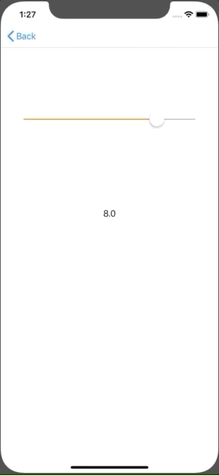

+++
title = "UISlider で値を取得する(Swift5.0)"
url = "2019-06-01"
date = "2019-06-01"
description = "UISlider で値を取得する(Swift5.0)"
tags = ["iOS", "Swift", "UIKit"]
categories = ["iOS"]
archives = "2019/06"
+++

<br>

UISlider で値を取得するサンプルコードです。
最小値と最大値を設定することで、その間の任意の値を取ることができます。



<!-- Google Ads -->


<!-- Amazon Ads -->


<!--more-->

**UISlider_20190522.swift**

```swift
import UIKit

class UISlider_20190522: UIViewController {

    var sliderValue: UILabel!
    
    override func viewDidLoad() {
        super.viewDidLoad()
        
        view.backgroundColor = .white
        
        let initialValue: Float = 8.0
        let width = view.frame.width
        let height = view.frame.height

        let slider = UISlider()
        slider.minimumValue = 0.0
        slider.maximumValue = 10.0
        slider.value = initialValue
        slider.tintColor = .orange
        slider.frame = CGRect(x: width * 0.1, y: height * 0.2, width: width * 0.8, height: height * 0.1)
        slider.addTarget(self, action: #selector(sliderDidChangeValue(_:)), for: .valueChanged)
        view.addSubview(slider)
        
        sliderValue = UILabel()
        sliderValue.frame = CGRect(x: width * 0.1, y: height * 0.4, width: width * 0.8, height: height * 0.1)
        sliderValue.textAlignment = .center
        sliderValue.text = String(initialValue)
        view.addSubview(sliderValue)
    }
    
    @objc func sliderDidChangeValue(_ sender: UISlider) {
        let value = sender.value
        sliderValue.text = String(value)
    }
}

```

